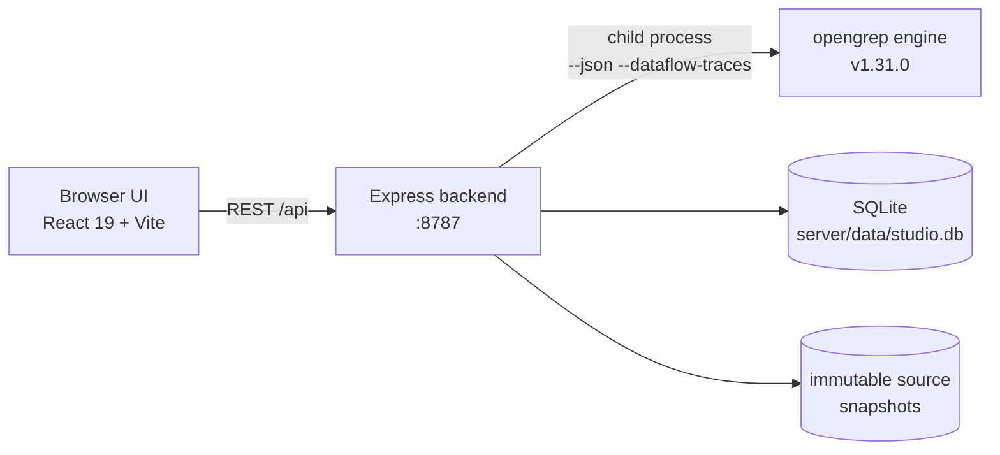

<div align="center">

<h1>Opengrep Studio</h1>
<p><strong>Find weaknesses before attackers do.</strong></p>
<p>A local-first code-audit workbench on top of <a href="https://github.com/opengrep/opengrep">Opengrep</a>: import source, scan with rules, triage findings, diff against a baseline, and ship a report — <strong>your code never leaves your machine</strong>.</p>
<p><a href="./README.md">简体中文</a> · <a href="#quick-start">Quick Start</a> · <a href="#highlights">Highlights</a> · <a href="#security-model">Security Model</a></p>
<p>
<a href="https://github.com/Lyfxxk/Opengrep-Studio/actions/workflows/ci.yml"></a>
<a href="#license"></a>
<a href="https://github.com/opengrep/opengrep"></a>
<a href="#requirements"></a>

</p>

<p><sub>Triage view: baseline cards (new / fixed / remaining) · taint flow (source → propagation → sink) · highlighted hits · review verdicts</sub></p>
</div>

---

## Why

Every codebase hides a few landmines: database passwords hardcoded in source, user input concatenated straight into SQL, debug endpoints left in after release, passwords still hashed with MD5. **Static code analysis** flags these problems early — without running your program and without uploading your code anywhere.

The opengrep engine (the open-source community continuation of Semgrep OSS) scans professionally, but driving a real audit from its CLI means hitting four walls:

- **The output is just JSON** — what was matched and how severe it is, all read by eyeball from terminal output, with no workspace for triage;
- **Rule messages are English-only** — a hint like "tainted data flowing into eval" isn't immediately actionable for everyone: where exactly is the problem, and what should be changed?
- **No way to tell whether a fix worked** — rescan after fixing, and figuring out which findings are new and which are truly gone means manually diffing two JSON files;
- **Nothing to hand to managers or clients** — a risk report has to be assembled from JSON line by line, and it never looks professional.

Opengrep Studio completes this pipeline: **drop in code → click scan → triage findings → export a report**. The engine runs locally, and your code never leaves your machine. The analysis power belongs to the upstream engine — Studio turns scan output into a **reviewable, comparable, verifiable, deliverable** audit workflow.

#### Who is this for

- **Security consultants / appsec engineers doing code audits** — client code can't go to third-party clouds, and delivery means a proper audit report;
- **Small teams without a commercial SAST budget** — commercial platforms cost tens of thousands per year; this is free, open source (MIT), and runs entirely locally;
- **Anyone learning application security** — 812 rules fully localized in Chinese + a Chinese CWE knowledge base with fix advice + taint-flow visualization, and a rule lab that validates rules on the spot;
- **Open-source authors** — scan for hardcoded secrets and dangerous calls before publishing; it takes minutes.

## Highlights

- **Multi-source import, zero cloud** — drag a folder, upload ZIP / 7Z / RAR / TAR.GZ, or shallow-clone a Git repo. `.gitignore` / `.opengrepignore` respected by default (toggle off to hunt hardcoded secrets in `.env`). Language stats shown after upload.
- **812 built-in rules across 12 languages** — curated from [opengrep-rules](https://github.com/opengrep/opengrep-rules) (CWE/OWASP metadata first, upstream provenance kept), covering 108 CWEs. Rule messages are **fully localized in Chinese**, with a Chinese CWE knowledge base and fix advice.
- **Triage that sticks** — every finding links to file & line with highlighted code; taint findings show the full source → sink chain; review verdicts (confirmed / false positive / accepted) persist across scans by fingerprint.
- **Baseline & snapshot diffing** — each scan classifies findings as new / fixed / remaining against a baseline; the scan center compares any two completed scans (cross-project) at both issue level (fingerprints) and file level (snapshot content).
- **Printable report + reproducibility manifest** — paper-styled audit report (print to PDF or download a self-contained offline HTML) with source SHA-256, full engine command line, and rule-file hashes.
- **Rule Lab** — write a rule, paste a positive and a negative sample, run the real engine, get a pass/fail verdict; save verified rules with samples as portable packs with one-click regression. See it in action:


- **SARIF interop** — export SARIF 2.1.0 for GitHub Code Scanning / DefectDojo / SonarQube; import SARIF 2.x from other tools as a full scan.
- **Dashboard** — cross-project risk posture, top-hit rules, engine status, auto-refresh while scans run.
- **Engine check-update & one-click upgrade** — the dashboard card shows the version actually installed and its source; "Check for updates" compares it against the latest stable release and upgrades in place. The swap is atomic (download → SHA-256 from the release asset digest → `opengrep --version` check → replace), so a failed upgrade leaves the previous engine untouched. Only latest stable (no pre-releases); users who manage the engine via `OPENGREP_BIN` get a disabled button; upgrade is blocked while scans or the Rule Lab are running. The installed version is recorded in `opengrep-tool/installed.json`, so re-running `npm run setup:engine` never downgrades an upgraded engine.

<details>
<summary><b>More screenshots</b></summary>
<table>
<tr><td align="center"></td><td align="center"></td></tr>
<tr><td align="center"></td><td align="center"></td></tr>
<tr><td align="center"></td><td align="center"></td></tr>
</table>
</details>

## Quick Start

### Requirements

- **Node.js ≥ 22.5** (the backend uses built-in `node:sqlite` — no native dependencies)
- The scan engine is downloaded and SHA-256-verified automatically (~50 MB); Git only needed for repo-clone import

### One-click (recommended)

Double-click `一键启动（Windows）.bat` on Windows, or on macOS / Linux:

```sh
./一键启动（macOS／Linux）.sh
```

Frontend at <http://localhost:1022>, API at <http://localhost:8787>.

### Manual

```sh
git clone https://github.com/Lyfxxk/Opengrep-Studio.git
cd Opengrep-Studio
npm run install:all   # root + server + code dependencies
npm run setup:engine  # download opengrep v1.31.0, verify SHA-256
npm run dev           # backend :8787 + frontend :1022
```

### Docker

```sh
npm run docker:build
npm run docker:run    # = docker run --rm -p 8787:8787 -v ogstudio-data:/data opengrep-studio
```

Open <http://localhost:8787>; data persists in the `ogstudio-data` volume.

Default login: `admin` / `123456` (see [Security Model](#security-model)). Suggested flow: create a scan config → create a project and bind it → import source → scan → triage → set baseline & rescan → generate the report. Run `npm run seed` for demo projects with baselines and reviews.

<details>
<summary><b>Troubleshooting</b></summary>
<ul>
<li><b>Engine download slow/blocked</b>: downloads fall back automatically (<code>OPENGREP_DOWNLOAD_BASE</code> mirror → github.com → api.github.com), so a blocked github.com usually needs no manual step; if all channels fail, set a mirror or download from <a href="https://github.com/opengrep/opengrep/releases/tag/v1.31.0">opengrep Releases</a> and point <code>OPENGREP_BIN</code> at it</li>
<li><b>"Check for updates" reports GitHub API rate limit</b>: anonymous calls are capped at 60/hour and results are cached for 10 minutes; retry later — scanning is unaffected</li>
<li><b>macOS Gatekeeper</b>: <code>xattr -d com.apple.quarantine &lt;engine-path&gt;</code></li>
<li><b>Ports busy</b>: <code>node server/scripts/kill-port.mjs 8787 1022</code></li>
<li><b>Other env vars</b>: <code>PORT</code> / <code>HOST</code> / <code>DATA_DIR</code> / <code>CUSTOM_RULES_DIR</code> / <code>OPENGREP_BIN</code> / <code>OPENGREP_DOWNLOAD_BASE</code></li>
</ul>
</details>

## How It Works



Single-process deployment (the backend also serves the built frontend in production, loopback-only by default). Every scan runs against an immutable source snapshot; the snapshot hash and full command line are archived for reproducibility. SQLite holds projects/scans/issues/reviews/configs — no external services.

## Security Model

- **Local-first**: binds `127.0.0.1` by default; no uploads, no telemetry
- **The login gate is a frontend-only guard** (`admin` / `123456`); the API itself has **no authentication** — do not expose it to the public internet (Docker mode binds `0.0.0.0`; use behind a protected network)
- Upload hardening: Zip-Slip / symlink / size / file-count guards; Git clone is https-only with credential prompts disabled

## Roadmap

- [x] Chinese localization of all 812 rule messages + CWE knowledge base
- [x] Baseline & two-snapshot diffing, review evidence chain
- [x] SARIF 2.1.0 import/export, reproducibility manifest
- [x] Rule Lab & portable rule packs with sample regression
- [x] Docker image & one-click launch on 3 platforms
- [x] Engine check-update & one-click upgrade (multi-channel download fallback)
- [ ] English UI (i18n)
- [ ] Scan queue & parallel scheduling
- [ ] Rule-pack import from URL & community index
- [ ] GitHub Action template (scan in CI, upload SARIF)
- [ ] Customizable report templates

## Development

| Command | Purpose |
| :--- | :--- |
| `npm run dev` | Backend (`tsx watch` :8787) + frontend (Vite :1022) |
| `npm test` | Backend unit tests (engine resolution / gitignore semantics / rule YAML / SARIF import) |
| `npm run test-packs` | Rule-pack structure validation & sample regression |
| `npm run e2e` | Black-box REST regression (24 scenarios, needs backend + engine) |
| `npm run seed` | Seed demo data |
| `npm --prefix code run lint` | Frontend typecheck + ESLint |

Layout: `code/` (React 19 + Vite + Tailwind v4 + shadcn/ui frontend), `server/` (Express backend, `node:sqlite`), `server/rules/security/` (12 built-in language packs), `docs/images/`. To contribute a rule: verify it in the Rule Lab with positive/negative samples → save as a pack → export → open a PR. Do not submit rules sourced from semgrep-rules (its license restricts competitive use); keep upstream provenance for opengrep-rules content. CI runs backend tests, frontend lint/build, and a full E2E with the real engine.

## Thanks

- [opengrep/opengrep](https://github.com/opengrep/opengrep) — the engine (LGPL-2.1); not vendored in this repo, downloaded and verified by script
- [opengrep/opengrep-rules](https://github.com/opengrep/opengrep-rules) — source of the built-in rules, and all their authors
- [shadcn/ui](https://ui.shadcn.com/) / [Radix UI](https://www.radix-ui.com/) / [Tailwind CSS](https://tailwindcss.com/) / [CodeMirror](https://codemirror.net/) / [Vite](https://vite.dev/) / [React](https://react.dev/)

## License

[MIT](./LICENSE) for this repository's code. Two third-party notes: the opengrep engine is LGPL-2.1 (downloaded separately, SHA-256-verified); built-in rules come from opengrep-rules under LGPL 2.1 + Commons Clause — free to use and redistribute with attribution, but the rules themselves must not be sold as a paid product.