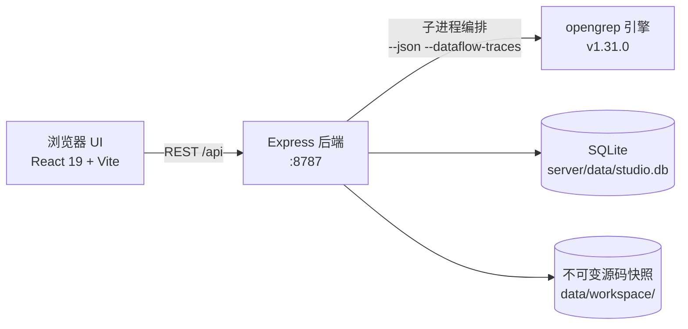

<div align="center">

<h1>Opengrep Studio · 码审工作台</h1>
<p><strong>让隐患，先于攻击者现形。</strong></p>
<p>本地优先的 <a href="https://github.com/opengrep/opengrep">Opengrep</a> 静态代码审计工作台——上传源码、规则扫描、逐条审阅、基线对比、交付报告，<strong>代码不出本机</strong>。</p>
<p><a href="./README.en.md">English</a> · <a href="#快速开始">快速开始</a> · <a href="#功能亮点">功能亮点</a> · <a href="#安全模型">安全模型</a> · <a href="#常见问题">常见问题</a></p>
<p>
<a href="https://github.com/Lyfxxk/Opengrep-Studio/actions/workflows/ci.yml"></a>
<a href="#license"></a>
<a href="https://github.com/opengrep/opengrep"></a>
<a href="#环境要求"></a>

</p>

<p><sub>扫描结果审阅页：基线三卡（新增 / 已修复 / 遗留）· 污点传播链（源 → 传播 → 汇聚点）· 命中代码高亮 · 人工复核标记</sub></p>
</div>

---

## 为什么需要 Opengrep Studio

Opengrep（社区从 Semgrep OSS 延续的静态分析引擎）规则生态强大，但直接用命令行做一次完整审计，你会遇到四道坎：

- **输出是给人看的 JSON，不是给审计流程用的**——命中了哪些规则、严重程度如何，全靠肉眼翻终端输出；
- **规则消息是英文的**，团队里不是每个人都能一眼看懂 "tainted data flowing into eval" 意味着什么；
- **没有基线概念**——修复之后重扫一次，哪些是新增、哪些已修复、哪些遗留，全靠手工比对；
- **交付没有抓手**——给管理者或客户的风险报告，需要从 JSON 里手工拼。

Opengrep Studio 把这条链路补完整：它编排本地的 opengrep 引擎二进制，把扫描结果变成**可审阅、可对比、可复核、可交付**的审计工作流。引擎能力归功上游，Studio 专注于工作流本身。

## 功能亮点

### 🗂 多源导入，代码不经云端

拖拽整个文件夹、上传 ZIP / 7Z / RAR / TAR.GZ 压缩包，或粘贴 Git 仓库地址浅克隆导入（默认遵循 `.gitignore` / `.opengrepignore` 口径，也可关掉以深挖 `.env` 里的硬编码密钥）。上传后自动统计语言构成。


### 📚 341 条内置规则，12 种语言，全量中文消息

精选自 [opengrep-rules](https://github.com/opengrep/opengrep-rules)（优先收录带 CWE / OWASP 元数据的规则，每条保留上游溯源链接），覆盖 87 种 CWE；**341 条规则消息 100% 提供中文翻译**，另附 86 类 CWE 中文弱点说明与修复建议。自建规则包支持在线编辑、导入导出与质量检查。


### 🔍 逐条审阅：代码定位、污点链路、人工复核

每条问题直达文件与行号，命中行红色高亮；污点类问题展示「污点源 → 传播路径 → 汇聚点」链路；人工复核结论（已确认 / 误报 / 已接受）按问题指纹跨扫描继承，构成审计证据链。

### 📊 基线对比与双快照对比

设定基线扫描后，每次扫描自动给出 **新增 / 已修复 / 遗留** 三分类；扫描中心还支持任选两次已完成扫描做双快照对比（可跨项目）：问题级按指纹比对，文件级按源码快照内容比对。


### 📄 可打印的审计报告 + 可复现清单

一键生成纸感排版的《代码审计测试报告》：总体结论、风险分布、高频规则、热点文件、问题明细、复核统计，支持直接打印为 PDF 或下载单文件离线 HTML；每份报告附带可复现清单（源码 SHA-256、完整引擎命令行、规则文件哈希）。


### 🧪 规则实验室：先验证，再入库

左侧写规则 YAML，右侧贴正例与反例，一键运行真实引擎验证「能不能命中、有没有误报」；调通的规则连同样本保存为便携规则包，后续可一键回归检查。草稿自动保存，Ctrl+Enter 运行。


### 🔁 SARIF 双向互通

导出 SARIF 2.1.0 供 GitHub Code Scanning / DefectDojo / SonarQube 消费；也可把其他工具产出的 SARIF 2.x 导入为一次完整扫描，纳入基线与报告体系。

### 🖥 仪表看盘

项目数、累计扫描、检出问题、规则包一目了然；跨项目的风险分布、高频命中规则、引擎状态与各项目风险速览，扫描进行中自动刷新。

<details>
<summary><b>界面一览（登录页与仪表盘）</b></summary>
<table>
<tr>
<td align="center"></td>
<td align="center"></td>
</tr>
</table>
</details>

## 快速开始

### 环境要求

- **Node.js ≥ 22.5**（后端使用内置 `node:sqlite`，无原生依赖）
- 扫描引擎由脚本自动下载（约 50 MB，SHA-256 校验），无需预装；Git 仅在使用仓库克隆导入时需要

### 方式一：一键启动（推荐）

Windows 用户双击 `一键启动（Windows）.bat`，macOS / Linux 用户执行：

```sh
./一键启动（macOS／Linux）.sh
```

脚本会自动检查 Node 版本、安装依赖、下载引擎，并打开浏览器。前端 <http://localhost:1022>，后端 API <http://localhost:8787>。

### 方式二：手动三步

```sh
git clone https://github.com/Lyfxxk/Opengrep-Studio.git
cd Opengrep-Studio
npm run install:all   # 安装根目录 / server / code 三处依赖
npm run setup:engine  # 下载 opengrep v1.31.0 并校验 SHA-256
npm run dev           # 同时启动后端(8787)与前端(1022)
```

### 方式三：Docker

```sh
npm run docker:build
npm run docker:run    # 等价于 docker run --rm -p 8787:8787 -v ogstudio-data:/data opengrep-studio
```

镜像内置引擎与已构建前端，访问 <http://localhost:8787> 即可使用，数据持久化在 `ogstudio-data` 卷。

### 首次使用

默认账号 `admin` / `123456`（见[安全模型](#安全模型)）。建议流程：

1. **扫描配置**——勾选要启用的规则包（可加排除 / 包含路径、引擎参数）
2. **新建项目**并绑定该配置
3. **导入源码**（拖文件夹 / 压缩包 / Git 克隆）
4. **发起扫描**，完成后逐条审阅、复核
5. 设基线、再扫描，看 **新增 / 已修复 / 遗留**；需要交付时**生成测试报告**

想先看效果？`npm run seed` 可一键灌入三个演示项目（含基线对比与复核记录）。

<details>
<summary><b>故障排查</b></summary>
<ul>
<li><b>引擎下载慢或失败</b>：设置镜像 <code>set OPENGREP_DOWNLOAD_BASE=&lt;镜像地址&gt;</code>（macOS/Linux 用 <code>export</code>）后重试；或从 <a href="https://github.com/opengrep/opengrep/releases/tag/v1.31.0">opengrep Releases</a> 手动下载，再用 <code>OPENGREP_BIN</code> 指向二进制路径</li>
<li><b>macOS 提示无法验证引擎</b>：<code>xattr -d com.apple.quarantine &lt;引擎路径&gt;</code></li>
<li><b>端口被占用</b>：<code>node server/scripts/kill-port.mjs 8787 1022</code></li>
<li><b>更多环境变量</b>：<code>PORT</code> / <code>HOST</code> / <code>DATA_DIR</code> / <code>CUSTOM_RULES_DIR</code> / <code>OPENGREP_BIN</code> / <code>OPENGREP_DOWNLOAD_BASE</code></li>
</ul>
</details>

## 与命令行直扫对比

| 能力 | `opengrep scan` 直扫 | Opengrep Studio |
| :--- | :--- | :--- |
| 结果形态 | 终端 JSON / 文本 | 可交互审阅：代码高亮、污点链路、过滤搜索 |
| 中文体验 | 英文消息 | 341 条规则消息全量中文 + CWE 中文知识库 |
| 基线管理 | 无 | 新增 / 已修复 / 遗留自动分类，复核跨扫描继承 |
| 版本对比 | 无 | 双快照对比（问题级 + 文件级，可跨项目） |
| 报告交付 | 手工拼 | 一键纸感报告（打印 / 离线 HTML）+ 可复现清单 |
| 规则调试 | 改完重跑 | 规则实验室：正反例即时验证、样本回归 |
| 工具链互通 | 自行处理 | SARIF 2.1.0 导入 / 导出 |

## 工作原理



- 单进程部署：后端同时托管构建后的前端（生产模式访问 8787 端口即可），默认只监听 `127.0.0.1`
- 每次扫描基于**不可变源码快照**执行，快照哈希与完整命令行存档，报告可复现
- SQLite 存储项目 / 扫描 / 问题 / 复核 / 配置，无外部服务依赖，全部数据在 `server/data/`
- 扫描全局串行（本地资源保护），规则实验室与扫描互斥

## 安全模型

诚实声明，请务必了解：

- **本地单机工具**：默认只监听 `127.0.0.1`，代码与结果不上传、无遥测
- **登录仅为防误触的前端门禁**（固定账号 `admin` / `123456`），**后端接口无鉴权**——不要将服务暴露到公网；确需局域网使用时自行设置 `HOST` 并加上访问控制
- Docker 模式默认 `HOST=0.0.0.0`，请仅在内网 / 加防护的前提下使用
- 上传解压有 Zip-Slip / 符号链接 / 体积与文件数防护；Git 克隆仅允许 https 协议并禁用凭证交互

## 常见问题

<details>
<summary><b>支持哪些语言和平台？</b></summary>
<p>内置规则覆盖 Python、JS/TS、Java、Go、C、C#、PHP、Bash、Kotlin、Swift、Rust、Dockerfile 共 12 种语言；Studio 本身可运行在 Windows / macOS / Linux（x64 / arm64）及 Docker。</p>
</details>

<details>
<summary><b>和 Semgrep 是什么关系？</b></summary>
<p>Opengrep 是社区从 Semgrep OSS 延续出的开源引擎（LGPL-2.1），Studio 编排其官方二进制，规则精选自 opengrep-rules。Studio 与 Semgrep Inc. 无关联。</p>
</details>

<details>
<summary><b>我的代码会被上传吗？</b></summary>
<p>不会。扫描、存储、报告生成全部在本机完成，服务默认只监听本机回环地址。</p>
</details>

<details>
<summary><b>数据存在哪里？删除项目会残留吗？</b></summary>
<p>全部在 <code>server/data/</code>（SQLite + 源码快照）与自建规则包目录。删除项目会级联删除其扫描、问题、复核记录与快照目录。</p>
</details>

<details>
<summary><b>怎么接入 GitHub Code Scanning？</b></summary>
<p>在扫描结果页「导出 SARIF」，把产物按 GitHub 文档上传到 code-scanning 即可；指纹采用稳定去重格式，支持增量上报。</p>
</details>

<details>
<summary><b>能导入其他工具的扫描结果吗？</b></summary>
<p>支持 SARIF 2.x：在项目详情页「导入 SARIF」，结果会成为一次完整扫描，可设基线、出报告。</p>
</details>

## Roadmap

- [x] 内置规则中文化（341 条全覆盖）与 CWE 中文知识库
- [x] 基线对比 / 双快照对比 / 复核证据链
- [x] SARIF 2.1.0 导入导出与可复现清单
- [x] 规则实验室与便携规则包（含样本回归）
- [x] Docker 镜像与三平台一键启动
- [ ] 界面英文 i18n
- [ ] 扫描队列与并行调度
- [ ] 规则包在线 URL 导入与社区规则包索引
- [ ] GitHub Action 工作流模板（CI 中跑扫描并回传 SARIF）
- [ ] 报告模板自定义（品牌 / 页眉页脚）

## 开发指南

常用命令（根目录执行）：

| 命令 | 说明 |
| :--- | :--- |
| `npm run dev` | 同时启动后端 `tsx watch`(:8787) 与前端 Vite(:1022) |
| `npm test` | 后端单测（引擎解析 / gitignore 语义 / 规则 YAML / SARIF 导入） |
| `npm run test-packs` | 规则包结构校验与样本回归 |
| `npm run e2e` | 黑盒 REST 回归（需先启动后端与引擎，24 组场景） |
| `npm run seed` | 灌入演示数据 |
| `npm --prefix code run lint` | 前端类型检查 + ESLint |

目录结构：

```text
├─ code/                 # React 19 + Vite + Tailwind v4 + shadcn/ui 前端
│  └─ src/pages/         # 仪表盘 / 项目 / 扫描结果 / 报告 / 规则中心(含实验室) / 配置
├─ server/               # Express 后端（node:sqlite，无原生依赖）
│  ├─ src/               # API / 扫描编排 / SARIF / 快照对比 / 规则包 / 报告
│  ├─ rules/security/    # 12 语言内置规则（精选自 opengrep-rules）
│  └─ scripts/           # 引擎下载 / 种子数据 / 测试 / 规则再生成
└─ docs/images/          # 文档图片
```

**贡献一条规则的推荐路径**：规则实验室写规则并用正反例验证 → 「保存到规则包」（附上样本）→ 导出 zip → 提 PR。⚠️ 请勿提交来自 semgrep-rules 的规则（其许可限制竞争性使用）；opengrep-rules 来源的规则请保留上游溯源信息。前端有演示模式：`VITE_USE_MOCK=true npm --prefix code run dev`。

CI（`.github/workflows/ci.yml`）包含三个任务：后端类型检查 + 单测、前端 lint + 构建、以及**下载真实引擎跑完整 E2E**。

## 致谢

- [opengrep/opengrep](https://github.com/opengrep/opengrep) —— 扫描引擎（LGPL-2.1），本仓库不内嵌其二进制，由脚本下载并校验
- [opengrep/opengrep-rules](https://github.com/opengrep/opengrep-rules) —— 内置规则的来源，感谢上游所有规则作者
- [shadcn/ui](https://ui.shadcn.com/) / [Radix UI](https://www.radix-ui.com/) / [Tailwind CSS](https://tailwindcss.com/) / [CodeMirror](https://codemirror.net/) / [Vite](https://vite.dev/) / [React](https://react.dev/) —— 构成界面的一切好东西

## License

本项目代码以 [MIT](./LICENSE) 发布。

需要注意的两项第三方许可：

- **扫描引擎**：opengrep 以 LGPL-2.1 发布，本仓库不含引擎二进制，`npm run setup:engine` 从官方 Releases 下载并做 SHA-256 校验
- **内置规则**：精选自 opengrep-rules（LGPL 2.1 + Commons Clause），可自由使用与再分发（保留署名），但不得将规则本身作为付费产品出售
