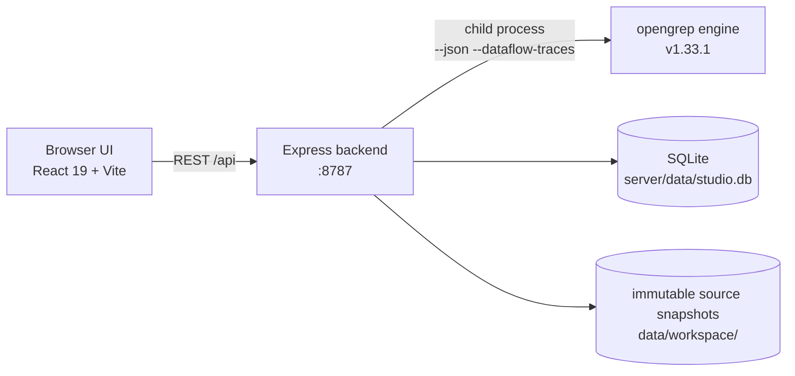

<div align="center">

<h1>Opengrep Studio · Code Audit Workbench</h1>
<p><strong>Find weaknesses before attackers do.</strong></p>
<p>A local-first static code-audit workbench on top of <a href="https://github.com/opengrep/opengrep">Opengrep</a> — import source, scan with rules, triage findings one by one, diff against baselines, deliver reports — <strong>your code never leaves your machine</strong>.</p>
<p><a href="./docs/README.zh-Hans.md">简体中文</a> · <a href="./docs/README.zh-Hant.md">繁體中文</a> · <a href="#quick-start">Quick Start</a> · <a href="#highlights">Highlights</a> · <a href="#security-model">Security Model</a> · <a href="#faq">FAQ</a></p>
<p>
<a href="https://github.com/Lyfxxk/Opengrep-Studio/actions/workflows/ci.yml"></a>
<a href="#license"></a>
<a href="https://github.com/opengrep/opengrep"></a>
<a href="#requirements"></a>

</p>

<p><sub>Triage view: baseline cards (new / fixed / remaining) · taint flow (source → propagation → sink) · highlighted hits · review verdicts</sub></p>
</div>

---

## Why Opengrep Studio

Every codebase hides a few landmines: database passwords hardcoded in source, user input concatenated straight into SQL, debug endpoints left in after release, passwords still hashed with MD5. **Static code analysis** flags these problems early — without running your program and without uploading your code anywhere.

#### First, AI: it reads code well, but it can't carry an audit

To be fair, AI is genuinely good at reading code — **business-logic flaws, authorization risks, novel patterns no rule covers**: it understands intent. But using an AI chat as a code audit runs into four walls:

- **AI samples; an audit must be exhaustive** — a 100k-line project won't fit into any context window; of 47 SQL-concatenation sites it may flag the 5 "obvious" ones, and you'll never know it skipped the other 42. A rule engine promises that **every match gets reported** — only then do you dare write "all problem patterns covered by these 812 rules have been checked" in your conclusions;
- **A chat is one-shot; an audit needs a ledger** — AI doesn't remember what it read last month: which findings are newly introduced, which got truly fixed, which you already ruled a false positive — everything starts over;
- **"AI said so" doesn't count as evidence** — client delivery demands reproducibility: source hashes, engine version, full command line, so anyone can rerun and get the same result; a chat log can be neither re-verified nor attributed;
- **It can't keep up with commit frequency** — a full read-through costs real tokens, and the bigger the project, the costlier and leakier it gets; a local engine takes seconds to minutes at zero marginal cost — that's what plugs into CI.

#### Then, the engine: exhaustive scanning, but the CLI alone can't finish an audit

So this isn't either/or: **rule engines provide the exhaustive safety net, AI adds semantic understanding** — Semgrep itself ships AI assistance and every SAST vendor is wiring in LLMs; that's the road everyone is on. The engine behind Opengrep Studio is opengrep (the open-source community continuation of Semgrep OSS), and it scans professionally — but driving a full audit straight from its CLI still means four walls:

- **The output is just JSON** — what was matched and how severe it is, all read by eyeball from terminal output, with no workspace for triage;
- **Rule messages are English-only** — a hint like "tainted data flowing into eval" doesn't immediately tell everyone where the problem is or what to change;
- **No way to tell whether a fix worked** — rescan after fixing, and figuring out which findings are new and which are truly gone means manually diffing two JSON files;
- **Nothing to hand to managers or clients** — a risk report has to be assembled from JSON line by line, and it never looks professional.

#### What Studio completes is the entire pipeline after the scan

Opengrep Studio completes this pipeline: **drop in code → click scan → triage findings → export a report**. The engine runs locally, and **your code never leaves your machine**. The analysis power belongs to the upstream engine — Studio turns scan output into a **reviewable, comparable, verifiable, deliverable** audit workflow. In the AI era this workflow is scarcer, not obsolete: AI dumps a big pile of findings on you in one go, and someone has to dedupe them, baseline them, track them across scans, and turn them into a report — **AI produces findings; Studio manages them**.

#### Who is this for

- **Security consultants / appsec engineers doing code audits** — client code can't go to third-party clouds (and shouldn't be pasted into online AI chat either); delivery means a reproducible audit report;
- **Small teams without a commercial SAST budget** — commercial audit platforms cost a small fortune per year; this is free, open source (MIT), and runs entirely locally;
- **Anyone learning application security** — 812 rules with fully Chinese messages + a Chinese CWE knowledge base with fix advice + taint-flow visualization, and a rule lab that validates rules on the spot;
- **Open-source authors** — scan for hardcoded secrets and dangerous calls before publishing; it takes minutes.

## Highlights

### 🗂 Multi-source import, your code never touches the cloud

Drag in a whole folder, upload ZIP / 7Z / RAR / TAR.GZ archives, or paste a Git repo URL for a shallow-clone import (respects `.gitignore` / `.opengrepignore` by default; toggle it off to dig hardcoded secrets out of `.env`). Language composition is analyzed automatically after upload.


### 📚 812 built-in rules, 12 languages, fully Chinese messages

Curated from [opengrep-rules](https://github.com/opengrep/opengrep-rules) (rules carrying CWE / OWASP metadata first, upstream provenance links kept on every rule), covering 108 CWEs; **100% of the 812 rule messages are translated into Chinese**, plus 108 CWE knowledge entries in Chinese with weakness notes and fix advice. Custom rule packs support online editing, import/export, and quality checks.


### 🔍 Finding-by-finding triage: code locations, taint chains, review verdicts

Every finding links straight to file and line with the hit highlighted in red; taint findings show the full source → propagation → sink chain; review verdicts (confirmed / false positive / accepted) persist across scans by finding fingerprint, building the audit evidence chain.

### 📊 Baseline diff & dual-snapshot compare

Set a baseline scan and every later scan automatically classifies findings as **new / fixed / remaining**; the scan center can also pick any two completed scans for a dual-snapshot compare (even across projects): issue level matched by fingerprint, file level by snapshot content.


### 📄 Printable audit report + reproducibility manifest

One click generates a paper-styled "Code Audit Test Report": overall verdict, risk distribution, top-hit rules, hot files, finding details, triage stats — print straight to PDF or download a single-file offline HTML; every report ships with a reproducibility manifest (source SHA-256, full engine command line, rule-file hashes).


### 🧪 Rule Lab: verify first, commit later

Rule YAML on the left, positive and negative samples on the right, one click runs the real engine to check "does it hit, does it false-positive"; a verified rule saves together with its samples as a portable rule pack, ready for one-click regression afterwards. Drafts autosave; Ctrl+Enter runs.


### 🔁 SARIF interop, both ways

Export SARIF 2.1.0 for GitHub Code Scanning / DefectDojo / SonarQube to consume; or import SARIF 2.x produced by other tools as a full scan, included in your baseline and report system.

### 🖥 Dashboard

Projects, cumulative scans, findings and rule packs at a glance; cross-project risk distribution, top-hit rules, engine status and per-project risk overview — auto-refreshes while a scan is running.

### ⬆️ Engine check-update & one-click upgrade

The dashboard "Engine status" card shows the **actually installed** version and where it came from; click "Check for updates" to compare against the latest upstream stable and upgrade in one click:

- The upgrade is an atomic swap: download → verify SHA-256 (from the GitHub release asset digest) → run `opengrep --version` to confirm → only then replace files; if any step fails, the old engine stays untouched
- Only the latest stable is offered (pre-releases are ignored); the button is disabled for users managing the engine themselves via `OPENGREP_BIN`
- Upgrading is disabled while a scan or the Rule Lab is running (Windows can't replace a running exe); the version-probe cache invalidates automatically after a successful upgrade
- The installed version is recorded in `opengrep-tool/installed.json`; re-running `npm run setup:engine` never downgrades an upgraded engine back to the version pinned in `engines.json`

<details>
<summary><b>UI at a glance (login & dashboard)</b></summary>
<table>
<tr>
<td align="center"></td>
<td align="center"></td>
</tr>
</table>
</details>

## Quick Start

### Requirements

- **Node.js ≥ 22.12** — built-in `node:sqlite` needs 22.5+, and Vite 8 in the frontend needs 22.12+; still no native dependencies
- The scan engine is downloaded and SHA-256-verified automatically (~50 MB), nothing to preinstall; Git is only needed for repo-clone import

### Option 1: One-click launch (recommended)

Double-click `一键启动（Windows）.bat` on Windows; on macOS / Linux run:

```sh
./一键启动（macOS／Linux）.sh
```

The script checks your Node version, installs dependencies, downloads the engine, and opens the browser. Frontend at <http://localhost:1022>, backend API at <http://localhost:8787>.

### Option 2: Three manual steps

```sh
git clone https://github.com/Lyfxxk/Opengrep-Studio.git
cd Opengrep-Studio
npm run install:all   # root + server + code dependencies in one go
npm run setup:engine  # download opengrep v1.33.1 and verify SHA-256
npm run dev           # backend (:8787) + frontend (:1022) together
```

### Option 3: Docker

```sh
npm run docker:build
npm run docker:run    # = docker run --rm -p 8787:8787 -v ogstudio-data:/data opengrep-studio
```

The image ships with the engine and the built frontend — open <http://localhost:8787> and you're in; data persists in the `ogstudio-data` volume.

### First run

Default login: `admin` / `123456` (see [Security Model](#security-model)). Suggested flow:

1. **Scan config** — pick the rule packs to enable (optionally with exclude/include paths and engine args)
2. **Create a project** and bind that config — or skip binding: a protected fallback config (all enabled built-in rule packs, cannot be deleted) is bound automatically on the first scan
3. **Import source** (drag a folder / upload an archive / Git clone)
4. **Run a scan**, then triage findings one by one
5. Set a baseline, rescan, and watch **new / fixed / remaining**; when it's time to deliver, **generate the test report**

Want to see it before touching your own code? `npm run seed` seeds three demo projects (with baseline diffs and review records) in one go.

<details>
<summary><b>Troubleshooting</b></summary>
<ul>
<li><b>Engine download slow/blocked</b>: downloads fall back automatically (<code>OPENGREP_DOWNLOAD_BASE</code> mirror → github.com → api.github.com), so a blocked github.com usually needs no manual step; if all channels fail, set a mirror (<code>set OPENGREP_DOWNLOAD_BASE=&lt;mirror-url&gt;</code>, use <code>export</code> on macOS/Linux) or download from <a href="https://github.com/opengrep/opengrep/releases">opengrep Releases</a> and point <code>OPENGREP_BIN</code> at it</li>
<li><b>"Check for updates" reports GitHub API rate limit</b>: anonymous calls are capped at 60/hour and results are cached for 30 minutes; retry later — scanning is unaffected</li>
<li><b>macOS Gatekeeper</b>: <code>xattr -d com.apple.quarantine &lt;engine-path&gt;</code></li>
<li><b>Ports busy</b>: <code>node server/scripts/kill-port.mjs 8787 1022</code></li>
<li><b>Other env vars</b>: <code>PORT</code> / <code>HOST</code> / <code>DATA_DIR</code> / <code>CUSTOM_RULES_DIR</code> / <code>OPENGREP_BIN</code> / <code>OPENGREP_DOWNLOAD_BASE</code> (server); timeout overrides take seconds: <code>CLONE_TIMEOUT_SECONDS</code> / <code>SEVEN_Z_TIMEOUT_SECONDS</code> / <code>RULE_LAB_TIMEOUT_SECONDS</code>. The dev server honours <code>API_TARGET</code> for the <code>/api</code> proxy. Custom rule pack files keep landing in <code>server/rules/custom</code> when only <code>DATA_DIR</code> is set — relocate both together, otherwise the database and the rule files drift apart (the backend prints both directories at startup and warns about any mismatch)</li>
</ul>
</details>

## Raw CLI vs. Opengrep Studio

| Capability | `opengrep scan` straight | Opengrep Studio |
| :--- | :--- | :--- |
| Result form | terminal JSON / text | interactive triage: code highlights, taint chains, filtering & search |
| Localization | English-only messages | all 812 rule messages in Chinese (simplified + traditional) + Chinese CWE knowledge base |
| Baseline management | none | auto new / fixed / remaining classification; verdicts persist across scans |
| Version diffing | none | dual-snapshot compare (issue level + file level, cross-project) |
| Report delivery | hand-assembled | one-click paper-styled report (print / offline HTML) + reproducibility manifest |
| Rule debugging | edit, rerun, hope | Rule Lab: instant positive/negative validation, sample regression |
| Toolchain interop | DIY | SARIF 2.1.0 import / export |

## How It Works



- Single-process deployment: the backend also serves the built frontend (in production, port 8787 is all you need); binds `127.0.0.1` only, by default
- Every scan runs against an **immutable source snapshot**; the snapshot hash and the full command line are archived, so every report is reproducible
- SQLite stores projects / scans / findings / reviews / configs — no external service dependencies; all data lives in `server/data/`
- Up to 2 scans run concurrently (extra ones are queued automatically) to make use of local resources; the Rule Lab and scans are mutually exclusive

## Security Model

Honest disclosure — please read:

- **Local single-machine tool**: binds `127.0.0.1` only by default; code and results never leave the machine, no telemetry
- **The login gate is a frontend-only guard against mis-clicks** (fixed account `admin` / `123456`); **the backend API has no authentication** — do not expose the service to the public internet; if you truly need it on the LAN, set `HOST` yourself and add access control
- Docker mode defaults to `HOST=0.0.0.0`; use it only inside an intranet / behind protection
- Upload & unzip are hardened against Zip-Slip / symlinks / size & file-count bombs; Git clone is https-only with credential interaction disabled

## FAQ

<details>
<summary><b>Which languages and platforms are supported?</b></summary>
<p>Built-in rules cover Python, JS/TS, Java, Go, C, C#, PHP, Bash, Kotlin, Swift, Rust and Dockerfile — 12 languages in total; Studio itself runs on Windows / macOS / Linux (x64 / arm64) and in Docker.</p>
</details>

<details>
<summary><b>What's the relationship to Semgrep?</b></summary>
<p>Opengrep is the open-source engine continued by the community from Semgrep OSS (LGPL-2.1); Studio orchestrates its official binary, and rules are curated from opengrep-rules. Studio is not affiliated with Semgrep Inc.</p>
</details>

<details>
<summary><b>Will my code be uploaded anywhere?</b></summary>
<p>No. Scanning, storage and report generation all happen locally; the service binds to the local loopback address only, by default.</p>
</details>

<details>
<summary><b>Where is data stored? Does deleting a project leave anything behind?</b></summary>
<p>Everything lives in <code>server/data/</code> (SQLite + source snapshots) and the custom rule-pack directory. Deleting a project cascades to its scans, findings, review records and snapshot directory.</p>
</details>

<details>
<summary><b>How do I wire this into GitHub Code Scanning?</b></summary>
<p>Click "Export SARIF" on the scan result page and upload the artifact to code-scanning per GitHub's docs; fingerprints use a stable dedupe format that supports incremental reporting.</p>
</details>

<details>
<summary><b>Can I import scan results from other tools?</b></summary>
<p>SARIF 2.x is supported: click "Import SARIF" on the project detail page and the results become a full scan — set it as a baseline, generate reports.</p>
</details>

## Roadmap

- [x] Chinese localization of all 812 rule messages + CWE knowledge base
- [x] Baseline & two-snapshot diffing, review evidence chain
- [x] SARIF 2.1.0 import/export, reproducibility manifest
- [x] Rule Lab & portable rule packs with sample regression
- [x] Docker image & one-click launch on 3 platforms
- [x] Engine check-update & one-click upgrade (multi-channel download fallback)
- [x] UI i18n (English / Simplified Chinese / Traditional Chinese)
- [x] Scan queue & parallel scheduling
- [ ] Rule-pack import from URL & community index
- [ ] GitHub Action workflow template (scan in CI, upload SARIF back)
- [ ] Customizable report templates (branding / header & footer)

## Development

Common commands (run from the repo root):

| Command | Purpose |
| :--- | :--- |
| `npm run dev` | Backend (`tsx watch` :8787) + frontend (Vite :1022) together |
| `npm test` | Backend unit tests (engine resolution / gitignore semantics / rule YAML / SARIF import) |
| `npm run test-packs` | Rule-pack structure validation & sample regression |
| `npm run i18n:check` | Language-pack consistency (3 UI packs + simplified/traditional rule texts & CWE) |
| `npm run e2e` | Black-box REST regression (start backend + engine first; 21 scenario groups) |
| `npm run seed` | Seed demo data |
| `npm --prefix code run lint` | Frontend typecheck + ESLint |

Directory layout:

```text
├─ code/                 # React 19 + Vite + Tailwind v4 + shadcn/ui frontend
│  └─ src/pages/         # Dashboard / Projects / Scan results / Report / Rules center (incl. lab) / Config
├─ server/               # Express backend (node:sqlite, no native deps)
│  ├─ src/               # API / scan orchestration / SARIF / snapshot diff / rule packs / report
│  ├─ rules/security/    # Built-in rules for 12 languages (curated from opengrep-rules)
│  └─ scripts/           # Engine download / seed data / tests / rule regeneration
└─ docs/images/          # Docs images
```

**Recommended path for contributing a rule**: write it in the Rule Lab and validate with positive/negative samples → "Save to rule pack" (with samples attached) → export the zip → open a PR. ⚠️ Do not submit rules sourced from semgrep-rules (its license restricts competitive use); keep upstream provenance for rules from opengrep-rules. The frontend has a demo mode: `VITE_USE_MOCK=true npm --prefix code run dev`.

CI (`.github/workflows/ci.yml`) runs three jobs: backend typecheck + unit tests, frontend lint + build, and a **full E2E with the real engine downloaded**.

## Thanks

- [opengrep/opengrep](https://github.com/opengrep/opengrep) — the scan engine (LGPL-2.1); this repo does not vendor its binary, it is downloaded and verified by script
- [opengrep/opengrep-rules](https://github.com/opengrep/opengrep-rules) — source of the built-in rules; thanks to all upstream rule authors
- [shadcn/ui](https://ui.shadcn.com/) / [Radix UI](https://www.radix-ui.com/) / [Tailwind CSS](https://tailwindcss.com/) / [CodeMirror](https://codemirror.net/) / [Vite](https://vite.dev/) / [React](https://react.dev/) — all the good stuff the interface is made of

## License

This repository's code is released under [MIT](./LICENSE).

Two third-party license notes:

- **The scan engine**: opengrep is released under LGPL-2.1; this repo contains no engine binary — `npm run setup:engine` downloads it from the official Releases and verifies it by SHA-256
- **Built-in rules**: curated from opengrep-rules (LGPL 2.1 + Commons Clause) — free to use and redistribute with attribution kept, but the rules themselves must not be sold as a paid product

## Star History

[](https://star-history.com/#Lyfxxk/Opengrep-Studio)

