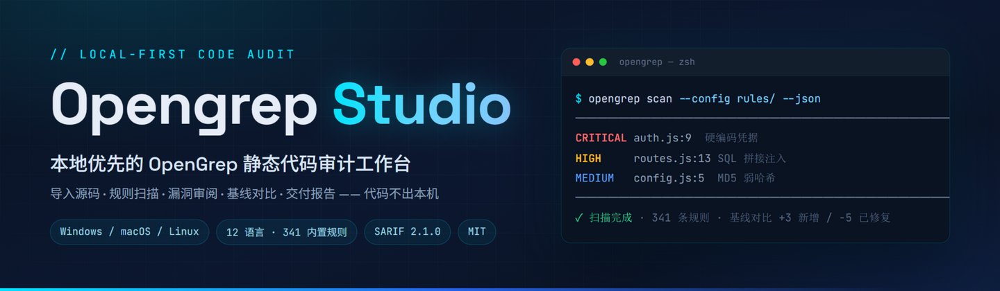
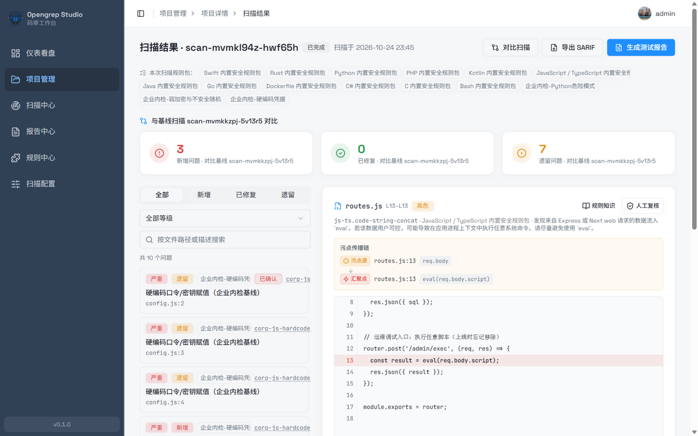
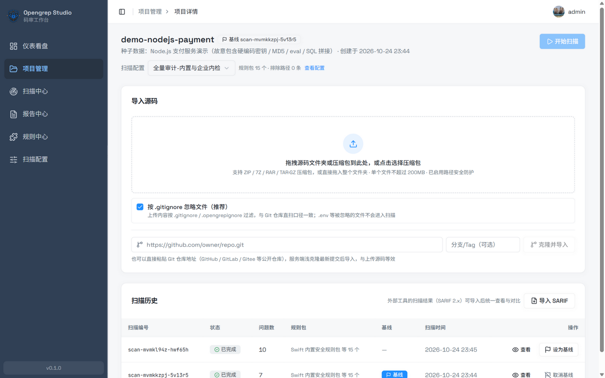
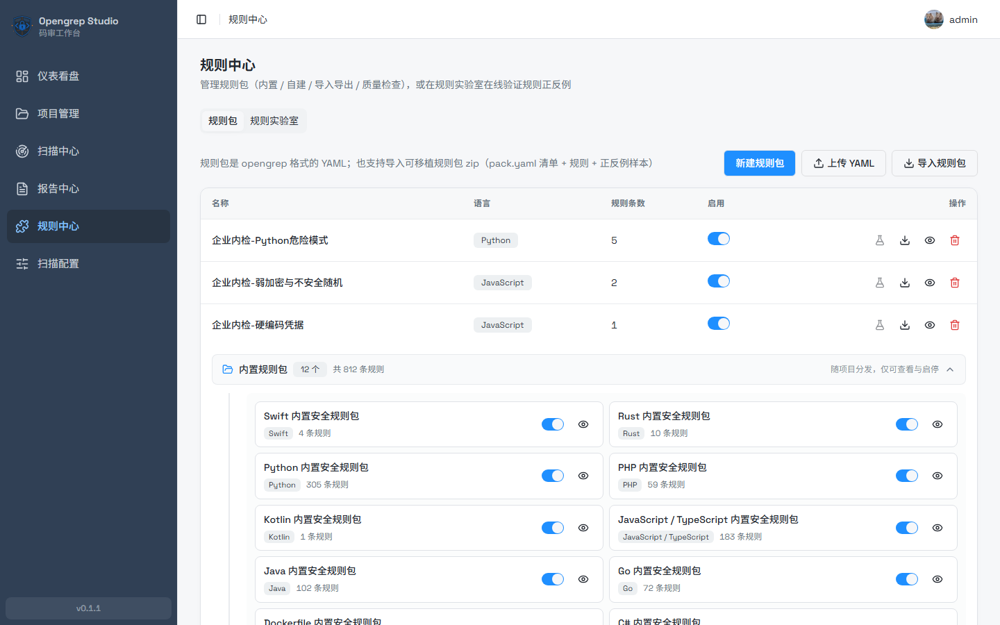
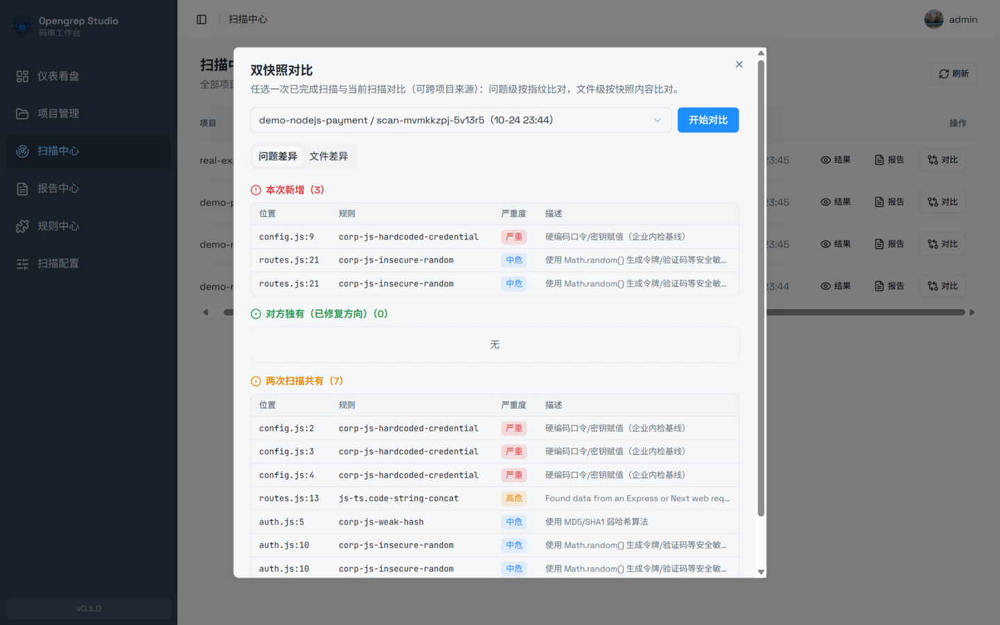
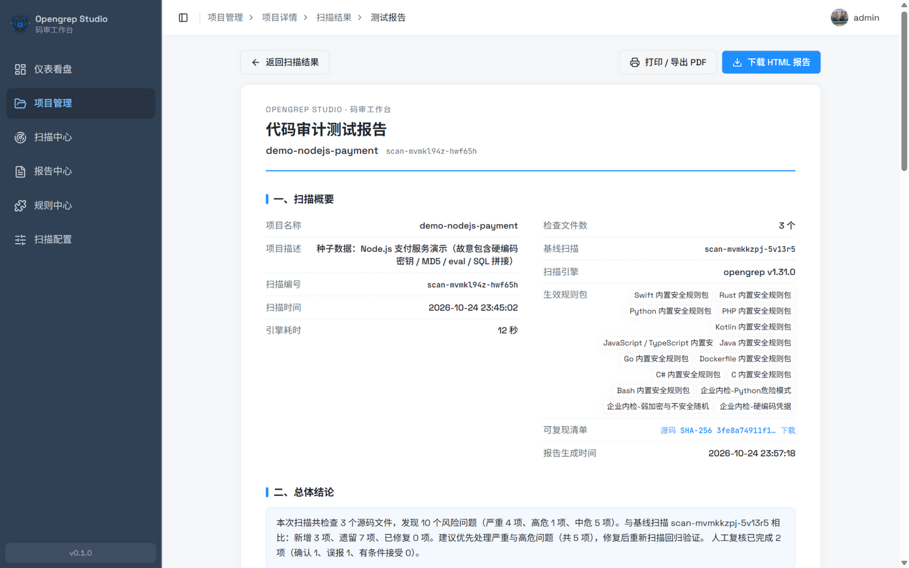
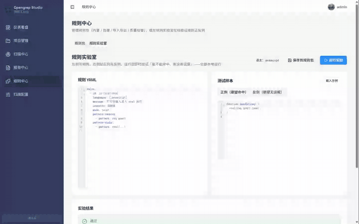
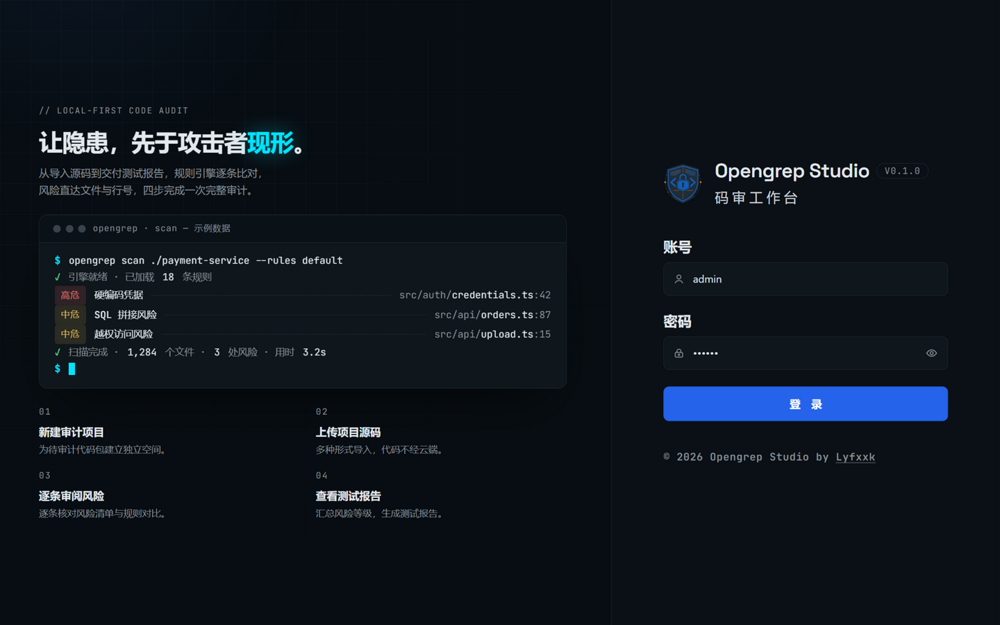
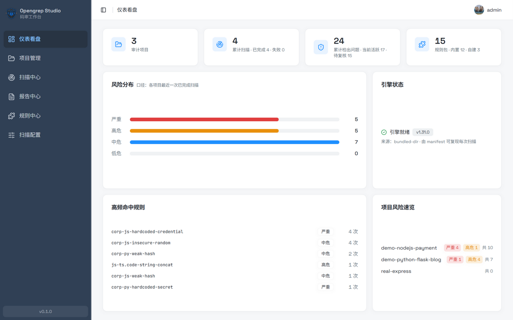
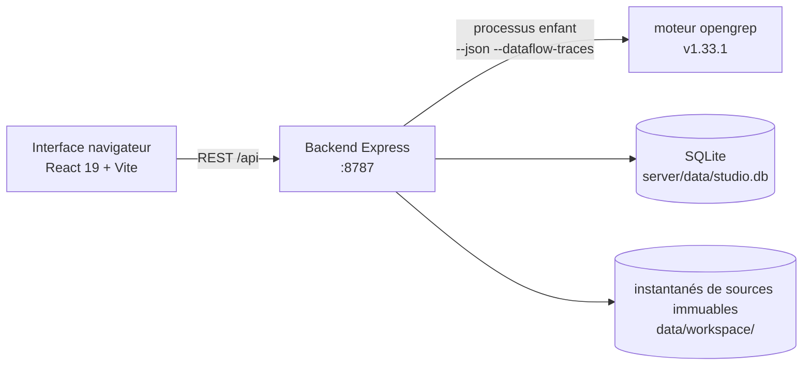

<div align="center">

<h1>Opengrep Studio · Poste d’audit de code</h1>
<p><strong>Trouvez les faiblesses avant les attaquants.</strong></p>
<p>Un poste de travail local d’audit statique de code bâti sur <a href="https://github.com/opengrep/opengrep">Opengrep</a> — importer les sources, scanner avec des règles, trier les résultats un à un, comparer aux références, livrer des rapports — <strong>votre code ne quitte jamais votre machine</strong>.</p>
<p><a href="../README.md">English</a> · <a href="./README.zh-Hans.md">简体中文</a> · <a href="./README.zh-Hant.md">繁體中文</a> · <a href="./README.ja.md">日本語</a> · <a href="./README.ko.md">한국어</a> · <a href="./README.ru.md">Русский</a> · <a href="./README.fr.md">Français</a></p>
<p>
<a href="https://github.com/Lyfxxk/Opengrep-Studio/actions/workflows/ci.yml"></a>
<a href="#licence"></a>
<a href="#prérequis"></a>

</p>

<p><sub>Vue de triage : cartes de référence (nouveaux / corrigés / restants) · flux de données (source → propagation → puits) · correspondances surlignées · verdicts de revue</sub></p>
</div>

---

## Pourquoi Opengrep Studio

Chaque base de code cache quelques mines : mots de passe de base de données codés en dur dans les sources, entrées utilisateur concaténées directement en SQL, points de terminaison de débogage laissés après la mise en production, mots de passe encore hachés en MD5. **L’analyse statique de code** signale ces problèmes en amont — sans exécuter votre programme et sans envoyer votre code nulle part.

#### D’abord, l’IA : elle lit bien le code, mais elle ne peut pas mener un audit

Soyons justes, l’IA est réellement douée pour lire le code — **défauts de logique métier, risques d’autorisation, schémas nouveaux qu’aucune règle ne couvre** : elle comprend l’intention. Mais utiliser un chat IA comme audit de code se heurte à quatre murs :

- **L’IA échantillonne ; un audit doit être exhaustif** — un projet de 100 000 lignes ne tient dans aucune fenêtre de contexte ; sur 47 sites de concaténation SQL, il peut signaler les 5 « évidents », et vous ne saurez jamais qu’il a sauté les 42 autres. Un moteur de règles promet que **chaque correspondance est signalée** — c’est seulement alors que vous osez écrire dans vos conclusions « tous les schémas problématiques couverts par ces 812 règles ont été vérifiés » ;
- **Un chat est unique ; un audit exige un registre** — l’IA ne se souvient pas de ce qu’elle a lu le mois dernier : quels résultats sont nouvellement introduits, lesquels sont réellement corrigés, lesquels vous avez déjà jugés faux positifs — tout repart de zéro ;
- **« L’IA l’a dit » ne compte pas comme preuve** — la livraison au client exige la reproductibilité : hachés des sources, version du moteur, ligne de commande complète, pour que quiconque puisse relancer et obtenir le même résultat ; un journal de chat ne peut être ni revérifié ni attribué ;
- **Il ne suit pas la fréquence des commits** — une lecture complète coûte de vrais jetons, et plus le projet est gros, plus c’est coûteux et lacunaire ; un moteur local prend des secondes à des minutes à coût marginal nul — c’est ce qui se branche sur la CI.

#### Ensuite, le moteur : balayage exhaustif, mais le CLI seul ne suffit pas à un audit

Ce n’est donc pas l’un ou l’autre : **les moteurs de règles offrent le filet de sécurité exhaustif, l’IA ajoute la compréhension sémantique** — Semgrep lui-même livre une assistance IA et chaque éditeur SAST y branche des LLM ; c’est la route que tout le monde suit. Le moteur derrière Opengrep Studio est opengrep (la suite communautaire open source de Semgrep OSS), et il scanne professionnellement — mais mener un audit complet directement depuis son CLI signifie encore quatre murs :

- **La sortie n’est que du JSON** — ce qui a correspondu et à quelle gravité, tout se lit à l’œil dans la sortie du terminal, sans espace de travail pour trier ;
- **Les messages de règles sont en anglais uniquement** — un indice comme « des données contaminées arrivent dans eval » ne dit pas immédiatement à tout le monde où est le problème ni quoi changer ;
- **Impossible de savoir si une correction a fonctionné** — on rescanne après correction, et déterminer quels résultats sont nouveaux et lesquels ont vraiment disparu revient à comparer deux fichiers JSON à la main ;
- **Rien à remettre aux responsables ou aux clients** — un rapport de risques doit être assemblé ligne par ligne depuis le JSON, et il ne paraît jamais professionnel.

#### Ce que Studio complète, c’est tout le pipeline après le scan

Opengrep Studio complète ce pipeline : **déposer le code → lancer le scan → trier les résultats → exporter un rapport**. Le moteur tourne localement, et **votre code ne quitte jamais votre machine**. La puissance d’analyse appartient au moteur amont — Studio transforme la sortie du scan en un flux d’audit **observable, comparable, vérifiable, livrable**. À l’ère de l’IA, ce flux est plus rare, pas obsolète : l’IA vous déverse un tas de résultats d’un coup, et quelqu’un doit les dédupliquer, en faire une référence, les suivre entre les scans et les transformer en rapport — **l’IA produit des résultats, Studio les gère**.

#### À qui cela s’adresse

- **Consultants sécurité / ingénieurs appsec menant des audits de code** — le code client ne peut pas partir dans des clouds tiers (et ne devrait pas non plus être collé dans un chat IA en ligne) ; livrer signifie un rapport d’audit reproductible ;
- **Petites équipes sans budget SAST commercial** — les plateformes d’audit commerciales coûtent une fortune par an ; ceci est gratuit, open source (MIT) et tourne entièrement en local ;
- **Toute personne apprenant la sécurité applicative** — 812 règles avec messages en huit langues + une base de connaissances CWE avec conseils de correction + visualisation du flux de données et un laboratoire de règles qui valide les règles sur place ;
- **Auteurs open source** — scannez pour les secrets codés en dur et les appels dangereux avant de publier ; cela prend quelques minutes.

## Points forts

### 🗂 Import multi-sources, votre code ne touche jamais le cloud

Glissez un dossier entier, chargez des archives ZIP / 7Z / RAR / TAR.GZ, ou collez l’URL d’un dépôt Git pour un import par clone superficiel (respecte `.gitignore` / `.opengrepignore` par défaut ; désactivez-le pour extraire les secrets codés en dur du `.env`). La composition des langages est analysée automatiquement après le chargement.



### 📚 812 règles intégrées, 12 langages, messages entièrement traduits

Sélectionnées depuis [opengrep-rules](https://github.com/opengrep/opengrep-rules) (en priorité les règles portant des métadonnées CWE / OWASP, le lien vers la source conservé sur chaque règle), couvrant 108 CWE ; **les 812 messages de règles sont disponibles en anglais, chinois simplifié, chinois traditionnel, japonais, coréen, russe, français et allemand**, plus une base de connaissances CWE (108 entrées avec notes de faiblesse et conseils de correction) dans les mêmes huit langues (l’interface anglaise retombe sur le chinois simplifié). Les packs de règles personnalisés prennent en charge l’édition en ligne, l’import/export et les contrôles qualité.

Tous les messages de règles et notes CWE sont aussi publiés sous forme de site statique encyclopédie des règles : <https://lyfxxk.github.io/Opengrep-Studio/> — généré par `server/scripts/build-rules-site.mjs` et déployé automatiquement à chaque push sur main.



### 🔍 Triage résultat par résultat : emplacements de code, chaînes de contamination, verdicts

Chaque résultat renvoie directement au fichier et à la ligne avec la correspondance surlignée en rouge ; les résultats de contamination affichent toute la chaîne source → propagation → puits ; les verdicts de revue (confirmé / faux positif / accepté) persistent entre les scans par empreinte du résultat, bâtissant la chaîne de preuves d’audit.

### 📊 Diff de référence et comparaison à deux instantanés

Définissez un scan de référence et chaque scan suivant classe automatiquement les résultats en **nouveaux / corrigés / restants** ; le centre de scan permet aussi de choisir deux scans terminés pour une comparaison à deux instantanés (même entre projets) : niveau résultat apparié par empreinte, niveau fichier par contenu d’instantané.



### 📄 Rapport d’audit imprimable + manifeste de reproductibilité

Un clic génère un « Rapport de test d’audit de code » au style papier : verdict global, distribution des risques, règles les plus fréquentes, fichiers chauds, détails des résultats, statistiques de triage — imprimez directement en PDF ou téléchargez un HTML hors ligne en un seul fichier ; chaque rapport est accompagné d’un manifeste de reproductibilité (SHA-256 des sources, ligne de commande complète du moteur, hachés des fichiers de règles). Rapport et manifeste s’affichent dans la langue de votre interface — anglais, chinois simplifié, chinois traditionnel, japonais, coréen, russe, français ou allemand.



### 🧪 Laboratoire de règles : vérifier d’abord, committer ensuite

YAML de la règle à gauche, échantillons positifs et négatifs à droite, un clic lance le vrai moteur pour vérifier « déclenche-t-il, fait-il des faux positifs » ; une règle vérifiée s’enregistre avec ses échantillons sous forme de pack de règles portable, prêt pour une régression en un clic ensuite. Les brouillons se sauvegardent automatiquement ; Ctrl+Entrée lance.



### 🔁 Interopérabilité SARIF dans les deux sens

Exportez du SARIF 2.1.0 pour GitHub Code Scanning / DefectDojo / SonarQube ; ou importez du SARIF 2.x produit par d’autres outils comme un scan complet, inclus dans votre système de références et de rapports.

### 🖥 Tableau de bord

Projets, scans cumulés, résultats et packs de règles d’un coup d’œil ; distribution des risques entre projets, règles les plus fréquentes, état du moteur et aperçu des risques par projet — rafraîchissement automatique pendant qu’un scan tourne.

### ⬆️ Vérification de mise à jour du moteur et mise à niveau en un clic

La carte « État du moteur » du tableau de bord affiche la version **réellement installée** et sa provenance ; cliquez sur « Vérifier les mises à jour » pour comparer à la dernière version stable amont et mettre à niveau en un clic :

- La mise à niveau est un remplacement atomique : télécharger → vérifier le SHA-256 (depuis le digest de la release GitHub) → exécuter `opengrep --version` pour confirmer → alors seulement remplacer les fichiers ; si une étape échoue, l’ancien moteur reste intact
- Seule la dernière version stable est proposée (les préversions sont ignorées) ; le bouton est désactivé pour les utilisateurs gérant le moteur eux-mêmes via `OPENGREP_BIN`
- La mise à niveau est désactivée pendant un scan ou pendant que le laboratoire de règles tourne (Windows ne peut pas remplacer un exe en cours d’exécution) ; le cache de sonde de version s’invalide automatiquement après une mise à niveau réussie
- La version installée est enregistrée dans `opengrep-tool/installed.json` ; relancer `npm run setup:engine` ne rétrograde jamais un moteur mis à niveau vers la version figée dans `engines.json`

<details>
<summary><b>L’interface en un coup d’œil (connexion et tableau de bord)</b></summary>
<table>
<tr>
<td align="center"></td>
<td align="center"></td>
</tr>
</table>
</details>

## Démarrage rapide

### Prérequis

- **Node.js ≥ 22.12** — le `node:sqlite` intégré exige 22.5+, et Vite 8 côté frontend exige 22.12+ ; toujours aucune dépendance native
- Le moteur de scan est téléchargé et vérifié par SHA-256 automatiquement (~50 Mo), rien à préinstaller ; Git n’est nécessaire que pour l’import par clonage de dépôt

### Option 1 : lancement en un clic (recommandé)

Double-cliquez `一键启动（Windows）.bat` sous Windows ; sous macOS / Linux exécutez :

```sh
./一键启动（macOS／Linux）.sh
```

Le script vérifie votre version de Node, installe les dépendances, télécharge le moteur et ouvre le navigateur. Frontend sur <http://localhost:1022>, API backend sur <http://localhost:8787>.

### Option 2 : trois étapes manuelles

```sh
git clone https://github.com/Lyfxxk/Opengrep-Studio.git
cd Opengrep-Studio
npm run install:all   # dépendances root + server + code en une fois
npm run setup:engine  # télécharger opengrep v1.33.1 et vérifier le SHA-256
npm run dev           # backend (:8787) + frontend (:1022) ensemble
```

### Option 3 : Docker

```sh
npm run docker:build
npm run docker:run    # = docker run --rm -p 8787:8787 -v ogstudio-data:/data opengrep-studio
```

L’image est livrée avec le moteur et le frontend compilé — ouvrez <http://localhost:8787> et vous y êtes ; les données persistent dans le volume `ogstudio-data`.

Une réserve sur les mises à niveau : une mise à niveau en un clic écrit dans la couche du conteneur (`/app/opengrep-tool`), elle survit donc aux redémarrages du conteneur mais est perdue quand le conteneur est recréé (`docker compose down && up`), retombant sur la version figée dans `engines.json`. Pour une montée de version durable du moteur, modifiez `server/scripts/engines.json` et reconstruisez l’image.

### Premier lancement

Connexion par défaut : `admin` / `123456` (voir [Modèle de sécurité](#modèle-de-sécurité)). Déroulé suggéré :

1. **Configuration de scan** — choisissez les packs de règles à activer (éventuellement avec chemins d’exclusion/inclusion et arguments du moteur)
2. **Créez un projet** et liez cette configuration — ou sautez la liaison : une configuration de repli protégée (tous les packs intégrés activés, impossible à supprimer) est liée automatiquement au premier scan
3. **Importez les sources** (glisser un dossier / charger une archive / clonage Git)
4. **Lancez un scan**, puis triez les résultats un à un
5. Définissez une référence, rescannez et observez **nouveaux / corrigés / restants** ; quand il est temps de livrer, **générez le rapport de test**

Envie de voir avant de toucher à votre propre code ? `npm run seed` crée d’un coup trois projets de démonstration (avec diffs de référence et enregistrements de revue).

<details>
<summary><b>Dépannage</b></summary>
<ul>
<li><b>Téléchargement du moteur lent/bloqué</b> : les téléchargements ont des replis automatiques (miroir <code>OPENGREP_DOWNLOAD_BASE</code> → github.com → api.github.com), donc un github.com bloqué ne demande généralement aucune étape manuelle ; si tous les canaux échouent, définissez un miroir (<code>set OPENGREP_DOWNLOAD_BASE=&lt;url-miroir&gt;</code>, utilisez <code>export</code> sous macOS/Linux) ou téléchargez depuis les <a href="https://github.com/opengrep/opengrep/releases">opengrep Releases</a> et faites pointer <code>OPENGREP_BIN</code> dessus</li>
<li><b>« Vérifier les mises à jour » signale une limite de débit de l’API GitHub</b> : les appels anonymes sont plafonnés à 60/heure et les résultats sont mis en cache 30 minutes ; réessayez plus tard — le scan n’est pas affecté</li>
<li><b>Gatekeeper macOS</b> : <code>xattr -d com.apple.quarantine &lt;chemin-du-moteur&gt;</code></li>
<li><b>Ports occupés</b> : <code>node server/scripts/kill-port.mjs 8787 1022</code></li>
<li><b>Autres variables d’environnement</b> : <code>PORT</code> / <code>HOST</code> / <code>DATA_DIR</code> / <code>CUSTOM_RULES_DIR</code> / <code>OPENGREP_BIN</code> / <code>OPENGREP_DOWNLOAD_BASE</code> (serveur) ; les dépassements de délai se règlent en secondes : <code>CLONE_TIMEOUT_SECONDS</code> / <code>SEVEN_Z_TIMEOUT_SECONDS</code> / <code>RULE_LAB_TIMEOUT_SECONDS</code>. Le serveur de dev honore <code>API_TARGET</code> pour le proxy <code>/api</code>. Les fichiers de packs de règles personnalisés continuent d’arriver dans <code>server/rules/custom</code> quand seul <code>DATA_DIR</code> est défini — déplacez les deux ensemble, sinon la base et les fichiers de règles se désynchronisent (le backend affiche les deux répertoires au démarrage et avertit en cas d’écart)</li>
</ul>
</details>

## CLI brut vs Opengrep Studio

| Capacité | `opengrep scan` direct | Opengrep Studio |
| :--- | :--- | :--- |
| Forme du résultat | JSON / texte dans le terminal | triage interactif : surlignage de code, chaînes de contamination, filtrage et recherche |
| Localisation | messages en anglais uniquement | interface en huit langues (anglais / chinois simplifié / chinois traditionnel / japonais / coréen / russe / français / allemand) ; les 812 messages de règles et la base de connaissances CWE dans les mêmes huit langues |
| Gestion de référence | aucune | classement automatique nouveaux / corrigés / restants ; verdicts persistants entre scans |
| Diff de versions | aucune | comparaison à deux instantanés (niveau résultat + niveau fichier, entre projets) |
| Livraison de rapport | assemblée à la main | rapport au style papier en un clic (impression / HTML hors ligne) + manifeste de reproductibilité |
| Débogage de règles | éditer, relancer, espérer | laboratoire de règles : validation positive/négative instantanée, régression sur échantillons |
| Interopérabilité d’outils | bricolage | import / export SARIF 2.1.0 |

## Fonctionnement



- Déploiement en un seul processus : le backend sert aussi le frontend compilé (en production, le port 8787 suffit) ; lié à `127.0.0.1` uniquement, par défaut
- Chaque scan s’exécute sur un **instantané de sources immuable** ; le haché de l’instantané et la ligne de commande complète sont archivés, donc chaque rapport est reproductible
- SQLite stocke projets / scans / résultats / revues / configurations — aucune dépendance à un service externe ; toutes les données vivent dans `server/data/`
- Jusqu’à 2 scans tournent en parallèle (les supplémentaires passent automatiquement en file d’attente) pour exploiter les ressources locales ; le laboratoire de règles et les scans s’excluent mutuellement

## Tests

```sh
npm test             # tests unitaires du backend
npm run test-packs   # structure des packs de règles + échantillons embarqués
npm run e2e          # bout en bout HTTP contre un backend en cours (moteur réel)
npm run e2e:ui       # bout en bout navigateur (Playwright ; compile le frontend, démarre un backend isolé sur :8799)
npm run e2e:ui:fast  # bout en bout navigateur sans le cas de scan dépendant du moteur
```

Les tests navigateur vivent dans `code/e2e/` et écrivent dans `code/e2e/.tmp/`, ils ne touchent donc jamais votre `server/data/`. La CI lance les deux suites sur le moteur réel.

## Modèle de sécurité

Divulgation honnête — veuillez lire :

- **Outil local mono-poste** : lié à `127.0.0.1` uniquement par défaut ; le code et les résultats ne quittent jamais la machine, aucune télémétrie
- **La barrière de connexion n’est qu’une garde anti-clic accidentel côté frontend** (compte fixe `admin` / `123456`) ; **l’API backend n’a pas d’authentification** — n’exposez pas le service sur l’internet public ; si vous en avez vraiment besoin sur le LAN, définissez `HOST` vous-même et ajoutez un contrôle d’accès
- Le mode Docker met `HOST=0.0.0.0` par défaut ; à n’utiliser qu’à l’intérieur d’un intranet / derrière une protection
- Le chargement et la décompression sont durcis contre Zip-Slip / liens symboliques / bombes de taille et de nombre de fichiers ; le clonage Git est en https uniquement avec interaction d’identifiants désactivée

## FAQ

<details>
<summary><b>Quels langages et plateformes sont pris en charge ?</b></summary>
<p>Les règles intégrées couvrent Python, JS/TS, Java, Go, C, C#, PHP, Bash, Kotlin, Swift, Rust et Dockerfile — 12 langages au total ; Studio lui-même tourne sous Windows (x64) / macOS (x64 / arm64) / Linux (x64 / arm64) et dans Docker.</p>
</details>

<details>
<summary><b>Quelle est la relation avec Semgrep ?</b></summary>
<p>Opengrep est le moteur open source continué par la communauté depuis Semgrep OSS (LGPL-2.1) ; Studio orchestre son binaire officiel, et les règles sont sélectionnées depuis opengrep-rules. Studio n’est pas affilié à Semgrep Inc.</p>
</details>

<details>
<summary><b>Mon code sera-t-il envoyé quelque part ?</b></summary>
<p>Non. Le scan, le stockage et la génération de rapports se produisent tous localement ; le service n’est lié, par défaut, qu’à l’adresse de bouclage locale.</p>
</details>

<details>
<summary><b>Où sont stockées les données ? Supprimer un projet laisse-t-il des traces ?</b></summary>
<p>Tout vit dans <code>server/data/</code> (SQLite + instantanés de sources) et dans le répertoire des packs de règles personnalisés. Supprimer un projet entraîne en cascade ses scans, résultats, enregistrements de revue et répertoire d’instantanés.</p>
</details>

<details>
<summary><b>Comment brancher cela sur GitHub Code Scanning ?</b></summary>
<p>Cliquez sur « Exporter SARIF » sur la page de résultats et chargez l’artefact dans code-scanning selon la documentation GitHub ; les empreintes utilisent un format de déduplication stable qui prend en charge les rapports incrémentaux.</p>
</details>

<details>
<summary><b>Puis-je importer des résultats d’autres outils ?</b></summary>
<p>SARIF 2.x est pris en charge : cliquez sur « Importer SARIF » sur la page de détail du projet et les résultats deviennent un scan complet — définissez-le comme référence, générez des rapports.</p>
</details>

## Feuille de route

- [x] Localisation des 812 messages de règles + base de connaissances CWE en huit langues (anglais / chinois simplifié / chinois traditionnel / japonais / coréen / russe / français / allemand)
- [x] Diff de référence et comparaison à deux instantanés, chaîne de preuves de revue
- [x] Import/export SARIF 2.1.0, manifeste de reproductibilité
- [x] Laboratoire de règles et packs de règles portables avec régression sur échantillons
- [x] Image Docker et lancement en un clic sur 3 plateformes
- [x] Vérification de mise à jour du moteur et mise à niveau en un clic (repli de téléchargement multicanal)
- [x] Internationalisation de l’interface (anglais / chinois simplifié / chinois traditionnel / japonais / coréen / russe / français / allemand)
- [x] File d’attente de scans et ordonnancement parallèle
- [ ] Import de packs de règles depuis une URL et index communautaire
- [ ] Modèle de workflow GitHub Action (scan en CI, renvoi du SARIF)
- [ ] Modèles de rapport personnalisables (image de marque / en-tête et pied de page)

## Remerciements

- [opengrep/opengrep](https://github.com/opengrep/opengrep) — le moteur de scan (LGPL-2.1) ; ce dépôt ne livre pas son binaire, il est téléchargé et vérifié par script
- [opengrep/opengrep-rules](https://github.com/opengrep/opengrep-rules) — source des règles intégrées ; merci à tous les auteurs de règles amont
- [shadcn/ui](https://ui.shadcn.com/) / [Radix UI](https://www.radix-ui.com/) / [Tailwind CSS](https://tailwindcss.com/) / [CodeMirror](https://codemirror.net/) / [Vite](https://vite.dev/) / [React](https://react.dev/) — tout le bon matériel dont l’interface est faite

## Licence

Le code de ce dépôt est publié sous [MIT](../LICENSE).

Deux remarques sur les licences tierces :

- **Le moteur de scan** : opengrep est publié sous LGPL-2.1 ; ce dépôt ne contient aucun binaire de moteur — `npm run setup:engine` le télécharge depuis les Releases officielles et le vérifie par SHA-256
- **Les règles intégrées** : sélectionnées depuis opengrep-rules (LGPL 2.1 + Commons Clause) — libres d’utilisation et de redistribution avec mention conservée, mais les règles elles-mêmes ne doivent pas être vendues comme produit payant
