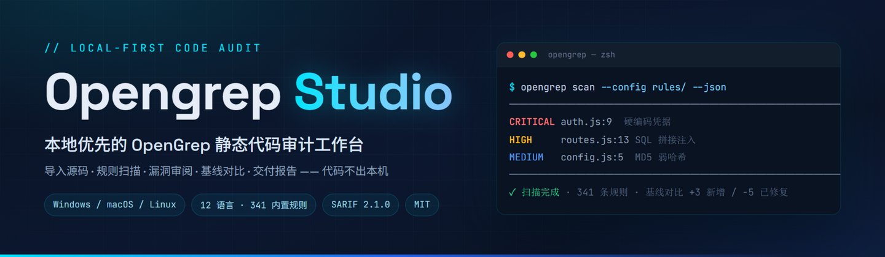
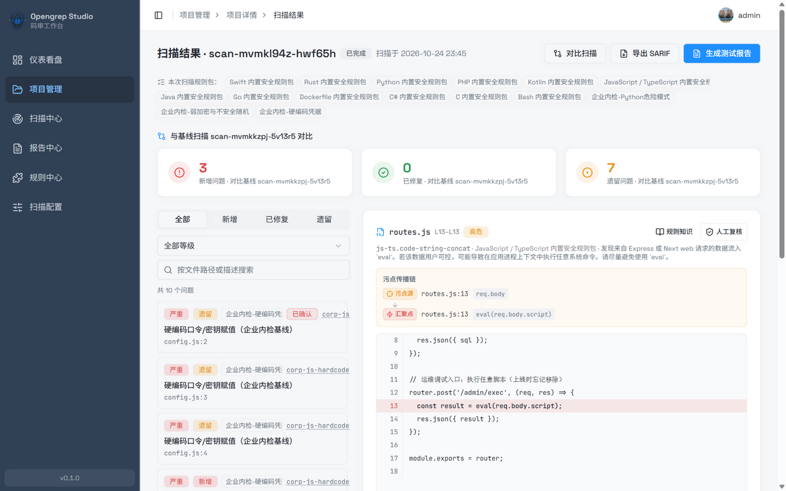
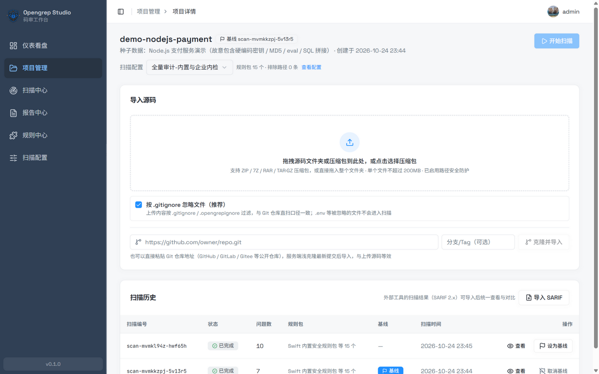
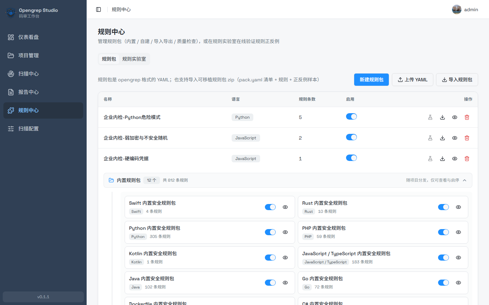
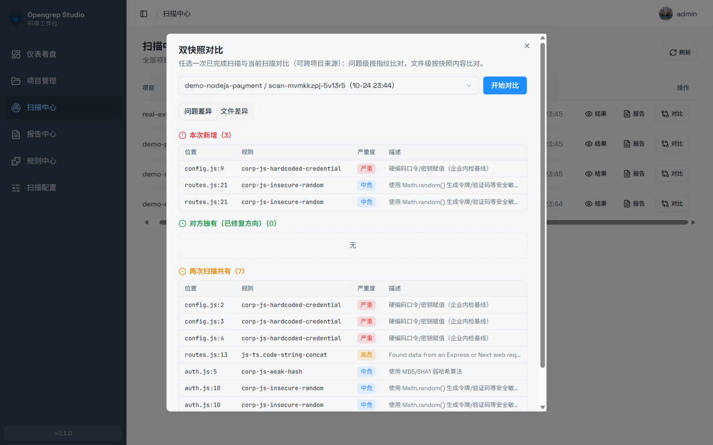
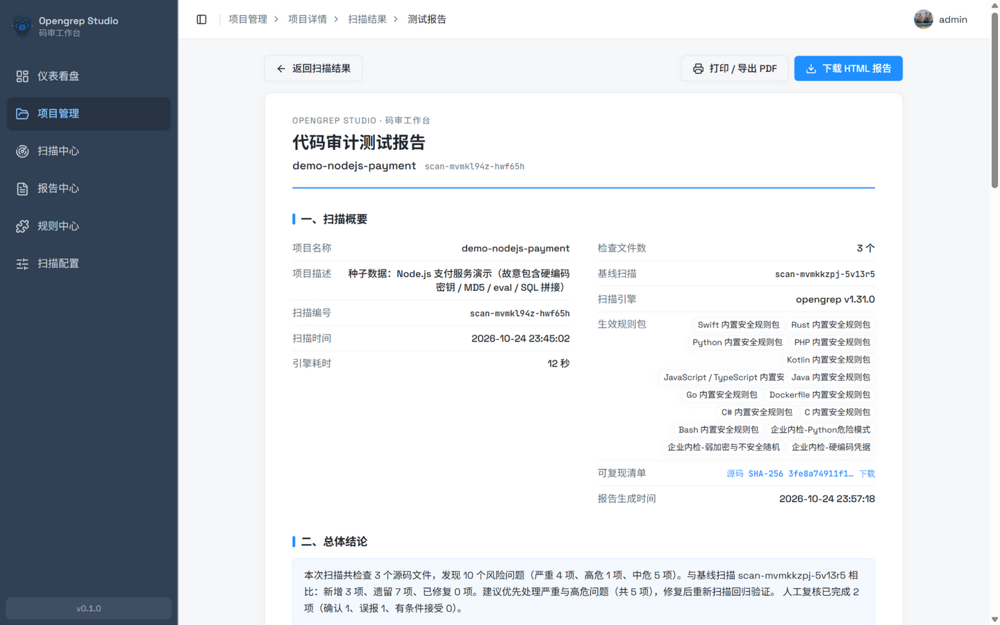
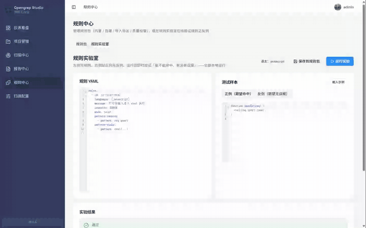
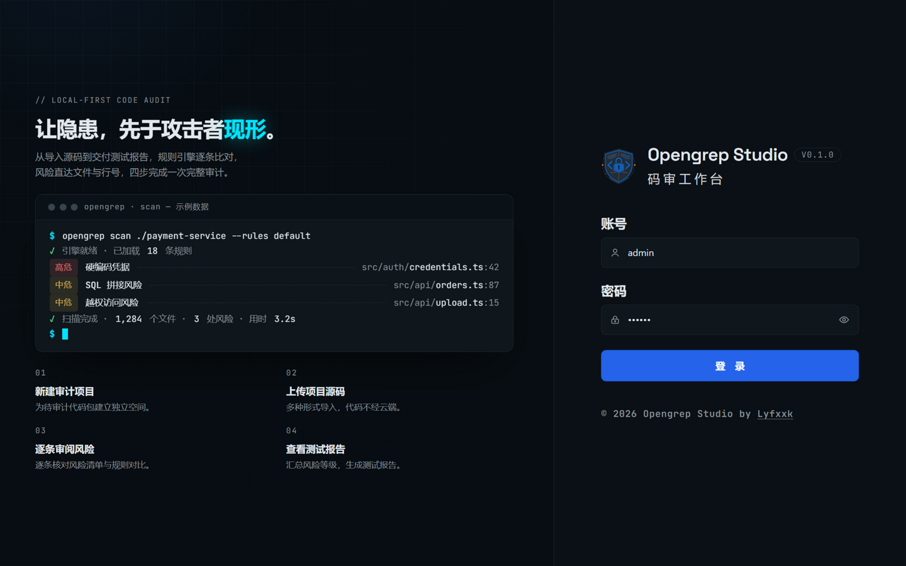
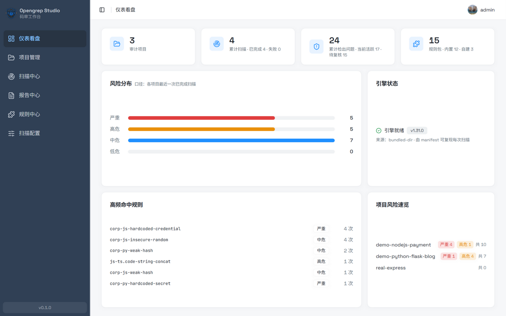
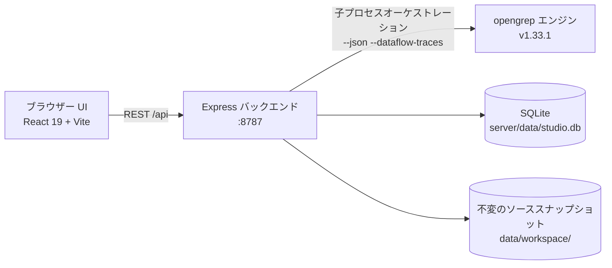

<div align="center">

<h1>Opengrep Studio · コード監査ワークベンチ</h1>
<p><strong>潜むリスクを、攻撃者より先に可視化する。</strong></p>
<p>ローカルファーストの <a href="https://github.com/opengrep/opengrep">Opengrep</a> 静的コード監査ワークベンチ——ソースコードのアップロード、ルールスキャン、問題ごとのレビュー、ベースライン比較、納品用レポートまで、<strong>コードは一切マシンの外に出ません</strong>。</p>
<p><a href="../README.md">English</a> · <a href="./README.zh-Hans.md">简体中文</a> · <a href="./README.zh-Hant.md">繁體中文</a> · <a href="./README.ja.md">日本語</a> · <a href="./README.ko.md">한국어</a> · <a href="./README.ru.md">Русский</a> · <a href="./README.fr.md">Français</a></p>
<p>
<a href="https://github.com/Lyfxxk/Opengrep-Studio/actions/workflows/ci.yml"></a>
<a href="#license"></a>
<a href="https://github.com/opengrep/opengrep"></a>
<a href="#動作環境"></a>

</p>

<p><sub>スキャン結果レビュー画面：ベースライン 3 カード（新規 / 修正済み / 残存）· タイントフロー（ソース → 伝播 → シンク）· ヒット行のハイライト · 手動レビュー記録</sub></p>
</div>

---

## なぜ Opengrep Studio が必要か

どのプロジェクトにも、いくつかの地雷が埋まっているかもしれません：コードに直書きされたデータベースのパスワード、SQL にそのまま連結されるユーザー入力、削除し忘れたデバッグ用エンドポイント、いまだに MD5 で保存されているパスワード。**静的コードスキャン**が行うのは、コードをアップロードせず、プログラムを実行せずに、こうした問題を事前に洗い出すことです。

#### まず AI から：コードは読めるが、網羅はできない

認めざるを得ませんが、AI のコード読解には確かな腕があります——**ビジネスロジックの脆弱性、越権アクセスのリスク、ルールがカバーしていない新しい書き方**、いずれも意図を理解できます。しかし「AI チャット」を「コード監査」の代わりにすると、4 つの壁にぶつかります。

- **AI はサンプリング、監査は全件列挙**——10 万行のプロジェクトではコンテキストに入りきりません。SQL 連結が 47 か所あるとき、AI は目立つ 5 か所を指摘するかもしれませんが、残りの 42 か所を見ていないこと自体に気付けません。ルールエンジンの約束は「**ヒットしたものはすべて報告される**」こと。スキャンを終えて初めて、結論に「この 812 件のルールがカバーする問題パターンはすべて確認済み」と書き込めます。
- **チャットは使い捨て、監査には台帳が必要**——AI は先月何を読んだか覚えていません。今回新たに持ち込まれたもの、実際に修正できたもの、以前判定した誤検知も、すべて一からやり直しです。
- **「AI が言ったこと」は証拠にならない**——顧客への納品に必要なのは再現性です。ソースコードのハッシュ、エンジンバージョン、完全なコマンドラインがあれば、誰でも同じ結果を実行できます。チャットの履歴は検証にも責任の追跡にも使えません。
- **コミット頻度ではコストが持たない**——リポジトリ全体の通読には現金同然のトークンがかかり、プロジェクトが大きいほど高くつき、見落としも増えます。ローカルエンジンなら秒から分レベル・限界費用ゼロだからこそ、CI に組み込めるのです。

#### 次にエンジンから：スキャンは網羅できるが、コマンドラインだけでは監査を完結できない

だから答えは二者択一ではありません。**ルールエンジンが全件網羅のフォールバックを担い、AI が意味の理解を担う**——Semgrep 公式の AI 支援も、各社 SAST の大規模モデル統合も、この道を進んでいます。Opengrep Studio が採用する opengrep（コミュニティが Semgrep OSS から引き継いだオープンソーススキャンエンジン）は極めて専門的にスキャンしますが、そのコマンドラインだけで完全な監査をやり遂げるには、やはり 4 つのハードルがあります。

- **スキャン結果はただの JSON の山**——どの問題がどれだけ深刻かは、端末出力を目で追うしかなく、問題ごとにレビューするワークベンチがありません。
- **ルールメッセージは英語**——"tainted data flowing into eval" のようなヒントを見ても、問題がどこにあり、どう直せばいいのか、誰もがすぐ理解できるとは限りません。
- **直しても、直ったかどうかが分からない**——コードを修正して再スキャンしても、何が新たに出てきたのか、何が本当に直ったのか、2 つの JSON を手作業で突き合わせるしかありません。
- **管理者や顧客に納品できない**——リスクレポートは JSON から 1 件ずつ手作業で組み立てることになり、書式も専門性を欠きます。

#### Studio が補うのは、スキャン後の一連のパイプライン

Opengrep Studio はこのパイプラインを丸ごと補います。**コードをドラッグ → ワンクリックでスキャン → 問題ごとにレビュー → ワンクリックでレポート**。スキャンエンジンはローカルで動き、**コードは最初から最後まであなたのマシンから出ません**。エンジンの実力は上流プロジェクトのもの、Studio は結果を**レビュー可能・比較可能・検証可能・納品可能**な監査ワークフローに変えることに専念します。AI の時代、このワークフローこそむしろ貴重です。AI は一度に大量の検出結果を吐き出しますが、重複排除、ベースライン設定、スキャン横断の追跡、レポート作成には受け皿が必要です——**AI が問題を生み、Studio が問題を管理する**。

#### このツールが向いている人

- **コード監査の案件を請け負うセキュリティサービス技術者 / 独立コンサルタント**——顧客のコードはサードパーティのクラウドプラットフォームに上げられず、オンライン AI に貼り付けるのも避けるべきです。納品時には再現可能な日本語のテストレポートが必要になります。
- **商用 SAST の予算がない小規模チーム**——商用コード監査プラットフォームは年間十数万がザラで、こちらは無料のオープンソース（MIT）+ ローカルデプロイです。
- **アプリケーションセキュリティを学んでいる人**——812 件のルールの 8 言語メッセージ + CWE の多言語修正提案 + タイントフローの可視化。ルールラボで書きながら即座に検証できます。
- **オープンソースの作者**——リリース前にハードコードされた秘密情報や危険な関数呼び出しを一度スキャンするだけ。数分で終わる作業です。

## 機能ハイライト

### 🗂 マルチソースインポート、コードはクラウドを経由しない

フォルダー全体をドラッグ＆ドロップ、ZIP / 7Z / RAR / TAR.GZ アーカイブのアップロード、または Git リポジトリ URL を貼り付けてシャロークローンでインポート（デフォルトでは `.gitignore` / `.opengrepignore` の規約に従い、オフにすれば `.env` 内のハードコードされた秘密情報まで掘り起こせます）。アップロード後は言語構成を自動集計します。



### 📚 組み込みルール 812 件、12 言語、メッセージ完全翻訳

[opengrep-rules](https://github.com/opengrep/opengrep-rules) から厳選（CWE / OWASP のメタデータを持つルールを優先的に収録し、各ルールに出所となる上流リンクを保持）、CWE 108 種をカバー。**812 件のルールメッセージは 100% 翻訳を提供**——英語原文に加え、簡体字 / 繁体字 / 日本語 / 韓国語 / ロシア語 / フランス語 / ドイツ語の 7 訳が全量カバー、計 8 言語。さらに 108 種類の CWE 脆弱性の説明と修正提案を付属（上記 7 言語、英語 UI では簡体字中国語にフォールバック）。カスタムルールパックはオンライン編集、インポート / エクスポート、品質チェックに対応しています。

全ルールメッセージと CWE の説明は、静的な「ルール百科」サイト <https://lyfxxk.github.io/Opengrep-Studio/> としても公開しています（`server/scripts/build-rules-site.mjs` が生成し、main への push で自動デプロイ）。



### 🔍 問題ごとのレビュー：コード位置特定、タイントフロー、手動レビュー

各問題からファイルと行番号へ直接ジャンプし、ヒット行は赤でハイライト。タイント系の問題では「ソース → 伝播経路 → シンク」のチェーンを表示します。手動レビューの判定（確認済み / 誤検知 / 受諾済み）は問題フィンガープリントごとにスキャンをまたいで引き継がれ、監査のエビデンスチェーンを構成します。

### 📊 ベースライン比較とスナップショット比較

ベースラインスキャンを設定すると、以降のスキャンでは自動的に **新規 / 修正済み / 残存** の 3 分類が表示されます。スキャンセンターでは、完了したスキャンを 2 つ自由に選んでスナップショット比較（プロジェクトをまたいで可）もできます。問題レベルはフィンガープリントで、ファイルレベルはソーススナップショットの内容で突き合わせます。



### 📄 印刷可能な監査レポート + 再現可能なマニフェスト

紙の印刷を意識したレイアウトの『コード監査テストレポート』をワンクリックで生成。総合判定、リスク分布、頻出ルール、ホットスポットファイル、問題明細、レビュー統計を含み、そのまま PDF に印刷したり、単一ファイルのオフライン HTML をダウンロードしたりできます。レポートと付属の再現マニフェスト（ソースコードの SHA-256、完全なエンジンコマンドライン、ルールファイルのハッシュ）は、英語 / 簡体字中国語 / 繁体字中国語 / 日本語 / 韓国語 / ロシア語 / フランス語 / ドイツ語の 8 言語に対応しています。



### 🧪 ルールラボ：検証してから登録

左側でルール YAML を書き、右側に正例と負例を貼り付けて、ワンクリックで実際のエンジンを実行し「ヒットするか、誤検知はないか」を検証します。動作を確認したルールはサンプルごとポータブルなルールパックとして保存でき、後でワンクリックのリグレッションチェックが可能です。ドラフトは自動保存、Ctrl+Enter で実行します。



### 🔁 SARIF 双方向連携

SARIF 2.1.0 をエクスポートして GitHub Code Scanning / DefectDojo / SonarQube で取り込めます。逆に、他のツールが出力した SARIF 2.x を 1 回の完全なスキャンとしてインポートし、ベースラインとレポートの体系に組み込むことも可能です。

### 🖥 ダッシュボード

プロジェクト数、累計スキャン、検出された問題、ルールパックが一目でわかります。プロジェクト横断のリスク分布、上位ヒットルール、エンジンの状態、各プロジェクトのリスク概要を表示し、スキャン中は自動更新されます。

### ⬆️ エンジンの更新確認とワンクリックアップグレード

ダッシュボードの「エンジン状態」カードには**実際にインストールされているバージョン**と出所が表示されます。「更新を確認」をクリックすると上流の最新 stable と比較し、新しいバージョンが見つかればワンクリックでアップグレードできます。

- アップグレードはアトミック置換です。ダウンロード → SHA-256（GitHub release 資産の digest）検証 → `opengrep --version` で確認 → その後にのみファイルを置換します。いずれかのステップが失敗すれば旧エンジンは一切変更されません
- 対象は最新 stable のみ（pre-release は扱いません）。`OPENGREP_BIN` でエンジンを自己管理しているユーザーはボタンがグレーアウトします
- スキャン / ルールラボの実行中はアップグレードを無効化します（Windows は実行中の exe の置換を許可しないため）。アップグレード後はバージョン検出のキャッシュが自動的に無効化されます
- 実際にインストールされたバージョンは `opengrep-tool/installed.json` に記録され、`npm run setup:engine` を再実行しても、アップグレード済みのエンジンが `engines.json` のピン留めバージョンへダウングレードされることはありません

<details>
<summary><b>画面一覧（ログインページとダッシュボード）</b></summary>
<table>
<tr>
<td align="center"></td>
<td align="center"></td>
</tr>
</table>
</details>

## クイックスタート

### 動作環境

- **Node.js ≥ 22.12**（バックエンドの組み込み `node:sqlite` には 22.5+、フロントエンドの Vite 8 には 22.12+ が必要。同様にネイティブ依存はありません）
- スキャンエンジンはスクリプトが自動ダウンロード（約 50 MB、SHA-256 検証）するため事前インストールは不要です。Git はリポジトリのクローンインポートを使う場合のみ必要です

### 方法 1：ワンクリック起動（推奨）

Windows ユーザーは `一键启动（Windows）.bat` をダブルクリック、macOS / Linux ユーザーは次を実行します。

```sh
./一键启动（macOS／Linux）.sh
```

スクリプトは Node バージョンの確認、依存関係のインストール、エンジンのダウンロードを自動で行い、ブラウザーを開きます。フロントエンドは <http://localhost:1022>、バックエンド API は <http://localhost:8787> です。

### 方法 2：手動 3 ステップ

```sh
git clone https://github.com/Lyfxxk/Opengrep-Studio.git
cd Opengrep-Studio
npm run install:all   # ルート / server / code の 3 か所の依存関係をインストール
npm run setup:engine  # opengrep v1.33.1 をダウンロードして SHA-256 を検証
npm run dev           # バックエンド(8787)とフロントエンド(1022)を同時起動
```

### 方法 3：Docker

```sh
npm run docker:build
npm run docker:run    # docker run --rm -p 8787:8787 -v ogstudio-data:/data opengrep-studio と同等
```

イメージにはエンジンとビルド済みフロントエンドが組み込まれており、<http://localhost:8787> にアクセスするだけで使えます。データは `ogstudio-data` ボリュームに永続化されます。

注意：コンテナー内の「ワンクリックアップグレード」が書き込むのはコンテナーの書き込み可能レイヤー（`/app/opengrep-tool`）です。コンテナーの再起動後も残りますが、コンテナーを再作成すると（`docker compose down && up` など）失われ、`engines.json` のピン留めバージョンにフォールバックします。エンジンバージョンを長期的に変更する場合は、`server/scripts/engines.json` を編集してからイメージを再ビルドしてください。

### 初めて使うとき

デフォルトのアカウントは `admin` / `123456` です（[セキュリティモデル](#セキュリティモデル) を参照）。推奨フロー：

1. **スキャン設定**——有効にするルールパックを選択します（除外 / 対象パスやエンジンパラメーターも追加できます）
2. **プロジェクトを新規作成**してこの設定を紐付け——紐付けずに始めることもできます。未紐付け、または紐付けた設定が削除された場合、スキャンは自動的に削除不可の「デフォルトスキャン設定」にフォールバックします
3. **ソースコードをインポート**（フォルダーのドラッグ / アーカイブ / Git クローン）
4. **スキャンを開始**し、完了後に問題ごとにレビュー・判定
5. ベースラインを設定して再スキャンし、**新規 / 修正済み / 残存** を確認。納品が必要なときは**テストレポートを生成**します

先に動作を見たいですか？`npm run seed` でデモ用プロジェクト 3 件（ベースライン比較とレビュー記録を含む）をワンクリックで投入できます。

<details>
<summary><b>トラブルシューティング</b></summary>
<ul>
<li><b>エンジンのダウンロードが遅い、または失敗する</b>：ダウンロードは <code>OPENGREP_DOWNLOAD_BASE ミラー → github.com → api.github.com</code> の順に自動でフォールバックするため、github.com に到達できない場合でも通常は介入なしでインストールが完了します。それでも失敗する場合は、ミラーを手動で設定（<code>set OPENGREP_DOWNLOAD_BASE=&lt;ミラーURL&gt;</code>、macOS/Linux は <code>export</code>）するか、<a href="https://github.com/opengrep/opengrep/releases">opengrep Releases</a> から手動でダウンロードして <code>OPENGREP_BIN</code> にバイナリーのパスを指定してください</li>
<li><b>更新確認で GitHub API のレート制限が表示される</b>：匿名呼び出しの上限は 60 回/時間で、確認結果は 30 分キャッシュされます。少し待ってから再試行すればよく、スキャンには影響しません</li>
<li><b>macOS でエンジンの検証ができないと表示される</b>：<code>xattr -d com.apple.quarantine &lt;エンジンパス&gt;</code></li>
<li><b>ポートが使用中の場合</b>：<code>node server/scripts/kill-port.mjs 8787 1022</code></li>
<li><b>その他の環境変数</b>：<code>PORT</code> / <code>HOST</code> / <code>DATA_DIR</code> / <code>CUSTOM_RULES_DIR</code> / <code>OPENGREP_BIN</code> / <code>OPENGREP_DOWNLOAD_BASE</code>（バックエンド）。タイムアウト系の変数の単位は秒です：<code>CLONE_TIMEOUT_SECONDS</code> / <code>SEVEN_Z_TIMEOUT_SECONDS</code> / <code>RULE_LAB_TIMEOUT_SECONDS</code>。フロントエンド開発では、<code>API_TARGET</code> で <code>/api</code> プロキシー先を指定できます。<code>DATA_DIR</code> だけを設定すると、カスタムルールパックのファイルは引き続き <code>server/rules/custom</code> に置かれるため、データディレクトリーを変更するときは両方の変数を一緒に設定してください。そうしないとデータベースとファイルが分離します（バックエンド起動時に 2 つのディレクトリーを表示し、食い違う残骸を報告します）</li>
</ul>
</details>

## CLI 直接スキャンとの比較

| 能力 | `opengrep scan` 直接実行 | Opengrep Studio |
| :--- | :--- | :--- |
| 結果の形態 | 端末の JSON / テキスト | インタラクティブなレビュー：コードハイライト、タイントフロー、フィルター検索 |
| ローカライズ | 英語メッセージ | UI は 8 言語（英 / 簡 / 繁 / 日 / 韓 / 露 / 仏 / 独）、812 件のルールメッセージと CWE ナレッジベースは簡体字・繁体字・日本語・韓国語・ロシア語・フランス語・ドイツ語版を収録 |
| ベースライン管理 | なし | 新規 / 修正済み / 残存を自動分類、レビュー判定はスキャン横断で引き継ぎ |
| バージョン比較 | なし | スナップショット比較（問題レベル + ファイルレベル、プロジェクト横断可） |
| レポート納品 | 手作業で組み立て | ワンクリックの紙印刷風レポート（印刷 / オフライン HTML）+ 再現マニフェスト |
| ルールデバッグ | 修正して再実行 | ルールラボ：正例・負例を即時検証、サンプルでリグレッション |
| ツールチェーン連携 | 自己対応 | SARIF 2.1.0 のインポート / エクスポート |

## 動作原理



- 単一プロセス構成：バックエンドがビルド済みフロントエンドもホストします（本番モードでは 8787 番ポートへのアクセスだけで足ります）。デフォルトのリッスン先は `127.0.0.1` のみ
- 各スキャンは**不変のソーススナップショット**に基づいて実行され、スナップショットのハッシュと完全なコマンドラインがアーカイブされるため、レポートは再現可能です
- SQLite がプロジェクト / スキャン / 問題 / レビュー / 設定を保存します。外部サービスへの依存はなく、全データは `server/data/` にあります
- スキャンは最大 2 件の同時実行（超過分は自動でキューイング）です。ルールラボとスキャンは排他になります

## セキュリティモデル

正直に宣言します。必ずご理解ください。

- **ローカル単体ツール**：デフォルトのリッスン先は `127.0.0.1` のみ。コードと結果はアップロードされず、テレメトリーもありません
- **ログインは誤操作を防ぐためのフロントエンドの門番にすぎません**（固定アカウント `admin` / `123456`）。**バックエンド API に認証はありません**——サービスを公開ネットワークに露出しないでください。LAN 内で使う必要がある場合は、`HOST` を自分で設定し、アクセス制御を追加してください
- Docker モードのデフォルトは `HOST=0.0.0.0` です。内部ネットワーク / 保護策ありの場合にのみ使用してください
- アップロードと解凍には Zip-Slip / シンボリックリンク / サイズとファイル数の防御があります。Git クローンは https プロトコルのみを許可し、資格情報の対話を無効化しています

## よくある質問

<details>
<summary><b>どの言語とプラットフォームに対応していますか？</b></summary>
<p>組み込みルールは Python、JS/TS、Java、Go、C、C#、PHP、Bash、Kotlin、Swift、Rust、Dockerfile の 12 言語をカバーします。UI とレポートは英語 / 簡体字中国語 / 繁体字中国語 / 日本語 / 韓国語 / ロシア語 / フランス語 / ドイツ語の 8 言語に対応。Studio 自体は Windows（x64）／macOS（x64 / arm64）／Linux（x64 / arm64）および Docker で動作します。</p>
</details>

<details>
<summary><b>Semgrep とはどのような関係ですか？</b></summary>
<p>Opengrep はコミュニティが Semgrep OSS から引き継いだオープンソースエンジン（LGPL-2.1）で、Studio はその公式バイナリーをオーケストレーションし、ルールは opengrep-rules から厳選しています。Studio は Semgrep Inc. とは関係ありません。</p>
</details>

<details>
<summary><b>コードはアップロードされますか？</b></summary>
<p>いいえ。スキャン、保存、レポート生成はすべてローカルで完結し、サービスはデフォルトではローカルのループバックアドレスのみをリッスンします。</p>
</details>

<details>
<summary><b>データはどこに保存されますか？プロジェクトを削除すると残留物が残りますか？</b></summary>
<p>すべて <code>server/data/</code>（SQLite + ソーススナップショット）とカスタムルールパックのディレクトリーに保存されます。プロジェクトを削除すると、そのスキャン、問題、レビュー記録、スナップショットディレクトリーも連鎖的に削除されます。</p>
</details>

<details>
<summary><b>GitHub Code Scanning に接続するには？</b></summary>
<p>スキャン結果ページの「SARIF をエクスポート」から成果物を取得し、GitHub のドキュメントに従って code-scanning にアップロードしてください。フィンガープリントは安定した重複排除形式を採用しており、増分アップロードに対応しています。</p>
</details>

<details>
<summary><b>他のツールのスキャン結果をインポートできますか？</b></summary>
<p>SARIF 2.x に対応しています。プロジェクト詳細ページの「SARIF をインポート」から取り込むと、結果は 1 回の完全なスキャンとして登録され、ベースライン設定やレポート作成が可能になります。</p>
</details>

## Roadmap

- [x] 組み込みルールの中国語対応（812 件フルカバー）と CWE 中国語ナレッジベース
- [x] ベースライン比較 / スナップショット比較 / レビューエビデンスチェーン
- [x] SARIF 2.1.0 のインポート / エクスポートと再現マニフェスト
- [x] ルールラボとポータブルルールパック（サンプルリグレッションを含む）
- [x] Docker イメージと 3 プラットフォームのワンクリック起動
- [x] エンジン更新確認とワンクリックアップグレード（ダウンロード 3 チャネルのフォールバック）
- [x] UI 多言語 i18n（英語 / 簡体字中国語 / 繁体字中国語 / 日本語 / 韓国語 / ロシア語 / フランス語 / ドイツ語）
- [x] ルールメッセージと CWE ナレッジベースの日本語 / 韓国語翻訳（812 件のルールメッセージ + 108 種の CWE を全量カバー）
- [x] スキャンキューと並行スケジューリング
- [ ] ルールパックのオンライン URL インポートとコミュニティルールパックインデックス
- [ ] GitHub Action ワークフローテンプレート（CI でスキャンを実行し SARIF を返送）
- [ ] レポートテンプレートのカスタマイズ（ブランド / ヘッダー・フッター）

## 謝辞

- [opengrep/opengrep](https://github.com/opengrep/opengrep) —— スキャンエンジン（LGPL-2.1）。本リポジトリはバイナリーを内蔵せず、スクリプトがダウンロードして検証します
- [opengrep/opengrep-rules](https://github.com/opengrep/opengrep-rules) —— 組み込みルールのソース。上流のすべてのルール作者に感謝します
- [shadcn/ui](https://ui.shadcn.com/) / [Radix UI](https://www.radix-ui.com/) / [Tailwind CSS](https://tailwindcss.com/) / [CodeMirror](https://codemirror.net/) / [Vite](https://vite.dev/) / [React](https://react.dev/) —— UI を構成するすべての優れたプロダクト

## License

本プロジェクトのコードは [MIT](../LICENSE) で公開しています。

注意が必要な 2 つのサードパーティライセンス：

- **スキャンエンジン**：opengrep は LGPL-2.1 で公開されており、本リポジトリはエンジンのバイナリーを含みません。`npm run setup:engine` が公式 Releases からダウンロードして SHA-256 を検証します
- **組み込みルール**：opengrep-rules（LGPL 2.1 + Commons Clause）から厳選。署名を保持すれば自由に使用・再配布できますが、ルール自体を有料製品として販売することはできません
