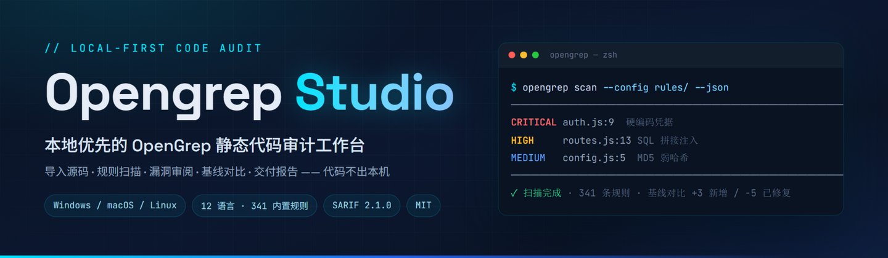
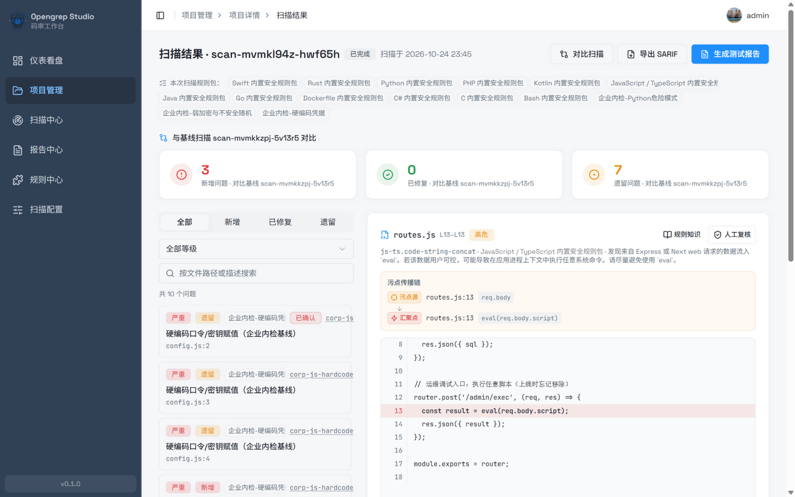
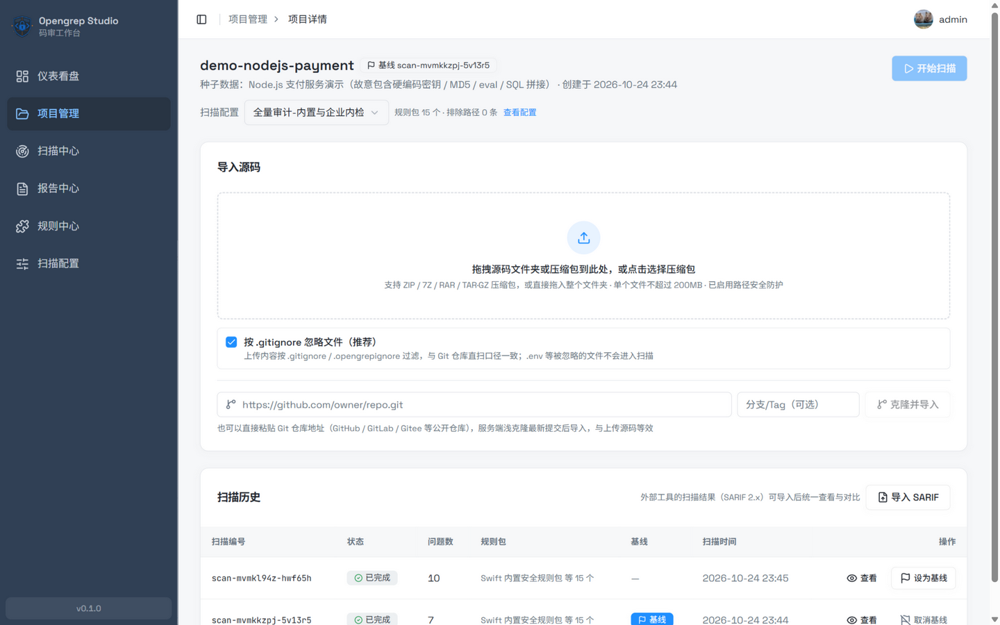
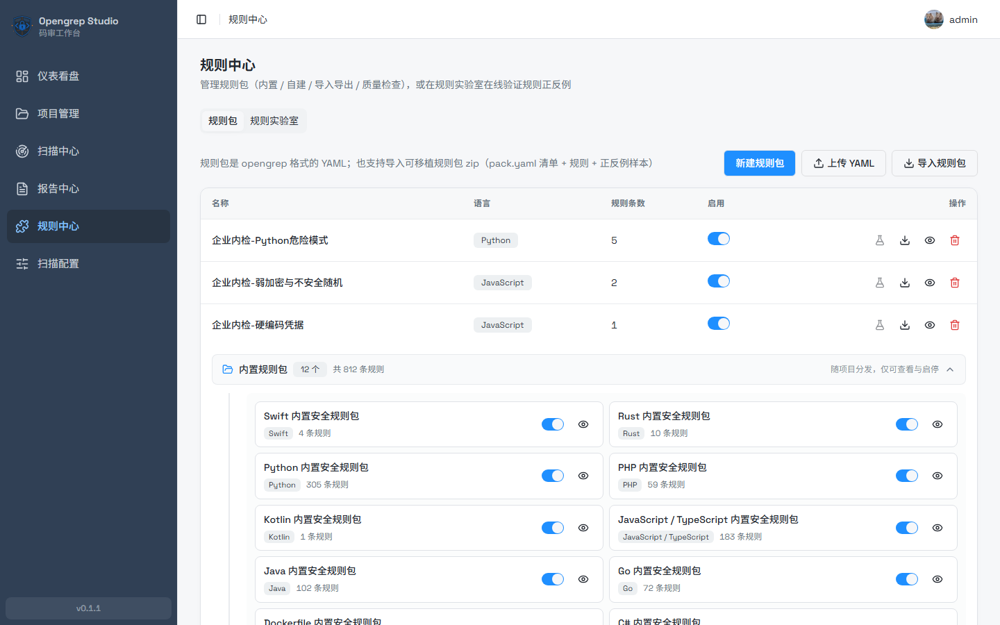
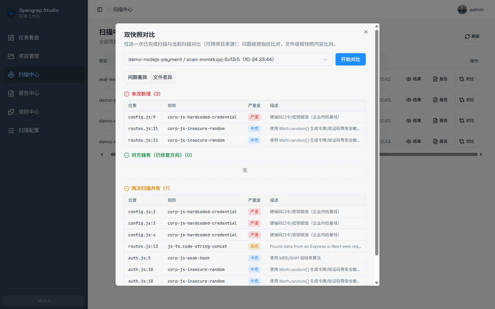
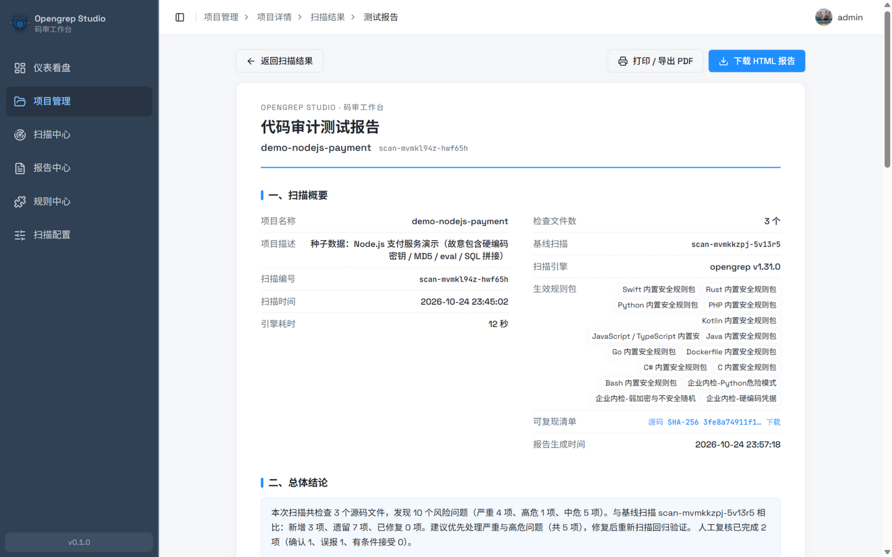
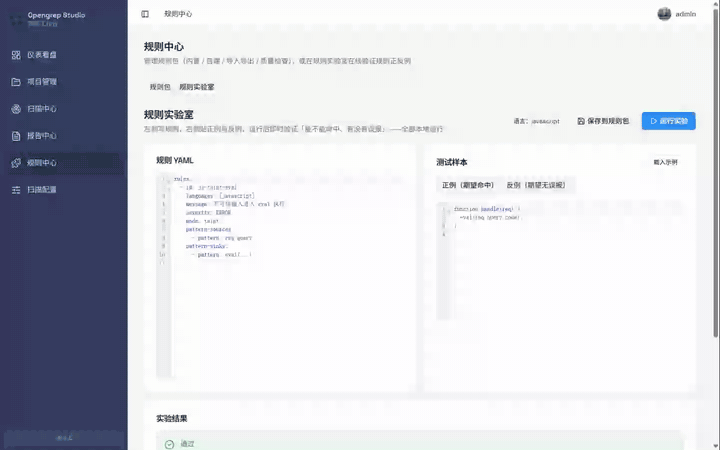
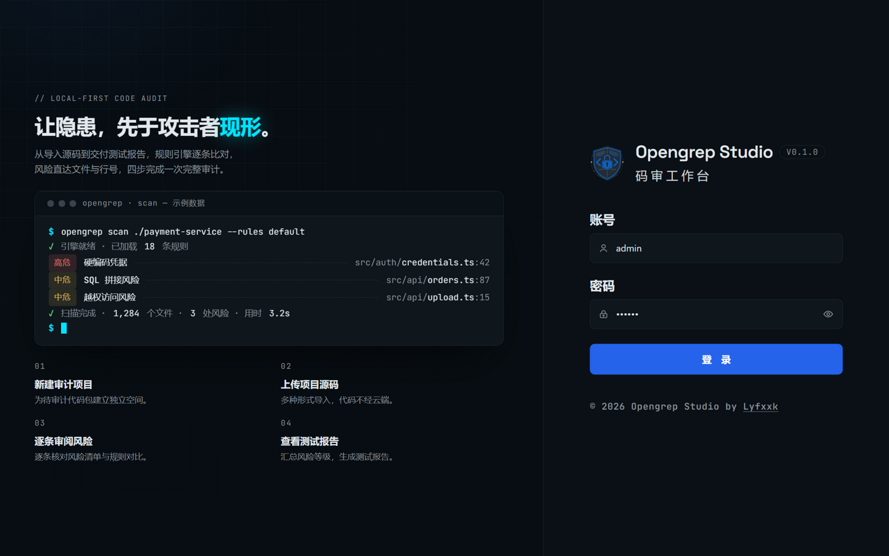
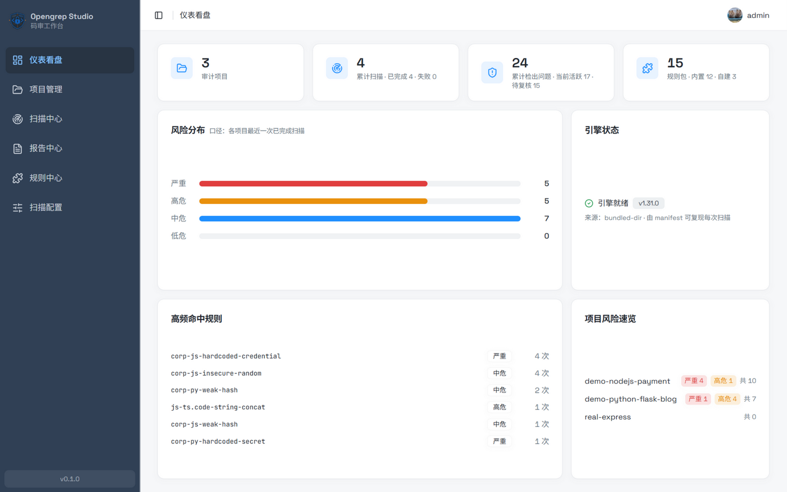
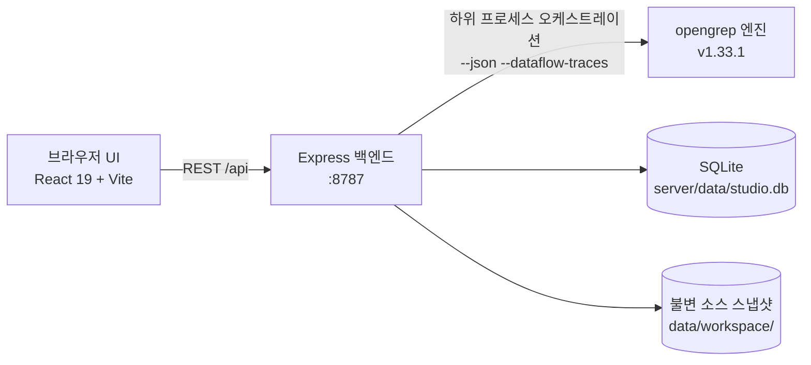

<div align="center">

<h1>Opengrep Studio · 코드 감사 워크벤치</h1>
<p><strong>숨어 있는 위험을 공격자보다 먼저 드러냅니다.</strong></p>
<p>로컬 퍼스트 방식의 <a href="https://github.com/opengrep/opengrep">Opengrep</a> 정적 코드 감사 워크벤치 — 소스 코드 가져오기, 규칙 스캔, 항목별 검토, 베이스라인 비교, 리포트 전달까지, <strong>코드는 사용자 컴퓨터를 떠나지 않습니다</strong>.</p>
<p><a href="../README.md">English</a> · <a href="./README.zh-Hans.md">简体中文</a> · <a href="./README.zh-Hant.md">繁體中文</a> · <a href="./README.ja.md">日本語</a> · <a href="./README.ko.md">한국어</a> · <a href="./README.ru.md">Русский</a> · <a href="./README.fr.md">Français</a></p>
<p>
<a href="https://github.com/Lyfxxk/Opengrep-Studio/actions/workflows/ci.yml"></a>
<a href="#라이선스"></a>
<a href="https://github.com/opengrep/opengrep"></a>
<a href="#요구-사항"></a>

</p>

<p><sub>스캔 결과 검토 화면: 베이스라인 3카드 (신규 / 해결됨 / 잔존) · 테인트 흐름 (소스 → 전파 → 싱크) · 적중 코드 하이라이트 · 수동 검토 판정</sub></p>
</div>

---

## 왜 Opengrep Studio가 필요한가

모든 프로젝트에는 지뢰 몇 개가 묻혀 있을 수 있습니다. 코드에 박혀 있는 데이터베이스 비밀번호, SQL에 그대로 이어 붙이는 사용자 입력, 삭제하는 것을 잊은 디버그 엔드포인트, 아직도 MD5로 저장하고 있는 비밀번호가 그렇습니다. **정적 코드 스캔**이 하는 일은, 코드를 업로드하지도 프로그램을 실행하지도 않은 채 이런 문제를 미리 표시해 주는 것입니다.

#### 먼저 AI: 코드는 읽을 줄 알지만 감사를 통째로 맡기기는 어려움

AI가 코드를 읽는 능력은 실제로 훌륭합니다 — **비즈니스 로직 취약점, 권한 우회 위험, 규칙이 커버하지 않는 새로운 패턴**까지 의도를 이해합니다. 하지만 "AI 채팅"을 "코드 감사"로 쓰면 네 가지 벽에 부딪힙니다:

- **AI는 표본 추출이고, 감사는 전수 조사입니다** — 십만 줄짜리 프로젝트라면 컨텍스트에 전부 담기지 않습니다. 47곳의 SQL 연결 중 눈에 띄는 5곳만 짚어 주고, 나머지 42곳을 봤는지 아닌지조차 알 수 없습니다. 규칙 엔진의 약속은 "**모든 적중을 빠짐없이 보고한다**"는 것이며, 그래야만 결론에 "이 812개 규칙이 커버하는 문제 패턴은 전부 확인했다"고 쓸 수 있습니다;
- **채팅은 일회성이고, 감사에는 장부가 필요합니다** — AI는 지난달 무엇을 읽었는지 기억하지 못합니다. 이번에 새로 유입된 것, 실제로 고쳐진 것, 이미 오탐이라 판정했던 것, 전부 처음부터 다시입니다;
- **"AI가 그렇다고 한다"는 증거가 되지 못합니다** — 고객 전달에는 재현성이 필요합니다: 소스 해시, 엔진 버전, 전체 명령줄이 있어야 누구나 같은 결과를 다시 만들 수 있습니다. 채팅 기록은 재검증도, 책임 소재 규명도 되지 않습니다;
- **커밋 빈도만큼 돌릴 수 없습니다** — 전체 저장소를 한 번 읽는 데는 실제 돈이 드는 토큰이 들고, 프로젝트가 클수록 비용도 누락도 커집니다. 로컬 엔진은 초 단위에서 분 단위에 한계 비용이 0이라야 CI에 붙일 수 있습니다.

#### 이어서 엔진: 스캔은 빠짐없이 가능하지만 명령줄만으로는 감사를 끝내지 못함

그래서 답은 양자택일이 아닙니다: **규칙 엔진이 전수 조사의 안전망을 담당하고, AI가 의미 이해를 담당합니다** — Semgrep 공식도 AI 어시스턴스를 붙이고 여러 SAST 벤더가 LLM을 연결하는, 모두가 가고 있는 길입니다. Opengrep Studio가 채용한 opengrep(Semgrep OSS를 커뮤니티가 이어받은 오픈소스 스캔 엔진)은 전문적으로 스캔하지만, 그 명령줄만으로 감사 한 판을 끝내려면 여전히 네 개의 고비가 있습니다:

- **스캔이 끝나면 JSON 더미일 뿐입니다** — 어떤 문제가 적중했고 얼마나 심각한지 전부 터미널 출력을 눈으로 훑어야 하고, 항목별 검토를 위한 작업대도 없습니다;
- **규칙 메시지는 영어입니다** — "tainted data flowing into eval" 같은 힌트만으로는 문제가 어디에 있고 무엇을 고쳐야 하는지 즉시 이해하지 못하는 사람이 많습니다;
- **고쳤는지 정말 고쳐졌는지 알 방법이 없습니다** — 코드를 고친 뒤 다시 스캔해도, 무엇이 새로 생겼고 무엇이 진짜 사라졌는지 JSON 두 개를 수작업으로 비교해야 합니다;
- **관리자와 고객에게 전달할 수 없습니다** — 위험 리포트를 JSON에서 한 줄씩 수작업으로 조립해야 하고, 형식도 전문적이지 않습니다.

#### Studio가 메워 주는 것: 스캔 이후의 전체 파이프라인

Opengrep Studio는 이 파이프라인 전체를 메웁니다: **코드를 끌어다 놓기 → 스캔 클릭 → 항목별 검토 → 원클릭 리포트**. 스캔 엔진은 로컬에서 실행되며 **코드는 끝까지 사용자의 컴퓨터를 떠나지 않습니다**. 분석 능력의 공은 업스트림에 돌리고, Studio는 결과를 **검토 가능·비교 가능·재검증 가능·전달 가능**한 감사 워크플로로 만드는 데 집중합니다. AI 시대에 이 워크플로는 오히려 더 희소해집니다: AI가 한 번에 산더미 같은 발견을 쏟아내면, 중복 제거, 베이스라인 지정, 스캔 간 추적, 리포트화를 받아 줄 곳이 반드시 필요합니다 — **AI는 발견을 만들고, Studio는 발견을 관리합니다**.

#### 이 도구는 누구에게 적합한가

- **코드 감사를 업으로 하는 보안 서비스 엔지니어 / 독립 컨설턴트** — 고객 코드는 서드파티 클라우드에 올릴 수 없고 온라인 AI에 붙여 넣어서도 안 됩니다. 전달 때는 재현 가능한 한국어 테스트 리포트가 필요합니다;
- **상용 SAST 예산이 없는 소규모 팀** — 상용 코드 감사 플랫폼은 연간 십수만 위안에 이릅니다. 여기는 무료 오픈소스(MIT) + 로컬 배포입니다;
- **애플리케이션 보안을 배우는 중인 사람** — 812개 규칙 메시지 전량 한국어 + CWE 한국어 수정 제안 + 테인트 흐름 시각화, 규칙 실험실에서 작성 즉시 검증;
- **오픈소스 저자** — 프로젝트 공개 전에 하드코딩된 시크릿과 위험 함수 호출을 한 번 스캔하면 끝입니다. 몇 분이면 됩니다.

## 주요 기능

### 🗂 다중 소스 가져오기, 코드는 클라우드를 거치지 않음

폴더 전체를 드래그하거나 ZIP / 7Z / RAR / TAR.GZ 압축 파일을 업로드하거나, Git 저장소 주소를 붙여 넣어 얕은 클론으로 가져올 수 있습니다(기본적으로 `.gitignore` / `.opengrepignore` 기준을 따르며, 끄면 `.env` 속 하드코딩된 시크릿까지 파고들 수 있습니다). 업로드 후 언어 구성이 자동으로 집계됩니다.



### 📚 기본 제공 규칙 812개, 12개 언어, 메시지 전량 번역

[opengrep-rules](https://github.com/opengrep/opengrep-rules)에서 선별했습니다(CWE / OWASP 메타데이터가 붙은 규칙을 우선 수록하고 규칙마다 업스트림 출처 링크를 유지) 108개 CWE를 커버하며, **812개 규칙 메시지 100% 번역 제공** — 영어 원문에 더해 중국어 간체 / 중국어 번체 / 일본어 / 한국어 / 러시아어 / 프랑스어 / 독일어 일곱 가지 번역을 전량 커버해 총 8개 언어입니다. 여기에 108개 유형의 CWE 취약점 설명과 수정 제안(위 일곱 언어, 영어 인터페이스는 간체 중국어로 폴백)이 함께 제공됩니다. 사용자 지정 규칙 팩은 온라인 편집, 가져오기·내보내기, 품질 검사를 지원합니다.

모든 규칙 메시지와 CWE 설명은 정적 "규칙 백과" 사이트 <https://lyfxxk.github.io/Opengrep-Studio/>로도 공개됩니다(`server/scripts/build-rules-site.mjs`가 생성하며, main 푸시 시 자동 배포).



### 🔍 항목별 검토: 코드 위치, 테인트 흐름, 수동 검토

모든 문제에서 파일과 줄 번호로 바로 이동하며 적중 줄은 빨간색으로 하이라이트됩니다. 테인트 유형 문제는 "테인트 소스 → 전파 경로 → 싱크" 흐름을 보여 주고, 수동 검토 판정(확인됨 / 오탐 / 수락됨)은 문제 지문을 기준으로 스캔 간 상속되어 감사 증거 체인을 구성합니다.

### 📊 베이스라인 비교와 이중 스냅샷 비교

베이스라인 스캔을 지정하면 이후 모든 스캔에서 **신규 / 해결됨 / 잔존** 3분류가 자동으로 나옵니다. 스캔 센터에서는 완료된 두 스캔을 골라 이중 스냅샷 비교(프로젝트 간 비교 가능)를 할 수도 있습니다. 문제 수준은 지문으로, 파일 수준은 소스 스냅샷 내용으로 비교합니다.



### 📄 인쇄 가능한 감사 리포트 + 재현 가능 매니페스트

한 번의 클릭으로 종이 질감 레이아웃의 "코드 감사 테스트 리포트"를 생성합니다: 총평, 위험 분포, 고빈도 규칙, 핫스팟 파일, 문제 상세, 검토 통계. PDF로 바로 인쇄하거나 단일 파일 오프라인 HTML로 다운로드할 수 있으며, 리포트와 함께 제공되는 재현 가능 매니페스트(소스 SHA-256, 전체 엔진 명령줄, 규칙 파일 해시)는 영어 / 중국어 간체 / 중국어 번체 / 일본어 / 한국어 / 러시아어 / 프랑스어 / 독일어 8개 언어를 지원합니다.



### 🧪 규칙 실험실: 먼저 검증, 그다음 등록

왼쪽에서 규칙 YAML을 작성하고 오른쪽에 긍정 샘플과 부정 샘플을 붙여 넣은 뒤, 한 번의 클릭으로 실제 엔진을 실행해 "적중하는가, 오탐은 없는가"를 검증합니다. 검증을 마친 규칙은 샘플과 함께 포터블 규칙 팩으로 저장되며, 이후 원클릭 회귀 검사를 돌릴 수 있습니다. 초안은 자동 저장되고 Ctrl+Enter로 실행합니다.



### 🔁 SARIF 양방향 연동

SARIF 2.1.0을 내보내 GitHub Code Scanning / DefectDojo / SonarQube에서 소비하게 할 수 있습니다. 반대로 다른 도구가 만든 SARIF 2.x를 하나의 완전한 스캔으로 가져와 베이스라인과 리포트 체계에 편입할 수도 있습니다.

### 🖥 대시보드

프로젝트 수, 누적 스캔, 탐지된 문제, 규칙 팩을 한눈에 볼 수 있습니다. 프로젝트 간 위험 분포, 고빈도 적중 규칙, 엔진 상태와 프로젝트별 위험 요약을 보여 주며, 스캔 진행 중에는 자동으로 새로 고칩니다.

### ⬆️ 엔진 업데이트 확인 및 원클릭 업그레이드

대시보드의 "엔진 상태" 카드에는 **실제 설치된 버전**과 출처가 표시됩니다. "업데이트 확인"을 클릭하면 업스트림 최신 stable과 비교하고, 새 버전이 발견되면 원클릭으로 업그레이드할 수 있습니다:

- 업그레이드는 원자적 교체입니다: 다운로드 → SHA-256(GitHub release 자산의 digest) 검증 → `opengrep --version` 실행 확인 → 그다음에야 파일 교체. 어느 단계든 실패하면 기존 엔진은 원래 그대로 유지됩니다
- 최신 stable만 대상으로 합니다(pre-release는 다루지 않음). `OPENGREP_BIN`으로 엔진을 직접 관리하는 사용자에게는 버튼이 비활성화됩니다
- 스캔 / 규칙 실험실 실행 중에는 업그레이드가 비활성화되고(Windows는 실행 중인 exe 교체를 허용하지 않음), 업그레이드 후 버전 탐지 캐시는 자동으로 무효화됩니다
- 실제 설치 버전은 `opengrep-tool/installed.json`에 기록되며, `npm run setup:engine`을 다시 실행해도 업그레이드된 엔진이 `engines.json`의 고정 버전으로 다운그레이드되지 않습니다

<details>
<summary><b>화면 미리 보기 (로그인 페이지와 대시보드)</b></summary>
<table>
<tr>
<td align="center"></td>
<td align="center"></td>
</tr>
</table>
</details>

## 빠른 시작

### 요구 사항

- **Node.js ≥ 22.12**(백엔드 내장 `node:sqlite`는 22.5+, 프런트엔드 Vite 8은 22.12+ 필요. 네이티브 의존성도 없음)
- 스캔 엔진은 스크립트가 자동으로 다운로드(약 50 MB, SHA-256 검증)하므로 사전 설치가 필요 없습니다. Git은 저장소 클론 가져오기를 사용할 때만 필요합니다

### 방법 1: 원클릭 실행(권장)

Windows 사용자는 `一键启动（Windows）.bat` 파일을 더블클릭하고, macOS / Linux 사용자는 다음을 실행합니다:

```sh
./一键启动（macOS／Linux）.sh
```

스크립트가 Node 버전 확인, 의존성 설치, 엔진 다운로드를 자동으로 진행하고 브라우저를 엽니다. 프런트엔드 <http://localhost:1022>, 백엔드 API <http://localhost:8787>.

### 방법 2: 수동 3단계

```sh
git clone https://github.com/Lyfxxk/Opengrep-Studio.git
cd Opengrep-Studio
npm run install:all   # 루트 / server / code 세 곳의 의존성 설치
npm run setup:engine  # opengrep v1.33.1 다운로드 및 SHA-256 검증
npm run dev           # 백엔드(8787)와 프런트엔드(1022) 동시 시작
```

### 방법 3: Docker

```sh
npm run docker:build
npm run docker:run    # docker run --rm -p 8787:8787 -v ogstudio-data:/data opengrep-studio 와 동일
```

이미지에는 엔진과 빌드된 프런트엔드가 포함되어 있습니다. <http://localhost:8787>에 접속하면 바로 사용할 수 있으며, 데이터는 `ogstudio-data` 볼륨에 영속화됩니다.

참고: 컨테이너 안의 "원클릭 업그레이드"는 컨테이너의 쓰기 가능 레이어(`/app/opengrep-tool`)에 기록됩니다. 컨테이너 재시작 후에도 유지되지만, 컨테이너를 재생성하면(예: `docker compose down && up`) 사라지고 `engines.json`의 고정 버전으로 되돌아갑니다. 장기적으로 엔진 버전을 바꾸려면 `server/scripts/engines.json`을 수정한 뒤 이미지를 다시 빌드하십시오.

### 처음 사용

기본 계정은 `admin` / `123456`입니다([보안 모델](#보안-모델) 참조). 권장 흐름:

1. **스캔 설정** — 사용할 규칙 팩을 체크(제외 / 포함 경로, 엔진 인자 추가 가능)
2. **새 프로젝트를 만들고** 해당 설정에 연결 — 연결하지 않아도 됩니다: 미연결이거나 연결된 설정이 삭제되었으면 스캔이 자동으로 삭제 불가능한 "기본 스캔 설정"으로 폴백합니다
3. **소스 코드 가져오기**(폴더 드래그 / 압축 파일 / Git 클론)
4. **스캔 실행**, 완료 후 항목별 검토·판정
5. 베이스라인을 설정하고 다시 스캔하여 **신규 / 해결됨 / 잔존**을 확인. 전달이 필요하면 **테스트 리포트 생성**

먼저 결과를 보고 싶으신가요? `npm run seed`로 데모 프로젝트 세 개(베이스라인 비교와 검토 기록 포함)를 한 번에 넣을 수 있습니다.

<details>
<summary><b>문제 해결</b></summary>
<ul>
<li><b>엔진 다운로드가 느리거나 실패할 때</b>: 다운로드는 <code>OPENGREP_DOWNLOAD_BASE 미러 → github.com → api.github.com</code> 순서로 자동 폴백하므로 github.com에 접속할 수 없어도 보통은 개입 없이 설치가 끝납니다. 그래도 실패하면 미러를 수동 설정하거나(<code>set OPENGREP_DOWNLOAD_BASE=&lt;미러 주소&gt;</code>, macOS/Linux는 <code>export</code>), <a href="https://github.com/opengrep/opengrep/releases">opengrep Releases</a>에서 수동으로 다운로드한 뒤 <code>OPENGREP_BIN</code>으로 바이너리 경로를 지정하십시오</li>
<li><b>업데이트 확인 시 GitHub API 요청 한도 초과 안내</b>: 익명 호출 상한은 시간당 60회이며 확인 결과는 30분간 캐시됩니다. 잠시 후 다시 시도하면 되고, 스캔에는 영향이 없습니다</li>
<li><b>macOS에서 엔진을 검증할 수 없다는 안내</b>: <code>xattr -d com.apple.quarantine &lt;엔진 경로&gt;</code></li>
<li><b>포트가 점유된 경우</b>: <code>node server/scripts/kill-port.mjs 8787 1022</code></li>
<li><b>기타 환경 변수</b>: (백엔드) <code>PORT</code> / <code>HOST</code> / <code>DATA_DIR</code> / <code>CUSTOM_RULES_DIR</code> / <code>OPENGREP_BIN</code> / <code>OPENGREP_DOWNLOAD_BASE</code>. 타임아웃 계열 변수의 단위는 초입니다: <code>CLONE_TIMEOUT_SECONDS</code> / <code>SEVEN_Z_TIMEOUT_SECONDS</code> / <code>RULE_LAB_TIMEOUT_SECONDS</code>. 프런트엔드 개발에는 <code>/api</code> 프록시 대상을 지정하는 <code>API_TARGET</code>이 별도로 있습니다. <code>DATA_DIR</code>만 설정하면 사용자 지정 규칙 팩 파일은 여전히 <code>server/rules/custom</code>에 저장되므로, 데이터 디렉터리를 옮길 때는 두 변수를 함께 설정하십시오. 그렇지 않으면 DB와 파일이 갈라집니다(백엔드 시작 시 두 디렉터리를 출력하고 맞지 않는 잔여물을 보고합니다)</li>
</ul>
</details>

## 명령줄 직접 스캔과의 비교

| 능력 | `opengrep scan` 직접 스캔 | Opengrep Studio |
| :--- | :--- | :--- |
| 결과 형태 | 터미널 JSON / 텍스트 | 대화형 검토: 코드 하이라이트, 테인트 흐름, 필터·검색 |
| 현지화 | 영어 메시지 | 인터페이스 8개 언어 (영어 / 간체 / 번체 / 일본어 / 한국어 / 러시아어 / 프랑스어 / 독일어), 812개 규칙 메시지와 CWE 지식 베이스 모두 간체·번체·일본어·한국어·러시아어·프랑스어·독일어 버전 제공 |
| 베이스라인 관리 | 없음 | 신규 / 해결됨 / 잔존 자동 분류, 검토 판정은 스캔 간 상속 |
| 버전 비교 | 없음 | 이중 스냅샷 비교 (문제 수준 + 파일 수준, 프로젝트 간 비교 가능) |
| 리포트 전달 | 수작업 조립 | 원클릭 종이 질감 리포트 (인쇄 / 오프라인 HTML) + 재현 가능 매니페스트 |
| 규칙 디버깅 | 고친 뒤 재실행 | 규칙 실험실: 긍정·부정 샘플 즉시 검증, 샘플 회귀 |
| 도구 체인 연동 | 직접 처리 | SARIF 2.1.0 가져오기 / 내보내기 |

## 작동 방식



- 단일 프로세스 배포: 백엔드가 빌드된 프런트엔드도 함께 서빙합니다(프로덕션 모드에서는 8787 포트로 접속하면 됩니다). 기본적으로 `127.0.0.1`에만 바인딩됩니다
- 모든 스캔은 **불변 소스 스냅샷** 기반으로 실행되며, 스냅샷 해시와 전체 명령줄이 보관되어 리포트를 재현할 수 있습니다
- SQLite가 프로젝트 / 스캔 / 문제 / 검토 / 설정을 저장합니다. 외부 서비스 의존성이 없고 모든 데이터는 `server/data/`에 있습니다
- 스캔은 최대 2개까지 동시 실행(초과분은 자동으로 대기열에 들어감)되며, 규칙 실험실과 스캔은 상호 배타입니다

## 보안 모델

솔직하게 밝힙니다. 반드시 확인하십시오:

- **로컬 단일 머신 도구**: 기본적으로 `127.0.0.1`에만 바인딩되며, 코드와 결과는 업로드되지 않고 텔레메트리도 없습니다
- **로그인은 오작동 방지용 프런트엔드 게이트일 뿐입니다**(고정 계정 `admin` / `123456`) **백엔드 API에는 인증이 없습니다** — 서비스를 공인망에 노출하지 마십시오. 사내망 사용이 꼭 필요하다면 `HOST`를 직접 설정하고 접근 제어를 추가하십시오
- Docker 모드의 기본값은 `HOST=0.0.0.0`입니다. 내부망 / 보호 장치가 있는 환경에서만 사용하십시오
- 업로드 압축 해제에는 Zip-Slip / 심볼릭 링크 / 크기·파일 수 방어가 있고, Git 클론은 https 프로토콜만 허용하며 자격 증명 대화형 입력은 비활성화됩니다

## 자주 묻는 질문

<details>
<summary><b>어떤 언어와 플랫폼을 지원합니까?</b></summary>
<p>기본 제공 규칙은 Python, JS/TS, Java, Go, C, C#, PHP, Bash, Kotlin, Swift, Rust, Dockerfile 12개 언어를 커버합니다. 인터페이스와 리포트는 영어 / 중국어 간체 / 중국어 번체 / 일본어 / 한국어 / 러시아어 / 프랑스어 / 독일어 8개 언어를 지원합니다. Studio 자체는 Windows(x64), macOS(x64 / arm64), Linux(x64 / arm64) 및 Docker에서 실행됩니다.</p>
</details>

<details>
<summary><b>Semgrep와는 어떤 관계입니까?</b></summary>
<p>Opengrep은 커뮤니티가 Semgrep OSS에서 이어받은 오픈소스 엔진(LGPL-2.1)입니다. Studio는 공식 바이너리를 오케스트레이션하고 규칙은 opengrep-rules에서 선별했습니다. Studio는 Semgrep Inc.와 무관합니다.</p>
</details>

<details>
<summary><b>제 코드가 업로드됩니까?</b></summary>
<p>아니요. 스캔, 저장, 리포트 생성은 전부 로컬에서 이루어지며, 서비스는 기본적으로 로컬 루프백 주소에만 바인딩됩니다.</p>
</details>

<details>
<summary><b>데이터는 어디에 저장됩니까? 프로젝트를 삭제하면 잔여물이 남습니까?</b></summary>
<p>모두 <code>server/data/</code>(SQLite + 소스 스냅샷)와 사용자 지정 규칙 팩 디렉터리에 있습니다. 프로젝트를 삭제하면 해당 스캔, 문제, 검토 기록과 스냅샷 디렉터리가 함께 삭제됩니다.</p>
</details>

<details>
<summary><b>GitHub Code Scanning에 연결하려면 어떻게 합니까?</b></summary>
<p>스캔 결과 페이지에서 "SARIF 내보내기"를 클릭하고, 산출물을 GitHub 문서에 따라 code-scanning에 업로드하면 됩니다. 지문은 안정적인 중복 제거 형식을 사용하여 증분 보고를 지원합니다.</p>
</details>

<details>
<summary><b>다른 도구의 스캔 결과를 가져올 수 있습니까?</b></summary>
<p>SARIF 2.x를 지원합니다. 프로젝트 상세 페이지에서 "SARIF 가져오기"를 클릭하면 결과가 하나의 완전한 스캔이 되며, 베이스라인 설정과 리포트 생성이 가능합니다.</p>
</details>

## 로드맵

- [x] 기본 제공 규칙 중국어 현지화(812개 전량 커버)와 CWE 중국어 지식 베이스
- [x] 베이스라인 비교 / 이중 스냅샷 비교 / 검토 증거 체인
- [x] SARIF 2.1.0 가져오기·내보내기와 재현 가능 매니페스트
- [x] 규칙 실험실과 포터블 규칙 팩(샘플 회귀 포함)
- [x] Docker 이미지와 3개 플랫폼 원클릭 실행
- [x] 엔진 업데이트 확인과 원클릭 업그레이드(다운로드 3채널 폴백)
- [x] 인터페이스 다국어 i18n(영어 / 중국어 간체 / 중국어 번체 / 일본어 / 한국어 / 러시아어 / 프랑스어 / 독일어)
- [x] 규칙 메시지와 CWE 지식 베이스 일본어·한국어 번역(812개 규칙 메시지 + 108개 CWE 전량 커버)
- [x] 스캔 대기열과 병렬 스케줄링
- [ ] 규칙 팩 온라인 URL 가져오기와 커뮤니티 규칙 팩 인덱스
- [ ] GitHub Action 워크플로 템플릿(CI에서 스캔 실행 후 SARIF 되돌려 보내기)
- [ ] 리포트 템플릿 사용자 지정(브랜딩 / 머리글·바닥글)

## 감사의 말

- [opengrep/opengrep](https://github.com/opengrep/opengrep) — 스캔 엔진(LGPL-2.1). 본 저장소는 바이너리를 포함하지 않으며, 스크립트가 다운로드하고 검증합니다
- [opengrep/opengrep-rules](https://github.com/opengrep/opengrep-rules) — 기본 제공 규칙의 출처. 업스트림의 모든 규칙 작성자에게 감사드립니다
- [shadcn/ui](https://ui.shadcn.com/) / [Radix UI](https://www.radix-ui.com/) / [Tailwind CSS](https://tailwindcss.com/) / [CodeMirror](https://codemirror.net/) / [Vite](https://vite.dev/) / [React](https://react.dev/) — 인터페이스를 이루는 모든 좋은 것들

## 라이선스

본 프로젝트의 코드는 [MIT](../LICENSE)로 배포됩니다.

주의가 필요한 두 가지 서드파티 라이선스:

- **스캔 엔진**: opengrep은 LGPL-2.1로 배포되며, 본 저장소는 엔진 바이너리를 포함하지 않습니다. `npm run setup:engine`이 공식 Releases에서 다운로드하고 SHA-256으로 검증합니다
- **기본 제공 규칙**: opengrep-rules에서 선별했습니다(LGPL 2.1 + Commons Clause). 출처 표기를 유지한다면 자유롭게 사용·재배포할 수 있지만, 규칙 자체를 유료 제품으로 판매할 수는 없습니다
