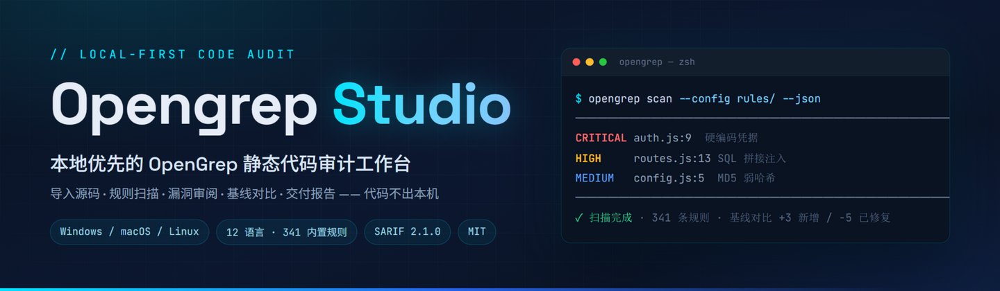
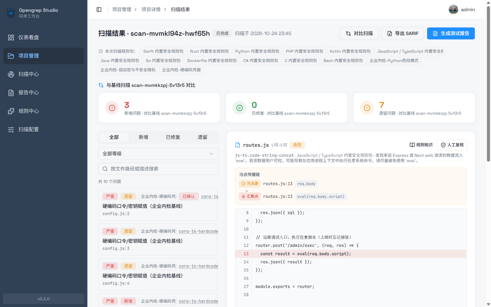
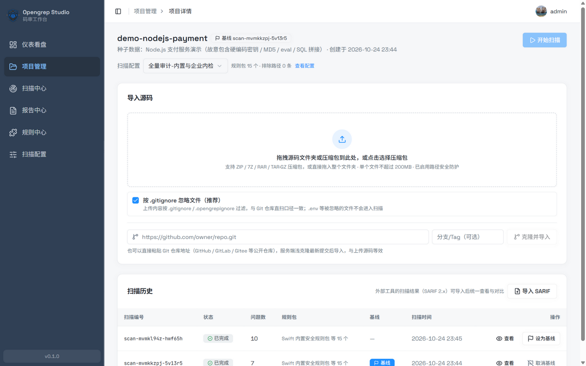
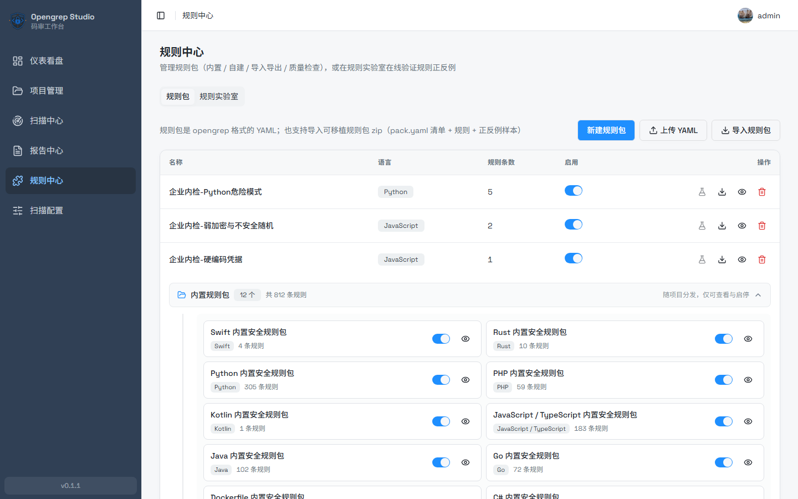
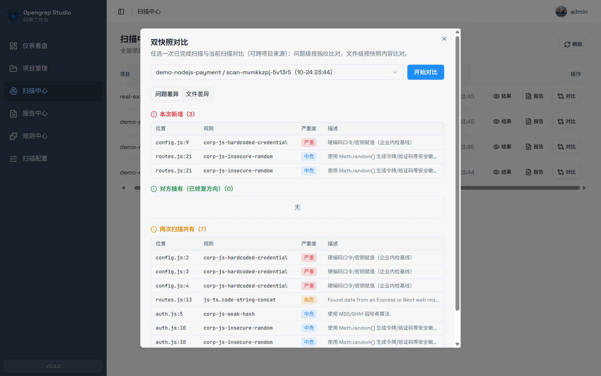
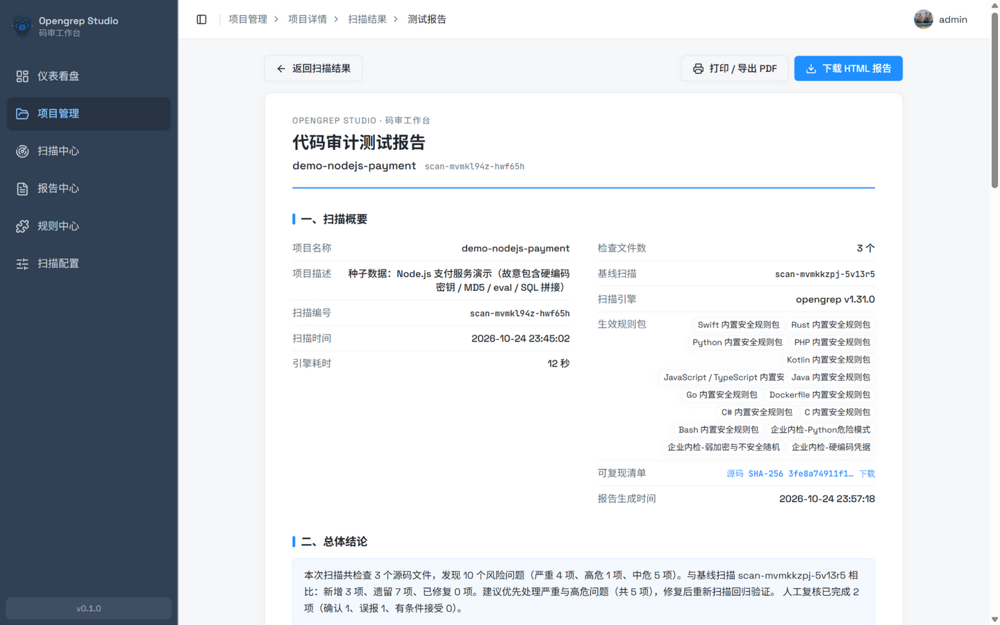
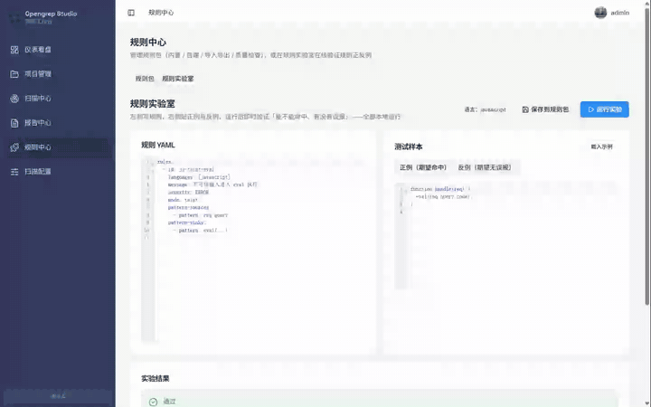
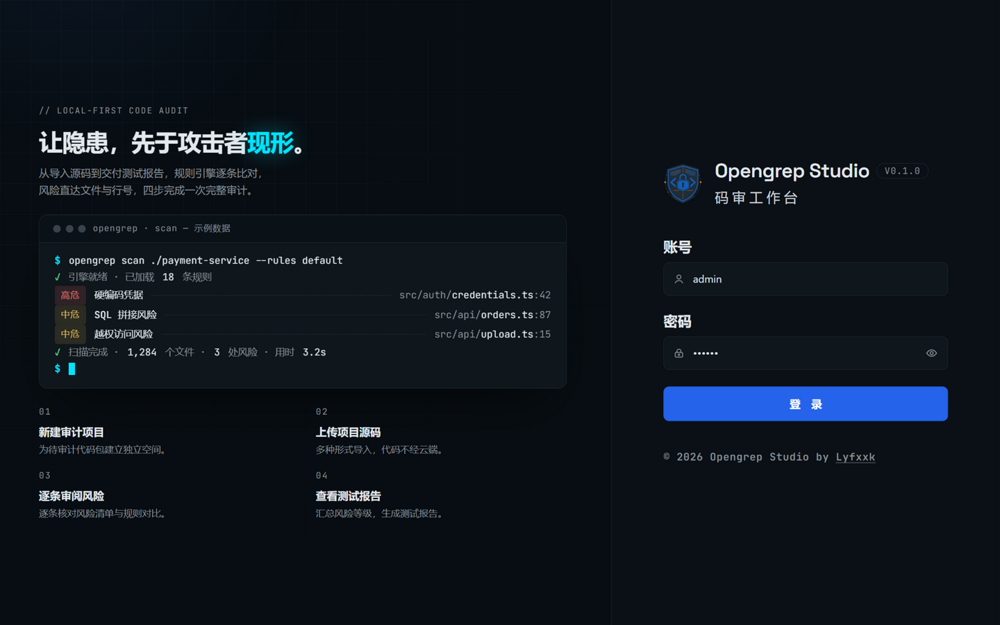
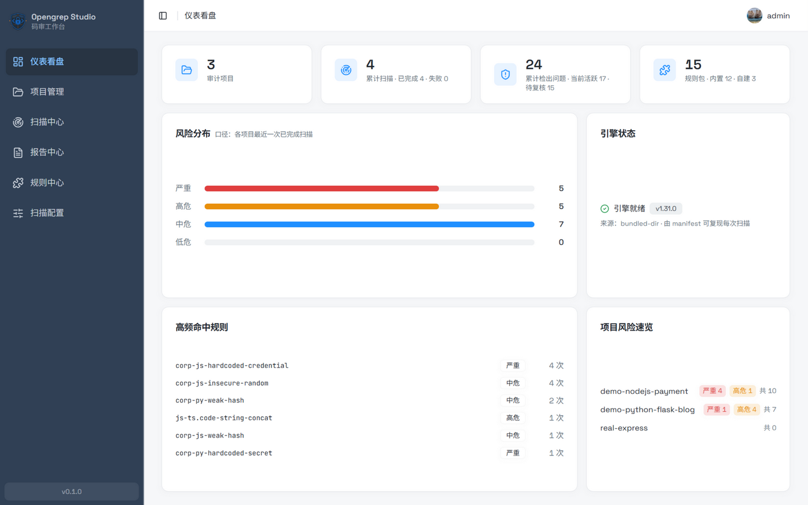
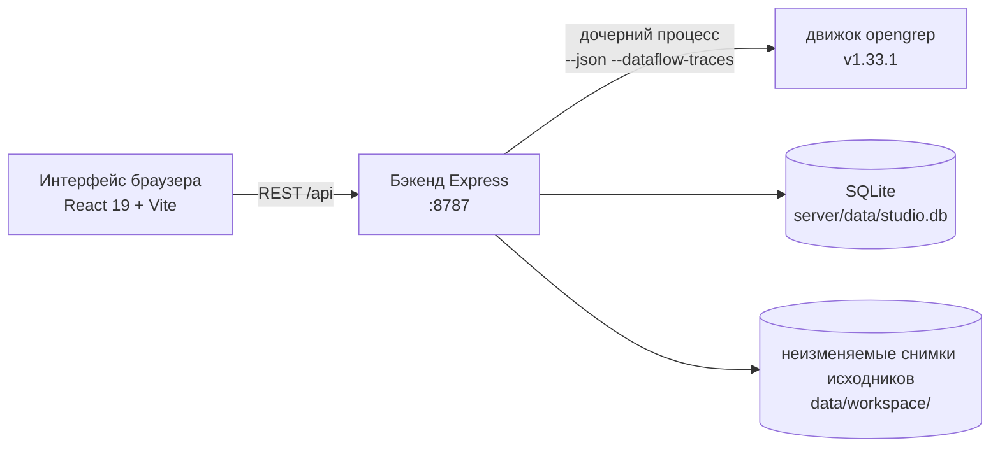

<div align="center">

<h1>Opengrep Studio · рабочее место аудита кода</h1>
<p><strong>Находите уязвимости раньше злоумышленников.</strong></p>
<p>Локальное рабочее место статического аудита кода на базе <a href="https://github.com/opengrep/opengrep">Opengrep</a> — импорт исходников, сканирование по правилам, разбор находок, сравнение с базой, подготовка отчётов — <strong>код не покидает вашу машину</strong>.</p>
<p><a href="../README.md">English</a> · <a href="./README.zh-Hans.md">简体中文</a> · <a href="./README.zh-Hant.md">繁體中文</a> · <a href="./README.ja.md">日本語</a> · <a href="./README.ko.md">한국어</a> · <a href="./README.ru.md">Русский</a> · <a href="./README.fr.md">Français</a></p>
<p>
<a href="https://github.com/Lyfxxk/Opengrep-Studio/actions/workflows/ci.yml"></a>
<a href="#лицензия"></a>
<a href="#требования"></a>

</p>

<p><sub>Разбор находок: карточки базы (новые / исправленные / оставшиеся) · поток данных (источник → распространение → сток) · подсветка совпадений · вердикты проверки</sub></p>
</div>

---

## Почему Opengrep Studio

В любой кодовой базе спрятано несколько мин: пароли от базы данных, зашитые прямо в исходники, пользовательский ввод, склеенный напрямую в SQL, отладочные эндпоинты, оставшиеся после релиза, пароли, всё ещё хэшированные через MD5. **Статический анализ кода** находит эти проблемы заранее — не запуская программу и не выгружая код куда-либо.

#### Сначала про ИИ: он хорошо читает код, но не может провести аудит

Справедливо будет сказать, что ИИ действительно силён в чтении кода — **логические ошибки, риски авторизации, новые шаблоны, которые не покрыты правилами**: он понимает замысел. Но использовать чат с ИИ как аудит кода упирается в четыре стены:

- **ИИ выбирает образцы, а аудит должен быть исчерпывающим** — проект на 100 тысяч строк не влезет ни в одно контекстное окно; из 47 мест склейки SQL он может пометить 5 «очевидных», и вы никогда не узнаете, что остальные 42 пропущены. Движок правил обещает, что **каждое совпадение будет доложено** — только тогда вы решитесь написать в заключении «все проблемные шаблоны, покрытые этими 812 правилами, проверены»;
- **Чат — разовое действие, аудиту нужен журнал** — ИИ не помнит, что читал в прошлом месяце: какие находки появились заново, какие действительно исправлены, какие вы уже признали ложным срабатыванием — всё начинается с нуля;
- **«Так сказал ИИ» не считается доказательством** — сдача клиенту требует воспроизводимости: хэши исходников, версия движка, полная командная строка, чтобы любой мог повторить и получить тот же результат; лог чата нельзя ни перепроверить, ни атрибуировать;
- **Он не поспевает за частотой коммитов** — полное прочтение стоит реальных токенов, и чем больше проект, тем дороже и «дырявее»; локальный движок тратит секунды-минуты при нулевой предельной стоимости — именно это и подключается к CI.

#### Теперь про движок: исчерпывающее сканирование, но одного CLI недостаточно для аудита

Так что это не «или-или»: **движки правил дают исчерпывающую страховку, ИИ добавляет смысловое понимание** — сам Semgrep уже поставляет ИИ-помощника, и каждый SAST-вендор встраивает LLM; по этой дороге идут все. Движок за Opengrep Studio — opengrep (продолжение Semgrep OSS силами сообщества), и он сканирует профессионально — но вести полноценный аудит прямо из его CLI — снова четыре стены:

- **На выходе просто JSON** — что совпало и насколько серьёзно, всё читается глазами из терминала, без рабочего пространства для разбора;
- **Сообщения правил только на английском** — подсказка «заражённые данные утекают в eval» не сразу говорит каждому, где проблема и что менять;
- **Непонятно, сработало ли исправление** — пересканируешь после правки, и разобраться, какие находки новые, а какие действительно исчезли, означает вручную сравнивать два JSON-файла;
- **Нечего передать руководству или клиенту** — отчёт о рисках приходится собирать из JSON построчно, и он никогда не выглядит профессионально.

#### Studio достраивает весь конвейер после сканирования

Opengrep Studio замыкает этот конвейер: **загрузить код → запустить сканирование → разобрать находки → экспортировать отчёт**. Движок работает локально, и **код не покидает вашу машину**. Аналитическая мощь принадлежит движку — Studio превращает вывод сканирования в **обозримый, сравнимый, проверяемый, сдаваемый** рабочий процесс аудита. В эпоху ИИ такой процесс дефицитнее, а не устарел: ИИ сваливает на вас кучу находок за один раз, и кто-то должен дедуплицировать их, выстроить базу, отслеживать между сканированиями и превратить в отчёт — **ИИ производит находки, Studio ими управляет**.

#### Для кого это

- **Консультанты по безопасности / appsec-инженеры, проводящие аудит кода** — код клиента нельзя отправлять в сторонние облака (и не стоит вставлять в онлайн-чат с ИИ); сдача означает воспроизводимый отчёт об аудите;
- **Малые команды без бюджета на коммерческий SAST** — коммерческие платформы аудита стоят ощутимых денег в год; это бесплатно, открытый исходный код (MIT) и полностью локально;
- **Все, кто изучает безопасность приложений** — 812 правил с сообщениями на восьми языках + база знаний CWE с советами по исправлению + визуализация потока данных и лаборатория правил, проверяющая правила на месте;
- **Авторы опенсорса** — проверьте на зашитые секреты и опасные вызовы перед публикацией; это занимает минуты.

## Возможности

### 🗂 Импорт из разных источников, код не касается облака

Перетащите целую папку, загрузите архивы ZIP / 7Z / RAR / TAR.GZ или вставьте URL Git-репозитория для импорта поверхностным клоном (по умолчанию учитываются `.gitignore` / `.opengrepignore`; отключите это, чтобы вытащить зашитые секреты из `.env`). Состав языков анализируется автоматически после загрузки.



### 📚 812 встроенных правил, 12 языков, полностью переведённые сообщения

Отобраны из [opengrep-rules](https://github.com/opengrep/opengrep-rules) (сначала правила с метаданными CWE / OWASP, ссылки на источник сохранены у каждого правила), покрывают 108 CWE; **все 812 сообщений правил доступны на английском, упрощённом и традиционном китайском, японском, корейском, русском, французском и немецком**, плюс база знаний CWE (108 записей с описанием уязвимости и советами по исправлению) на тех же восьми языках (английский интерфейс откатывается на упрощённый китайский). Пользовательские пакеты правил поддерживают онлайн-редактирование, импорт/экспорт и проверку качества.

Все сообщения правил и заметки CWE также опубликованы как статический сайт-энциклопедия правил: <https://lyfxxk.github.io/Opengrep-Studio/> — генерируется `server/scripts/build-rules-site.mjs` и автоматически публикуется при каждом push в main.



### 🔍 Разбор находок по одной: места в коде, цепочки потока, вердикты

Каждая находка ведёт прямо к файлу и строке с подсветкой совпадения красным; находки потока данных показывают полную цепочку источник → распространение → сток; вердикты проверки (подтверждено / ложное срабатывание / принято) сохраняются между сканированиями по отпечатку находки, выстраивая цепочку доказательств аудита.

### 📊 Сравнение с базой и двухснимочное сравнение

Задайте базовое сканирование, и каждое последующее автоматически классифицирует находки как **новые / исправленные / оставшиеся**; центр сканирования также позволяет выбрать любые два завершённых сканирования для двухснимочного сравнения (даже между проектами): уровень находок сопоставляется по отпечатку, уровень файлов — по содержимому снимка.



### 📄 Печатаемый отчёт об аудите + манифест воспроизводимости

Одним кликом создаётся отчёт «Кодовый аудит» в бумажном стиле: общий вердикт, распределение рисков, самые частые правила, «горячие» файлы, детали находок, статистика разбора — печатайте сразу в PDF или скачивайте автономный HTML одним файлом; каждый отчёт сопровождается манифестом воспроизводимости (SHA-256 исходников, полная командная строка движка, хэши файлов правил). Отчёт и манифест отображаются на языке вашего интерфейса — английском, упрощённом или традиционном китайском, японском, корейском, русском, французском или немецком.



### 🧪 Лаборатория правил: сначала проверь, потом коммить

YAML правила слева, позитивные и негативные образцы справа, один клик запускает реальный движок, чтобы проверить «срабатывает ли, даёт ли ложные срабатывания»; проверенное правило сохраняется вместе с образцами как переносимый пакет правил, готовый к регрессии одним кликом. Черновики автосохраняются; Ctrl+Enter запускает проверку.



### 🔁 Взаимодействие с SARIF в обе стороны

Экспортируйте SARIF 2.1.0 для GitHub Code Scanning / DefectDojo / SonarQube; или импортируйте SARIF 2.x, созданный другими инструментами, как полноценное сканирование, включённое в вашу систему базы и отчётов.

### 🖥 Панель управления

Проекты, накопленные сканирования, находки и пакеты правил с одного взгляда; распределение рисков между проектами, самые частые правила, статус движка и обзор рисков по каждому проекту — автообновляется во время сканирования.

### ⬆️ Проверка обновлений движка и обновление одним кликом

Карточка «Статус движка» на панели показывает **фактически установленную** версию и её источник; нажмите «Проверить обновления», чтобы сравнить с последней стабильной версией и обновить одним кликом:

- Обновление — атомарная замена: скачать → проверить SHA-256 (по digest из GitHub release) → выполнить `opengrep --version` для подтверждения → только затем заменить файлы; при сбое любого шага старый движок остаётся нетронутым
- Предлагается только последняя стабильная версия (предварительные релизы игнорируются); кнопка отключена для тех, кто управляет движком сам через `OPENGREP_BIN`
- Обновление отключено, пока идёт сканирование или работает лаборатория правил (Windows не может заменить запущенный exe); кэш проверки версии автоматически сбрасывается после успешного обновления
- Установленная версия записывается в `opengrep-tool/installed.json`; повторный запуск `npm run setup:engine` никогда не откатит обновлённый движок к версии, зафиксированной в `engines.json`

<details>
<summary><b>Интерфейс с одного взгляда (вход и панель)</b></summary>
<table>
<tr>
<td align="center"></td>
<td align="center"></td>
</tr>
</table>
</details>

## Быстрый старт

### Требования

- **Node.js ≥ 22.12** — встроенному `node:sqlite` нужен 22.5+, а Vite 8 на фронтенде нужен 22.12+; нативных зависимостей по-прежнему нет
- Движок сканирования скачивается и проверяется по SHA-256 автоматически (~50 МБ), ничего не нужно устанавливать заранее; Git нужен только для импорта клоном репозитория

### Вариант 1: запуск одним кликом (рекомендуется)

В Windows дважды щёлкните `一键启动（Windows）.bat`; на macOS / Linux выполните:

```sh
./一键启动（macOS／Linux）.sh
```

Скрипт проверит версию Node, установит зависимости, скачает движок и откроет браузер. Фронтенд на <http://localhost:1022>, API бэкенда на <http://localhost:8787>.

### Вариант 2: три ручных шага

```sh
git clone https://github.com/Lyfxxk/Opengrep-Studio.git
cd Opengrep-Studio
npm run install:all   # зависимости root + server + code одним заходом
npm run setup:engine  # скачать opengrep v1.33.1 и проверить SHA-256
npm run dev           # бэкенд (:8787) + фронтенд (:1022) вместе
```

### Вариант 3: Docker

```sh
npm run docker:build
npm run docker:run    # = docker run --rm -p 8787:8787 -v ogstudio-data:/data opengrep-studio
```

Образ поставляется с движком и собранным фронтендом — откройте <http://localhost:8787>, и вы на месте; данные сохраняются в томе `ogstudio-data`.

Одно замечание про обновления: обновление одним кликом пишет в слой контейнера (`/app/opengrep-tool`), поэтому переживает перезапуск контейнера, но теряется при пересоздании (`docker compose down && up`), откатываясь к версии из `engines.json`. Для долгосрочного обновления движка измените `server/scripts/engines.json` и пересоберите образ.

### Первый запуск

Вход по умолчанию: `admin` / `123456` (см. [Модель безопасности](#модель-безопасности)). Рекомендуемый порядок:

1. **Конфигурация сканирования** — выберите, какие пакеты правил включить (опционально с путями исключения/включения и аргументами движка)
2. **Создайте проект** и привяжите конфигурацию — или пропустите привязку: защищённая резервная конфигурация (все включённые встроенные пакеты, её нельзя удалить) привяжется автоматически при первом сканировании
3. **Импортируйте исходники** (перетащить папку / загрузить архив / Git-клон)
4. **Запустите сканирование**, затем разбирайте находки по одной
5. Задайте базу, пересканируйте и наблюдайте **новые / исправленные / оставшиеся**; когда пора сдавать работу — **создайте отчёт**

Хотите посмотреть до того, как трогать свой код? `npm run seed` за один заход создаёт три демо-проекта (с различиями базы и записями проверок).

<details>
<summary><b>Устранение неполадок</b></summary>
<ul>
<li><b>Движок скачивается медленно / заблокирован</b>: загрузки откатываются автоматически (<code>OPENGREP_DOWNLOAD_BASE</code> зеркало → github.com → api.github.com), так что заблокированный github.com обычно не требует ручных шагов; если все каналы не сработали, задайте зеркало (<code>set OPENGREP_DOWNLOAD_BASE=&lt;URL-зеркала&gt;</code>, на macOS/Linux — <code>export</code>) или скачайте из <a href="https://github.com/opengrep/opengrep/releases">opengrep Releases</a> и укажите на него <code>OPENGREP_BIN</code></li>
<li><b>«Проверить обновления» сообщает о лимите GitHub API</b>: анонимные вызовы ограничены 60/час, результаты кэшируются на 30 минут; повторите позже — сканирование не затронуто</li>
<li><b>macOS Gatekeeper</b>: <code>xattr -d com.apple.quarantine &lt;путь-к-движку&gt;</code></li>
<li><b>Порты заняты</b>: <code>node server/scripts/kill-port.mjs 8787 1022</code></li>
<li><b>Другие переменные окружения</b>: <code>PORT</code> / <code>HOST</code> / <code>DATA_DIR</code> / <code>CUSTOM_RULES_DIR</code> / <code>OPENGREP_BIN</code> / <code>OPENGREP_DOWNLOAD_BASE</code> (сервер); переопределения таймаутов задаются за секунды: <code>CLONE_TIMEOUT_SECONDS</code> / <code>SEVEN_Z_TIMEOUT_SECONDS</code> / <code>RULE_LAB_TIMEOUT_SECONDS</code>. Дев-сервер учитывает <code>API_TARGET</code> для прокси <code>/api</code>. Файлы пользовательских пакетов правил продолжают попадать в <code>server/rules/custom</code>, когда задан только <code>DATA_DIR</code> — переносите обе настройки вместе, иначе база и файлы правил разъедутся (бэкенд печатает обе директории при старте и предупреждает о любом расхождении)</li>
</ul>
</details>

## Голый CLI против Opengrep Studio

| Возможность | Напрямую `opengrep scan` | Opengrep Studio |
| :--- | :--- | :--- |
| Форма результата | терминальный JSON / текст | интерактивный разбор: подсветка кода, цепочки потока, фильтры и поиск |
| Локализация | сообщения только на английском | интерфейс на восьми языках (английский / упрощённый / традиционный китайский / японский / корейский / русский / французский / немецкий); все 812 сообщений правил и база знаний CWE на тех же восьми языках |
| Управление базой | нет | автоматическая классификация новых / исправленных / оставшихся; вердикты сохраняются между сканированиями |
| Сравнение версий | нет | двухснимочное сравнение (уровень находок + уровень файлов, между проектами) |
| Сдача отчёта | собирается вручную | отчёт в бумажном стиле одним кликом (печать / автономный HTML) + манифест воспроизводимости |
| Отладка правил | правь, перезапускай, надейся | лаборатория правил: мгновенная позитивная/негативная проверка, регрессия по образцам |
| Взаимодействие с инструментами | своими силами | импорт/экспорт SARIF 2.1.0 |

## Как это работает



- Однопроцессное развёртывание: бэкенд также раздаёт собранный фронтенд (в продакшене достаточно порта 8787); по умолчанию привязывается только к `127.0.0.1`
- Каждое сканирование идёт по **неизменяемому снимку исходников**; хэш снимка и полная командная строка архивируются, поэтому каждый отчёт воспроизводим
- SQLite хранит проекты / сканирования / находки / проверки / конфигурации — никаких внешних сервисов; все данные лежат в `server/data/`
- До 2 сканирований идут параллельно (лишние автоматически ставятся в очередь) для использования локальных ресурсов; лаборатория правил и сканирования взаимоисключающие

## Тестирование

```sh
npm test             # модульные тесты бэкенда
npm run test-packs   # структура пакетов правил + вложенные образцы
npm run e2e          # HTTP-сквозное против работающего бэкенда (реальный движок)
npm run e2e:ui       # браузерное сквозное (Playwright; собирает фронтенд, поднимает изолированный бэкенд на :8799)
npm run e2e:ui:fast  # браузерное сквозное без зависящего от движка случая сканирования
```

Браузерные тесты лежат в `code/e2e/` и пишут в `code/e2e/.tmp/`, поэтому никогда не трогают ваш `server/data/`. CI прогоняет оба набора на реальном движке.

## Модель безопасности

Честное раскрытие — пожалуйста, прочитайте:

- **Локальный одностанционный инструмент**: по умолчанию привязывается только к `127.0.0.1`; код и результаты не покидают машину, телеметрии нет
- **Вход — это защита только от случайных кликов на фронтенде** (фиксированный аккаунт `admin` / `123456`); **API бэкенда не имеет аутентификации** — не выставляйте сервис в открытый интернет; если он действительно нужен в локальной сети, задайте `HOST` сами и добавьте контроль доступа
- Режим Docker по умолчанию ставит `HOST=0.0.0.0`; используйте его только внутри интранета / за защитой
- Загрузка и распаковка защищены от Zip-Slip / симлинков / бомб размера и числа файлов; Git-клон только по https со отключённым вводом учётных данных

## FAQ

<details>
<summary><b>Какие языки и платформы поддерживаются?</b></summary>
<p>Встроенные правила покрывают Python, JS/TS, Java, Go, C, C#, PHP, Bash, Kotlin, Swift, Rust и Dockerfile — 12 языков; сама Studio работает на Windows (x64) / macOS (x64 / arm64) / Linux (x64 / arm64) и в Docker.</p>
</details>

<details>
<summary><b>Какова связь с Semgrep?</b></summary>
<p>Opengrep — открытый движок, продолженный сообществом от Semgrep OSS (LGPL-2.1); Studio управляет его официальным бинарником, а правила отобраны из opengrep-rules. Studio не связана с Semgrep Inc.</p>
</details>

<details>
<summary><b>Будет ли мой код загружен куда-либо?</b></summary>
<p>Нет. Сканирование, хранение и создание отчётов происходят локально; сервис по умолчанию привязывается только к локальному адресу обратной связи.</p>
</details>

<details>
<summary><b>Где хранятся данные? Удаление проекта оставляет следы?</b></summary>
<p>Всё лежит в <code>server/data/</code> (SQLite + снимки исходников) и в каталоге пользовательских пакетов правил. Удаление проекта каскадно затрагивает его сканирования, находки, записи проверок и каталог снимков.</p>
</details>

<details>
<summary><b>Как подключить это к GitHub Code Scanning?</b></summary>
<p>Нажмите «Экспортировать SARIF» на странице результатов и загрузите артефакт в code-scanning по документации GitHub; отпечатки используют стабильный формат дедупликации, поддерживающий добавочные отчёты.</p>
</details>

<details>
<summary><b>Можно ли импортировать результаты из других инструментов?</b></summary>
<p>Поддерживается SARIF 2.x: нажмите «Импортировать SARIF» на странице проекта, и результаты станут полноценным сканированием — задайте его как базу, создавайте отчёты.</p>
</details>

## План развития

- [x] Локализация всех 812 сообщений правил + база знаний CWE на восьми языках (английский / упрощённый / традиционный китайский / японский / корейский / русский / французский / немецкий)
- [x] Сравнение с базой и двухснимочное сравнение, цепочка доказательств проверки
- [x] Импорт/экспорт SARIF 2.1.0, манифест воспроизводимости
- [x] Лаборатория правил и переносимые пакеты правил с регрессией по образцам
- [x] Образ Docker и запуск одним кликом на 3 платформах
- [x] Проверка обновлений движка и обновление одним кликом (многоканальный откат загрузки)
- [x] Локализация интерфейса (английский / упрощённый / традиционный китайский / японский / корейский / русский / французский / немецкий)
- [x] Очередь сканирований и параллельное планирование
- [ ] Импорт пакетов правил по URL и сообщественный индекс
- [ ] Шаблон GitHub Action (сканирование в CI, выгрузка SARIF обратно)
- [ ] Настраиваемые шаблоны отчётов (брендинг / колонтитулы)

## Благодарности

- [opengrep/opengrep](https://github.com/opengrep/opengrep) — движок сканирования (LGPL-2.1); репозиторий не содержит его бинарник, он скачивается и проверяется скриптом
- [opengrep/opengrep-rules](https://github.com/opengrep/opengrep-rules) — источник встроенных правил; спасибо всем авторам правил
- [shadcn/ui](https://ui.shadcn.com/) / [Radix UI](https://www.radix-ui.com/) / [Tailwind CSS](https://tailwindcss.com/) / [CodeMirror](https://codemirror.net/) / [Vite](https://vite.dev/) / [React](https://react.dev/) — всё хорошее, из чего сделан интерфейс

## Лицензия

Код этого репозитория распространяется под [MIT](../LICENSE).

Два замечания о сторонних лицензиях:

- **Движок сканирования**: opengrep выпущен под LGPL-2.1; репозиторий не содержит бинарника движка — `npm run setup:engine` скачивает его из официальных Releases и проверяет по SHA-256
- **Встроенные правила**: отобраны из opengrep-rules (LGPL 2.1 + Commons Clause) — можно свободно использовать и распространять с сохранением указания авторства, но сами правила нельзя продавать как платный продукт
