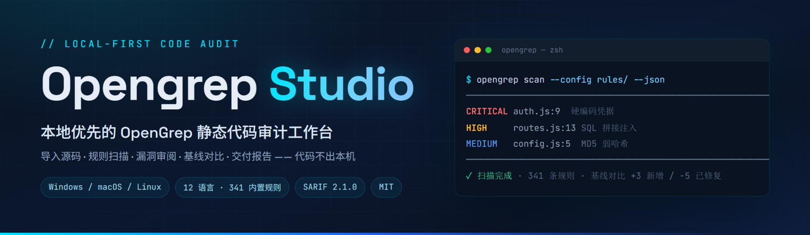
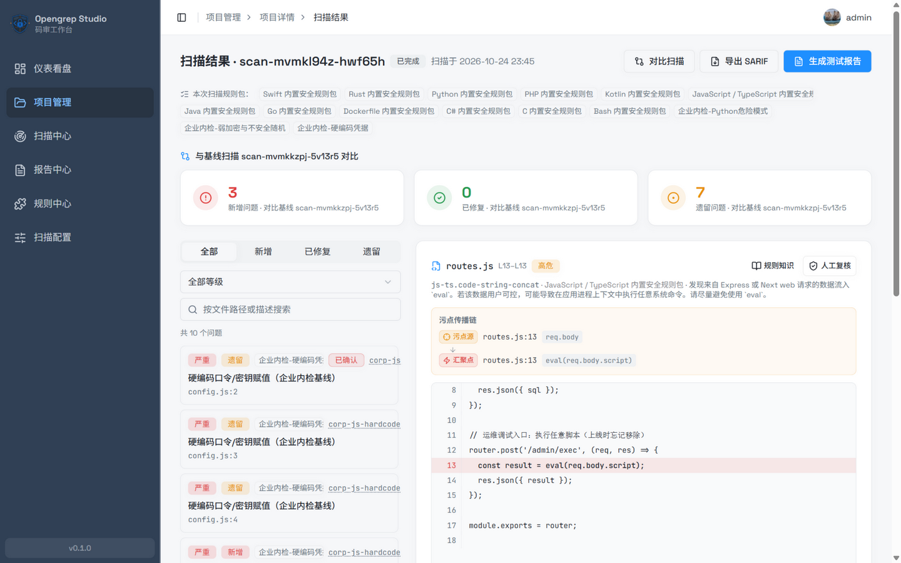
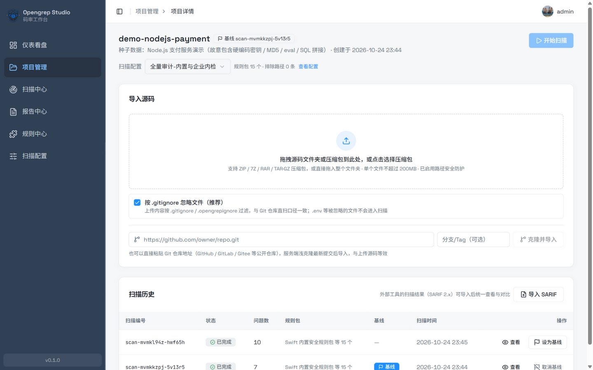
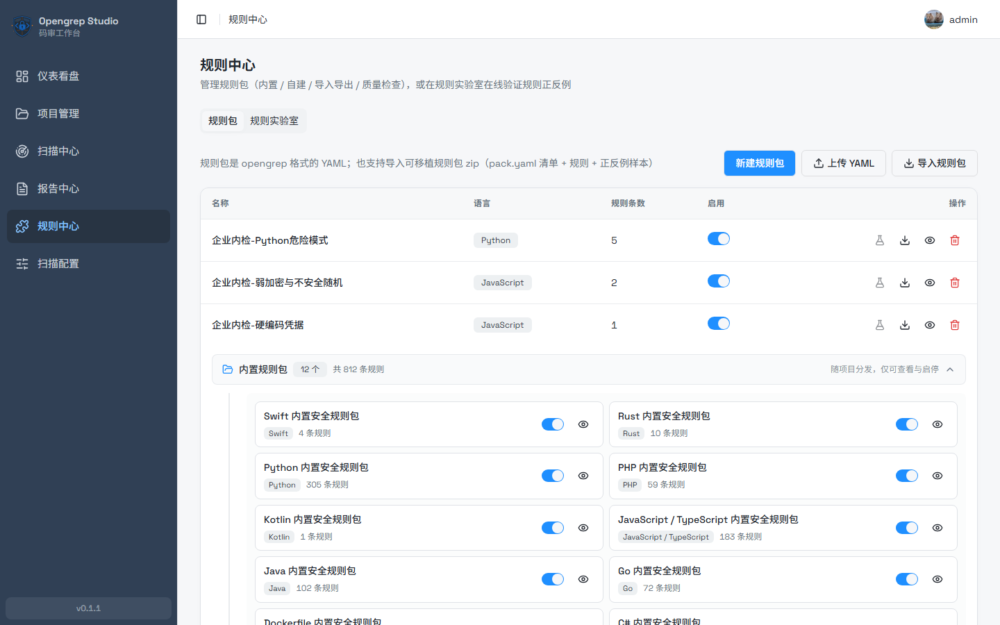
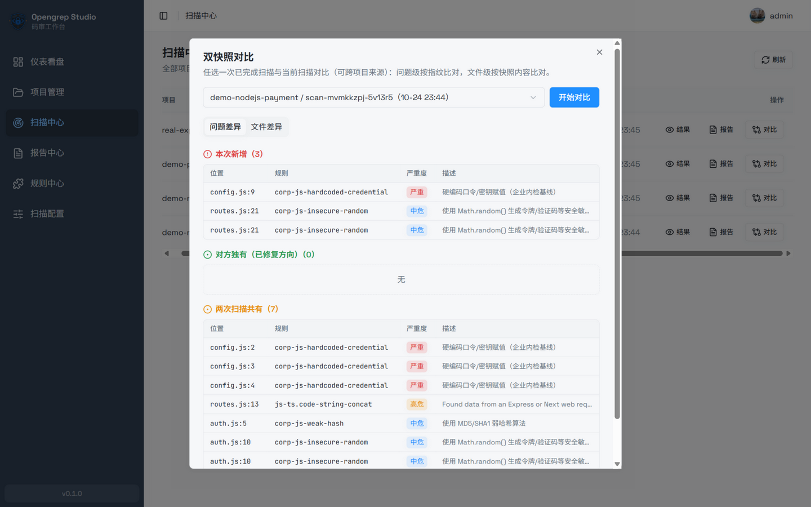
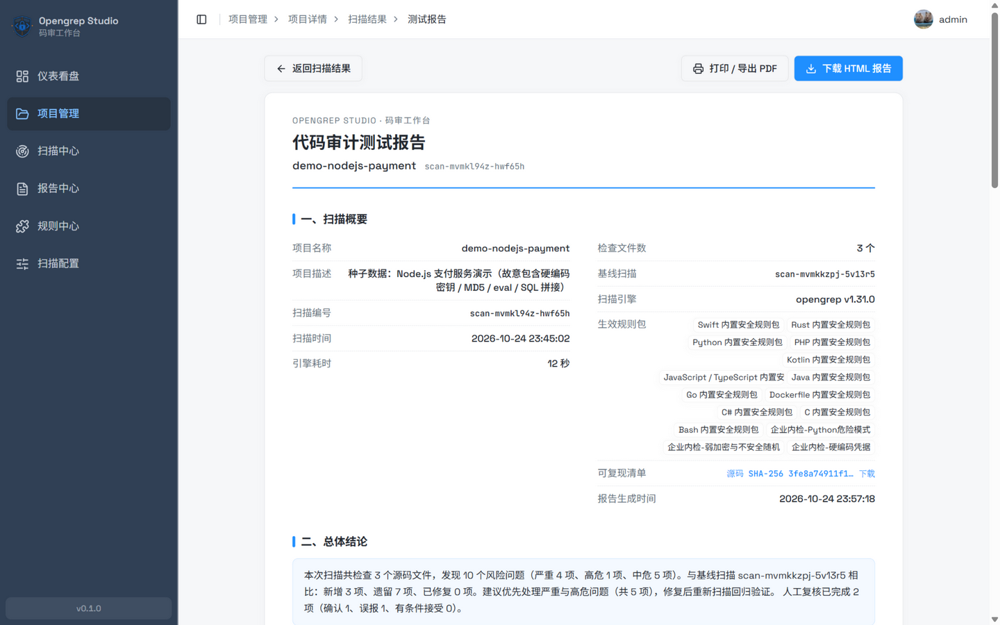
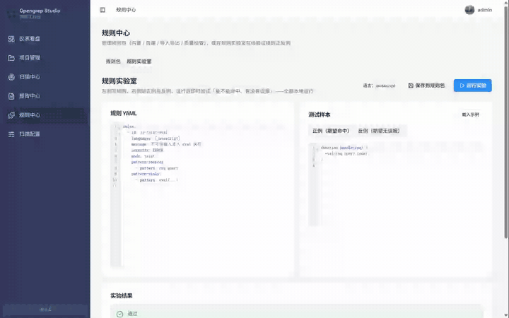
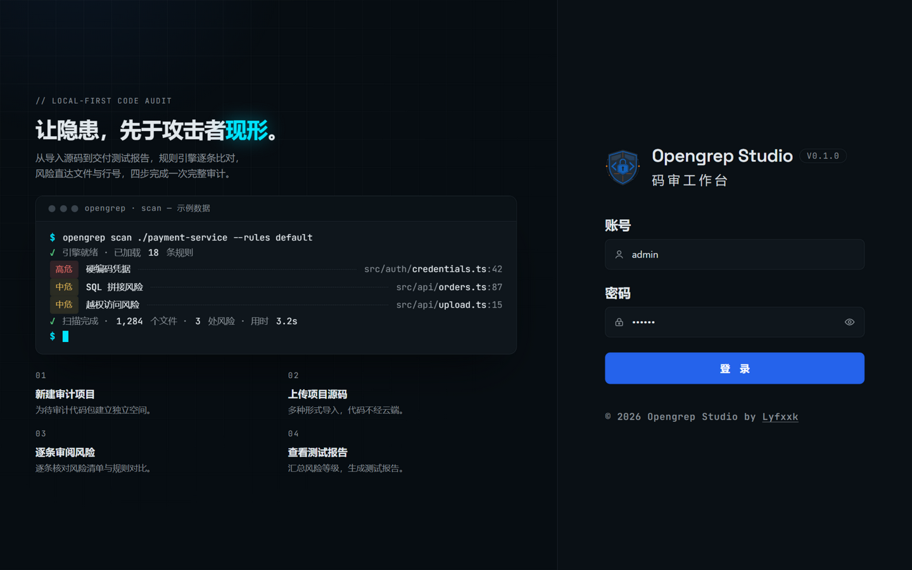
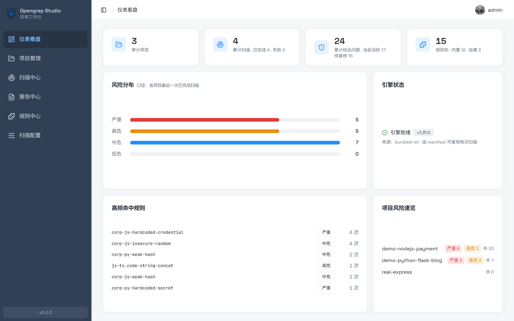
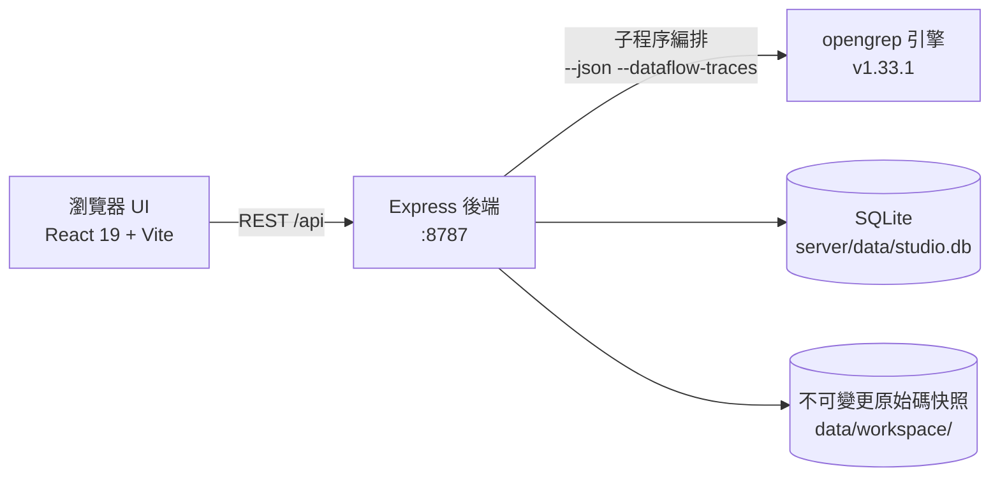

<div align="center">

<h1>Opengrep Studio · 碼審工作台</h1>
<p><strong>讓隱患，先於攻擊者現形。</strong></p>
<p>本地優先的 <a href="https://github.com/opengrep/opengrep">Opengrep</a> 靜態程式碼稽核工作台——上傳原始碼、規則掃描、逐條審閱、基線對比、交付報告，<strong>程式碼不出本機</strong>。</p>
<p><a href="../README.md">English</a> · <a href="./README.zh-Hans.md">简体中文</a> · <a href="#快速開始">快速開始</a> · <a href="#功能亮點">功能亮點</a> · <a href="#安全模型">安全模型</a> · <a href="#常見問題">常見問題</a></p>
<p>
<a href="https://github.com/Lyfxxk/Opengrep-Studio/actions/workflows/ci.yml"></a>
<a href="#license"></a>
<a href="https://github.com/opengrep/opengrep"></a>
<a href="#環境需求"></a>

</p>

<p><sub>掃描結果審閱頁：基線三卡（新增 / 已修復 / 遺留）· 污點傳播鏈（源 → 傳播 → 匯聚點）· 命中程式碼高亮 · 人工複核標記</sub></p>
</div>

---

## 為什麼需要 Opengrep Studio

每個專案裡都可能埋著幾顆雷：寫死在程式碼裡的資料庫密碼、直接拼進 SQL 的使用者輸入、忘了刪的除錯介面、還在用 MD5 存的密碼。**靜態程式碼掃描**做的事，就是不上傳程式碼、不執行程序，把這類問題提前標出來。

#### 先說 AI：讀得懂，卻顧不全

必須承認，AI 讀程式碼確實有一套——**業務邏輯漏洞、越權風險、規則沒覆蓋的新穎寫法**，它都能看懂意圖。但拿「AI 聊天」當「程式碼稽核」，會撞上四道牆：

- **AI 是抽樣，稽核要窮舉**——十萬行的專案上下文裝不下；47 處 SQL 拼接，它可能點出 5 處「顯眼的」，剩下 42 處你根本不知道它沒看到。規則引擎的承諾是「**每一條命中都會報出來**」，掃完你才敢在結論裡寫下「這 812 條規則覆蓋的問題模式，全部查過」；
- **聊天是一次性的，稽核要有台帳**——AI 不記得上個月讀過什麼：哪些是這次新引入的、哪些真的修掉了、你之前判定過的誤報，通通從頭再來；
- **「AI 說的」不能當證據**——交付客戶要的是可重現：原始碼雜湊、引擎版本、完整命令列，別人拿著就能跑出同樣的結果；一段聊天記錄既不能複核，也不能歸責；
- **按提交頻率跑不起**——通讀一遍整個儲存庫是真金白銀的 token，專案越大越貴、漏得越多；本地引擎秒級到分鐘級、零邊際成本，才接得進 CI。

#### 再說引擎：掃得全，但命令列做不完稽核

所以答案不是二選一：**規則引擎負責窮舉兜底，AI 負責語意理解**——Semgrep 官方做 AI 輔助、各家 SAST 接大型模型，走的都是這條路。Opengrep Studio 選用的 opengrep（社群從 Semgrep OSS 延續的開源掃描引擎）掃得很專業，但直接用它的命令列做完一次完整稽核，依然是四道關卡：

- **掃完只是一堆 JSON**——命中了哪些問題、有多嚴重，全靠肉眼翻終端機輸出，沒有逐條審閱的工作台；
- **規則訊息是英文的**——像 "tainted data flowing into eval" 這樣的提示，不是每個人都能立刻看懂問題在哪、該怎麼改；
- **修好了不知道有沒有修好**——改完程式碼重掃一次，哪些是新冒出來的、哪些真的修掉了，全靠手工比對兩份 JSON；
- **給管理者和客戶交不了差**——風險報告要從 JSON 裡一條條手工拼，格式還不專業。

#### Studio 補齊的，是掃描之後的整條流水線

Opengrep Studio 把這條流水線補齊：**拖進程式碼 → 點一下掃描 → 逐條審閱 → 一鍵出報告**。掃描引擎在本機執行，**程式碼從頭到尾不出你的機器**；引擎能力歸功上游，Studio 專注於把結果變成**可審閱、可對比、可複核、可交付**的稽核工作流程。AI 時代，這套工作流程反而更稀缺：AI 一次吐給你一大堆發現，去重、定基線、跨掃描追蹤、出報告，總要有個地方接——**AI 負責產點，Studio 負責管點**。

#### 這個工具適合誰

- **接程式碼稽核案的資安工程師 / 獨立顧問**——客戶程式碼不能傳第三方雲端平台，也不該貼給線上 AI；交付時需要一份可重現的中文測試報告；
- **沒有商業 SAST 預算的小團隊**——商業程式碼稽核平台一年動輒十幾萬，這裡是免費開源（MIT）+ 本地部署；
- **正在學應用安全的人**——812 條規則全量中文訊息 + CWE 中文修復建議 + 污點傳播鏈視覺化，規則實驗室即寫即驗證；
- **開源作者**——專案發布前掃一遍硬編碼金鑰、危險函式呼叫，幾分鐘的事。

## 功能亮點

### 🗂 多來源匯入，程式碼不經雲端

拖曳整個資料夾、上傳 ZIP / 7Z / RAR / TAR.GZ 壓縮檔，或貼上 Git 儲存庫網址淺層複製匯入（預設遵循 `.gitignore` / `.opengrepignore` 口徑，也可關掉以深挖 `.env` 裡的硬編碼金鑰）。上傳後自動統計語言組成。



### 📚 812 條內建規則，12 種語言，全量中文訊息

精選自 [opengrep-rules](https://github.com/opengrep/opengrep-rules)（優先收錄帶 CWE / OWASP 中繼資料的規則，每條保留上游溯源連結），覆蓋 108 種 CWE；**812 條規則訊息 100% 提供中文翻譯**，另附 108 類 CWE 中文弱點說明與修復建議。自建規則包支援線上編輯、匯入匯出與品質檢查。



### 🔍 逐條審閱：程式碼定位、污點鏈路、人工複核

每條問題直達檔案與行號，命中行紅色高亮；污點類問題展示「污點源 → 傳播路徑 → 匯聚點」鏈路；人工複核結論（已確認 / 誤報 / 已接受）按問題指紋跨掃描繼承，構成稽核證據鏈。

### 📊 基線對比與雙快照對比

設定基線掃描後，每次掃描自動給出 **新增 / 已修復 / 遺留** 三分類；掃描中心還支援任選兩次已完成掃描做雙快照對比（可跨專案）：問題級按指紋比對，檔案級按原始碼快照內容比對。



### 📄 可列印的稽核報告 + 可重現清單

一鍵生成紙感排版的《程式碼稽核測試報告》：總體結論、風險分布、高頻規則、熱點檔案、問題明細、複核統計，支援直接列印為 PDF 或下載單檔離線 HTML；每份報告附帶可重現清單（原始碼 SHA-256、完整引擎命令列、規則檔雜湊）。



### 🧪 規則實驗室：先驗證，再入庫

左側寫規則 YAML，右側貼正例與反例，一鍵執行真實引擎驗證「能不能命中、有沒有誤報」；調通的規則連同樣本儲存為可攜規則包，後續可一鍵回歸檢查。草稿自動儲存，Ctrl+Enter 執行。



### 🔁 SARIF 雙向互通

匯出 SARIF 2.1.0 供 GitHub Code Scanning / DefectDojo / SonarQube 消費；也可把其他工具產出的 SARIF 2.x 匯入為一次完整掃描，納入基線與報告體系。

### 🖥 儀表看盤

專案數、累計掃描、檢出問題、規則包一目了然；跨專案的風險分布、高頻命中規則、引擎狀態與各專案風險速覽，掃描進行中自動重新整理。

### ⬆️ 引擎檢查更新與一鍵升級

儀表板的「引擎狀態」卡片會顯示**實際安裝的版本**與來源，點「檢查更新」比對上游最新 stable，發現新版本可一鍵升級：

- 升級是原子替換：下載 → SHA-256（GitHub release 資產的 digest）校驗 → 執行 `opengrep --version` 核對 → 才替換檔案，任一步失敗舊引擎原封不動
- 只對最新 stable 開放（不碰 pre-release）；`OPENGREP_BIN` 自管引擎的使用者按鈕停用
- 掃描 / 規則實驗室執行期間禁用升級（Windows 不允許替換執行中的 exe），升級後版本探測快取自動失效
- 實際安裝版本記錄在 `opengrep-tool/installed.json`，重跑 `npm run setup:engine` 不會把升級過的引擎降級回 `engines.json` 的鎖定版本

<details>
<summary><b>介面一覽（登入頁與儀表板）</b></summary>
<table>
<tr>
<td align="center"></td>
<td align="center"></td>
</tr>
</table>
</details>

## 快速開始

### 環境需求

- **Node.js ≥ 22.12**（後端內建 `node:sqlite` 需 22.5+，前端 Vite 8 需 22.12+；同樣無原生相依）
- 掃描引擎由腳本自動下載（約 50 MB，SHA-256 校驗），無需預裝；Git 僅在使用儲存庫複製匯入時需要

### 方式一：一鍵啟動（推薦）

Windows 使用者雙擊 `一键启动（Windows）.bat`，macOS / Linux 使用者執行：

```sh
./一键启动（macOS／Linux）.sh
```

腳本會自動檢查 Node 版本、安裝相依套件、下載引擎，並開啟瀏覽器。前端 <http://localhost:1022>，後端 API <http://localhost:8787>。

### 方式二：手動三步

```sh
git clone https://github.com/Lyfxxk/Opengrep-Studio.git
cd Opengrep-Studio
npm run install:all   # 安裝根目錄 / server / code 三處相依套件
npm run setup:engine  # 下載 opengrep v1.33.1 並校驗 SHA-256
npm run dev           # 同時啟動後端(8787)與前端(1022)
```

### 方式三：Docker

```sh
npm run docker:build
npm run docker:run    # 等價於 docker run --rm -p 8787:8787 -v ogstudio-data:/data opengrep-studio
```

映像內建引擎與已建置前端，存取 <http://localhost:8787> 即可使用，資料持久化在 `ogstudio-data` 卷。

### 首次使用

預設帳號 `admin` / `123456`（見[安全模型](#安全模型)）。建議流程：

1. **掃描設定**——勾選要啟用的規則包（可加排除 / 包含路徑、引擎參數）
2. **新建專案**並綁定該設定——也可先不綁：未綁定或綁定的設定遭刪時，掃描會自動改用不可刪除的「預設掃描設定」兜底
3. **匯入原始碼**（拖資料夾 / 壓縮檔 / Git 複製）
4. **發起掃描**，完成後逐條審閱、複核
5. 設基線、再掃描，看 **新增 / 已修復 / 遺留**；需要交付時**生成測試報告**

想先看效果？`npm run seed` 可一鍵灌入三個示範專案（含基線對比與複核記錄）。

<details>
<summary><b>疑難排解</b></summary>
<ul>
<li><b>引擎下載慢或失敗</b>：下載會自動按 <code>OPENGREP_DOWNLOAD_BASE 鏡像 → github.com → api.github.com</code> 依次降級，github.com 不可達時通常無需介入即可裝完；仍失敗時可手動設定鏡像 <code>set OPENGREP_DOWNLOAD_BASE=&lt;鏡像位址&gt;</code>（macOS/Linux 用 <code>export</code>），或從 <a href="https://github.com/opengrep/opengrep/releases">opengrep Releases</a> 手動下載後用 <code>OPENGREP_BIN</code> 指向二進位檔路徑</li>
<li><b>檢查更新提示 GitHub API 限流</b>：匿名呼叫上限 60 次/小時，檢查結果快取 30 分鐘；稍後再試即可，不影響掃描</li>
<li><b>macOS 提示無法驗證引擎</b>：<code>xattr -d com.apple.quarantine &lt;引擎路徑&gt;</code></li>
<li><b>連接埠被佔用</b>：<code>node server/scripts/kill-port.mjs 8787 1022</code></li>
<li><b>更多環境變數</b>：<code>PORT</code> / <code>HOST</code> / <code>DATA_DIR</code> / <code>CUSTOM_RULES_DIR</code> / <code>OPENGREP_BIN</code> / <code>OPENGREP_DOWNLOAD_BASE</code>（後端）；逾時類變數取值單位為秒：<code>CLONE_TIMEOUT_SECONDS</code> / <code>SEVEN_Z_TIMEOUT_SECONDS</code> / <code>RULE_LAB_TIMEOUT_SECONDS</code>；前端開發另有 <code>API_TARGET</code> 指定 <code>/api</code> 代理目標</li>
</ul>
</details>

## 與命令列直掃對比

| 能力 | `opengrep scan` 直掃 | Opengrep Studio |
| :--- | :--- | :--- |
| 結果形態 | 終端機 JSON / 文字 | 可互動審閱：程式碼高亮、污點鏈路、篩選搜尋 |
| 中文體驗 | 英文訊息 | 812 條規則訊息全量中文（簡 / 繁）+ CWE 中文知識庫 |
| 基線管理 | 無 | 新增 / 已修復 / 遺留自動分類，複核跨掃描繼承 |
| 版本對比 | 無 | 雙快照對比（問題級 + 檔案級，可跨專案） |
| 報告交付 | 手工拼 | 一鍵紙感報告（列印 / 離線 HTML）+ 可重現清單 |
| 規則除錯 | 改完重跑 | 規則實驗室：正反例即時驗證、樣本回歸 |
| 工具鏈互通 | 自行處理 | SARIF 2.1.0 匯入 / 匯出 |

## 工作原理



- 單一程序部署：後端同時代管建置後的前端（生產模式存取 8787 連接埠即可），預設只監聽 `127.0.0.1`
- 每次掃描基於**不可變更原始碼快照**執行，快照雜湊與完整命令列封存，報告可重現
- SQLite 儲存專案 / 掃描 / 問題 / 複核 / 設定，無外部服務相依，全部資料在 `server/data/`
- 掃描最多 2 路並行（超出的自動排入佇列），規則實驗室與掃描互斥

## 安全模型

誠實聲明，請務必了解：

- **本地單機工具**：預設只監聽 `127.0.0.1`，程式碼與結果不上傳、無遙測
- **登入僅為防誤觸的前端門禁**（固定帳號 `admin` / `123456`），**後端介面無鑑權**——不要將服務暴露到公網；確需區域網路使用時自行設定 `HOST` 並加上存取控制
- Docker 模式預設 `HOST=0.0.0.0`，請僅在內網 / 加防護的前提下使用
- 上傳解壓有 Zip-Slip / 符號連結 / 體積與檔案數防護；Git 複製僅允許 https 協定並禁用憑證互動

## 常見問題

<details>
<summary><b>支援哪些語言和平台？</b></summary>
<p>內建規則覆蓋 Python、JS/TS、Java、Go、C、C#、PHP、Bash、Kotlin、Swift、Rust、Dockerfile 共 12 種語言；Studio 本身可執行在 Windows / macOS / Linux（x64 / arm64）及 Docker。</p>
</details>

<details>
<summary><b>和 Semgrep 是什麼關係？</b></summary>
<p>Opengrep 是社群從 Semgrep OSS 延續出的開源引擎（LGPL-2.1），Studio 編排其官方二進位檔，規則精選自 opengrep-rules。Studio 與 Semgrep Inc. 無關聯。</p>
</details>

<details>
<summary><b>我的程式碼會被上傳嗎？</b></summary>
<p>不會。掃描、儲存、報告生成全部在本機完成，服務預設只監聽本機回送位址。</p>
</details>

<details>
<summary><b>資料存在哪裡？刪除專案會殘留嗎？</b></summary>
<p>全部在 <code>server/data/</code>（SQLite + 原始碼快照）與自建規則包目錄。刪除專案會連帶刪除其掃描、問題、複核記錄與快照目錄。</p>
</details>

<details>
<summary><b>怎麼整合 GitHub Code Scanning？</b></summary>
<p>在掃描結果頁「匯出 SARIF」，把產物按 GitHub 文件上傳到 code-scanning 即可；指紋採用穩定去重格式，支援增量回報。</p>
</details>

<details>
<summary><b>能匯入其他工具的掃描結果嗎？</b></summary>
<p>支援 SARIF 2.x：在專案詳情頁「匯入 SARIF」，結果會成為一次完整掃描，可設基線、出報告。</p>
</details>

## Roadmap

- [x] 內建規則中文化（812 條全覆蓋）與 CWE 中文知識庫
- [x] 基線對比 / 雙快照對比 / 複核證據鏈
- [x] SARIF 2.1.0 匯入匯出與可重現清單
- [x] 規則實驗室與可攜規則包（含樣本回歸）
- [x] Docker 映像與三平台一鍵啟動
- [x] 引擎更新檢查與一鍵升級（下載三通道兜底）
- [x] 介面多語言 i18n（英文 / 簡體中文 / 繁體中文）
- [x] 掃描佇列與並行排程
- [ ] 規則包線上 URL 匯入與社群規則包索引
- [ ] GitHub Action 工作流程範本（CI 中跑掃描並回傳 SARIF）
- [ ] 報告範本自訂（品牌 / 頁首頁尾）

## 開發指南

常用命令（根目錄執行）：

| 命令 | 說明 |
| :--- | :--- |
| `npm run dev` | 同時啟動後端 `tsx watch`(:8787) 與前端 Vite(:1022) |
| `npm test` | 後端單元測試（引擎解析 / gitignore 語意 / 規則 YAML / SARIF 匯入） |
| `npm run test-packs` | 規則包結構校驗與樣本回歸 |
| `npm run i18n:check` | 語言包一致性（三份 UI 語言包＋簡繁規則說明／CWE） |
| `npm run e2e` | 黑箱 REST 回歸（需先啟動後端與引擎，21 組情境） |
| `npm run seed` | 灌入示範資料 |
| `npm --prefix code run lint` | 前端型別檢查 + ESLint |

目錄結構：

```text
├─ code/                 # React 19 + Vite + Tailwind v4 + shadcn/ui 前端
│  └─ src/pages/         # 儀表板 / 專案 / 掃描結果 / 報告 / 規則中心(含實驗室) / 設定
├─ server/               # Express 後端（node:sqlite，無原生相依）
│  ├─ src/               # API / 掃描編排 / SARIF / 快照對比 / 規則包 / 報告
│  ├─ rules/security/    # 12 語言內建規則（精選自 opengrep-rules）
│  └─ scripts/           # 引擎下載 / 種子資料 / 測試 / 規則再生成
└─ docs/images/          # 文件圖片
```

**貢獻一條規則的推薦路徑**：規則實驗室寫規則並用正反例驗證 → 「儲存到規則包」（附上樣本）→ 匯出 zip → 提 PR。⚠️ 請勿提交來自 semgrep-rules 的規則（其許可限制競爭性使用）；opengrep-rules 來源的規則請保留上游溯源資訊。前端有示範模式：`VITE_USE_MOCK=true npm --prefix code run dev`。

CI（`.github/workflows/ci.yml`）包含三個任務：後端型別檢查 + 單元測試、前端 lint + 建置、以及**下載真實引擎跑完整 E2E**。

## 致謝

- [opengrep/opengrep](https://github.com/opengrep/opengrep) —— 掃描引擎（LGPL-2.1），本儲存庫不內嵌其二進位檔，由腳本下載並校驗
- [opengrep/opengrep-rules](https://github.com/opengrep/opengrep-rules) —— 內建規則的來源，感謝上游所有規則作者
- [shadcn/ui](https://ui.shadcn.com/) / [Radix UI](https://www.radix-ui.com/) / [Tailwind CSS](https://tailwindcss.com/) / [CodeMirror](https://codemirror.net/) / [Vite](https://vite.dev/) / [React](https://react.dev/) —— 構成介面的一切好東西

## License

本專案程式碼以 [MIT](../LICENSE) 發布。

需要注意的兩項第三方許可：

- **掃描引擎**：opengrep 以 LGPL-2.1 發布，本儲存庫不含引擎二進位檔，`npm run setup:engine` 從官方 Releases 下載並做 SHA-256 校驗
- **內建規則**：精選自 opengrep-rules（LGPL 2.1 + Commons Clause），可自由使用與再散布（保留署名），但不得將規則本身作為付費產品出售

## 星標歷史

[](https://star-history.com/#Lyfxxk/Opengrep-Studio)
